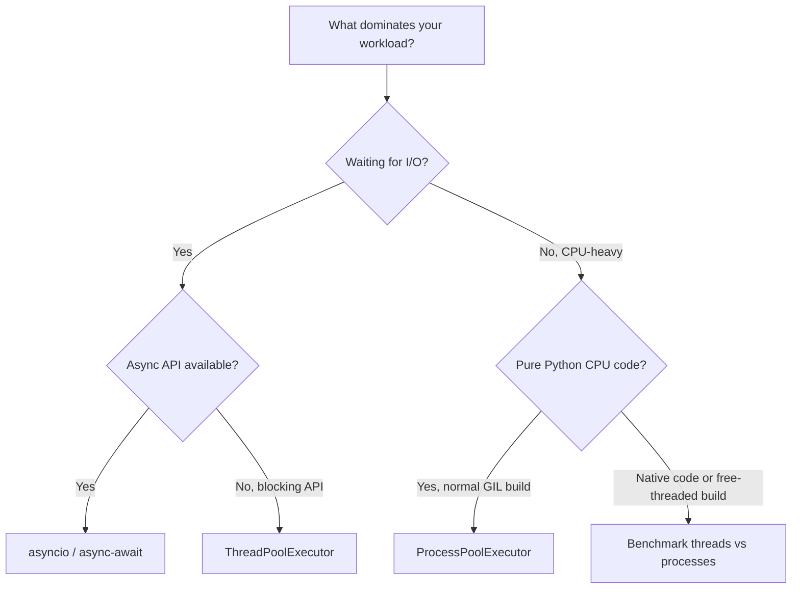

# Threads, Processes, and Async I/O

A practical guide to Python concurrency for experienced engineers. Prior experience with threads, processes, C# `Task` and async programming is useful, but **no previous Python concurrency knowledge is assumed**.

This lesson builds on [CPython Memory Model and the GIL](../01.%20CPython%20Memory%20Model%20and%20the%20GIL/README.md). All examples use the Python standard library. No external service, network access or packages are required.

## 1. Concurrency and parallelism are different

- **Concurrency:** multiple tasks can make progress over an overlapping period (for example, one waits for a database reply while another handles a request).
- **Parallelism:** two or more computations actually execute at the same instant, potentially on different CPU cores.
- **CPU-bound:** time is dominated by executing calculations. More OS threads do not normally speed up pure-Python bytecode with the **standard GIL-enabled CPython** runtime.
- **I/O-bound:** time is dominated by waiting for a network, disk, database or similar operation. Overlapping waits can improve throughput without increasing CPU parallelism.

Python offers several models, and they are **not interchangeable**:

| Model | Concurrency/parallelism | Memory | Typical choice |
|---|---|---|---|
| `threading.Thread` | OS threads; overlapping I/O waits; pure-Python CPU execution normally constrained by GIL | Shared within one process | A few blocking operations or long-lived worker threads |
| `ThreadPoolExecutor` | Pool of OS threads | Shared | Many independent calls to blocking synchronous APIs |
| `multiprocessing` / `ProcessPoolExecutor` | Separate OS processes can execute CPU work on different cores | Separate address spaces | Expensive independent Python computations |
| `asyncio` | Cooperative tasks typically executed by one event-loop thread | Shared within one process | High-volume I/O using non-blocking async APIs |

**Runtime exception:** optional **free-threaded CPython** (available since Python 3.13) permits Python threads to execute in parallel when the GIL is disabled; libraries and synchronization still matter. Native code can also release the GIL. Do not claim that all Python threads are always CPU-serial.

### Decision guide



The guide identifies a **starting point**, not a universal performance guarantee. Workloads that mix network I/O with CPU-heavy computation may require more than one model.

## 2. Requirements and how to run

Use **Python 3.11 or newer** (the `asyncio.TaskGroup` example requires 3.11+). The examples work with ordinary CPython and use no third-party libraries.

From the `02. Threads, Processes and Async IO/` directory:

```bash
python --version

python examples/threading_io.py --requests 3 --delay 0.2
python examples/thread_pool_io.py --requests 4 --workers 3 --delay 0.2
python examples/cpu_pool_comparison.py --iterations 1500000 --jobs 2
python examples/asyncio_io.py --requests 3 --delay 0.2
python examples/asyncio_blocking.py --requests 3 --delay 0.2

python -m unittest discover -s tests -v
```

Expected results: all strategies in a comparison compute **identical outputs**. There are **10 deterministic tests** with no assertions about elapsed times. Runtime measurements vary with processor load, container CPU limits, OS scheduling, GIL mode, process startup and Python version.

**Important:** the I/O demos use `time.sleep` / `asyncio.sleep` to model waiting. They do **not** perform real network, disk or database operations. The CPU demo intentionally uses a plain Python loop; it does not represent NumPy or native code that releases the GIL.

## 3. OS threads with `threading`

Start with [`examples/threading_io.py`](examples/threading_io.py). The sequential version waits for each simulated response before starting the next. The threaded version starts multiple OS threads and lets waiting periods overlap.

```python
import threading

# '-> None' is a return type hint, similar to C# 'void'.
# A Python function without an explicit return returns None.
def worker(index: int) -> None:
    print(f"Worker {index}")

# Thread(...) creates a Thread object but does not start it.
# target= and args= are named (keyword) arguments to its constructor.
# target=worker passes the function object; worker() would CALL it now.
# args=(2,) is a one-element tuple: the comma makes it a tuple, not (2).
# When started, the new thread will call worker(2).
thread = threading.Thread(target=worker, args=(2,))
thread.start()  # Actually start executing worker(2) on an OS thread.
thread.join()   # Block the caller until this thread exits (not 'await').
```

**Note — `-> None` versus C# `void`:** The `-> None` annotation declares that `worker` is **not expected to return a meaningful value**, similarly to a `void` method in C#. There is an important runtime difference: **every normal Python function call produces a value**. If execution reaches the end without an explicit `return`, Python automatically returns `None`. `None` is Python's special value for the absence of a value, broadly similar to `null` in C#. For example, calling `result = worker(2)` directly would print `Worker 2` and assign `None` to `result`. The annotation is a *type hint*; Python does not automatically enforce it at runtime.

**C# comparison — void method and OS thread:**

```csharp
using System;
using System.Threading;

void Worker(int index)
{
    Console.WriteLine($"Worker {index}");
}

var thread = new Thread(() => Worker(2)); // Delegate to execute later.
thread.Start(); // Starts the thread.
thread.Join();  // Blocks until the thread finishes.
```

In C#, `new Thread(() => Worker(2))` captures the argument in a delegate. In Python, `target=worker, args=(2,)` supplies the callable and its argument separately. Neither constructor starts the thread automatically.

Python-specific details:

- `threading.Thread` creates an OS thread; `start()` schedules it. Invoking `worker(2)` directly would execute in the **current** thread, not another thread.
- `join()` is synchronous waiting; it is **not** Python's `await` and it does **not** automatically propagate worker exceptions.
- `target=` and `args=` are **keyword arguments** in the `Thread(...)` constructor. `target=worker` passes the **function object** without calling it; `target=worker()` would call it immediately. `args=(2,)` is a one-item tuple whose comma is required; `(2)` alone is just an integer. The thread calls `worker(2)` only when started.
- The full example uses `queue.Queue` for **thread-safe communication** and sends worker exceptions back through the queue. Unlike an unsynchronized shared list or counter, the queue manages access between threads.

For `--requests 3 --delay 0.2`, sequential waiting is *approximately* `0.6s` and overlapping waits *approximately* `0.2s`, plus scheduling overhead. **Do not assert those numbers**. Real I/O and worker scheduling will differ.

### Shared state still requires synchronization

Even with a GIL, multi-step business operations are not automatically atomic:

```python
import threading

balance_lock = threading.Lock()

# 'with' uses the lock's context manager protocol:
# it acquires the lock on entry and always releases it on exit.
# The check and update must run together inside the critical section.
with balance_lock:
    if balance >= amount:
        balance -= amount
```

**Python syntax note — `with balance_lock:`:** `with` does not create a lock. It enters the context managed by the existing `threading.Lock` object: `__enter__()` acquires the lock before executing the indented block, and `__exit__()` releases it afterward, including when an exception occurs. For this specific lock, the behavior is equivalent to `balance_lock.acquire()` followed by a `try/finally` that calls `balance_lock.release()`. This is similar to C# `lock (balanceLock) { ... }`. Not every `with` statement acquires a lock: context managers can also manage files, transactions, pools, and other resources. See Lesson 03 for the `__enter__`/`__exit__` protocol in depth.

**C# comparison — critical section:**

```csharp
// balanceLock, balance, and amount are assumed to be defined.
lock (balanceLock)
{
    if (balance >= amount)
    {
        balance -= amount;
    }
}
```

The C# `lock` statement automatically exits the critical section, including if an exception occurs. Python's `with balance_lock:` uses the lock's context-manager methods to achieve the analogous behavior; both only synchronize threads using that same lock object.

Here `balance` and `amount` are assumed to already exist: this is a **short illustrative fragment**, not a standalone bank-account implementation. In a real financial system, a local thread lock does not coordinate **different processes or machines**; database transactions or distributed coordination may be required.

## 4. Managing threads with `ThreadPoolExecutor`

For many independent blocking calls, direct `Thread` management is often unnecessary. [`examples/thread_pool_io.py`](examples/thread_pool_io.py) uses `concurrent.futures.ThreadPoolExecutor`.

```python
from concurrent.futures import ThreadPoolExecutor

def calculate(value: int) -> int:
    return value * value

# 'with' manages the pool's lifetime (and shuts it down on exit).
# 'as executor' assigns the value returned by __enter__() to 'executor'.
# For ThreadPoolExecutor, __enter__() returns the executor object itself.
with ThreadPoolExecutor(max_workers=2) as executor:
    future = executor.submit(calculate, 5)
    print(future.result())  # 25
```

**Python syntax note — `as executor`:** The expression `ThreadPoolExecutor(max_workers=2)` first constructs a pool manager. On entering the `with` block, Python calls that context manager's `__enter__()` method and assigns its result to the variable after `as` (here, `executor`). For `ThreadPoolExecutor`, `__enter__()` returns the executor itself, letting you call `executor.submit(...)`. On leaving the block, Python calls `__exit__()`; this executor waits for submitted work and shuts down, even if an exception leaves the block. Other context managers can return a **different object** from `__enter__()`. Conceptually, this resembles C# `using (var resource = ...)`, but Python's `as` binds the `__enter__()` result.

**C# comparison — resource binding with `using`:**

```csharp
using System.IO;

using (var resource = new MemoryStream())
{
    // 'resource' is available within this scope.
    resource.WriteByte(42);
} // Dispose() is called at the end of the scope.
```

This illustrates the **resource-lifetime** analogy, not an equivalent C# thread pool. Unlike C# `using`, Python `as executor` binds the value returned by the context manager's `__enter__()`, which may differ from the original object. In this case both refer to the same executor.

- `max_workers=2` limits the number of concurrent worker threads.
- `submit(fn, arg)` schedules the callable and returns a **Future** (a placeholder for its eventual result). It does **not** run `fn` on the calling thread.
- `future.result()` **blocks** until completion and raises the worker's exception if the call failed.
- `with` invokes the executor's context-management protocol to cleanly shut down and wait for work. See the context-managers lesson for more depth.
- Retrieving futures in submission order preserves a deterministic output order, although work may complete in a different order.

**C# comparison:** `Future` and `.result()` resemble the notion of a result that arrives later, but `.result()` here is **blocking**. It is not an equivalent replacement for `await someTask` in C#. Thread-pool CPU work is still subject to GIL behavior in standard CPython.

## 5. CPU parallelism with processes

[`examples/cpu_pool_comparison.py`](examples/cpu_pool_comparison.py) runs the **same** pure-Python workload (1) sequentially, (2) in a `ThreadPoolExecutor`, and (3) in a `ProcessPoolExecutor`.

```python
import multiprocessing
from concurrent.futures import ProcessPoolExecutor

def cpu_work(iterations: int) -> int:
    total = 0
    for i in range(iterations):
        total += i * i
    return total

# list[int] is a return type hint: a list whose items should be integers.
# Like C# List<int>, but Python does not enforce this annotation at runtime.
def run_processes() -> list[int]:
    # get_context("spawn") chooses how later worker processes are started.
    # It does NOT start a process here; "spawn" means a fresh interpreter.
    context = multiprocessing.get_context("spawn")
    # Create a pool that can run up to 2 worker processes at a time.
    # mp_context=context tells the pool to start workers with "spawn".
    # 'as executor' binds the result of __enter__() to the variable.
    # 'with' automatically waits for submitted tasks and shuts down the pool.
    with ProcessPoolExecutor(max_workers=2, mp_context=context) as executor:
        # map() submits work for both inputs; list() collects results in input order.
        return list(executor.map(cpu_work, [500_000, 500_000]))

# __name__ is automatically set to "__main__" when run as a script.
# When imported, it is the module name instead; this block is skipped.
# This guard prevents spawned worker imports from starting another pool.
if __name__ == "__main__":
    print(run_processes())  # Call the function and print its returned list.
```

**Python syntax note — `with ProcessPoolExecutor(...) as executor:`:** `ProcessPoolExecutor` constructs a **process-pool manager**, not an ordinary OS thread. `max_workers=2` sets a limit of **two worker processes**; it does not mean only two tasks can ever be submitted. `mp_context=context` tells the pool to use the `spawn` configuration selected above. The `with` statement calls the pool's `__enter__()`, and `as executor` binds its result (for this class, **the pool object itself**) to the name `executor`. Tasks are submitted when `executor.map(...)` is used; constructing the executor does **not necessarily** start all workers immediately. The process pool serializes submitted inputs/results across separate process memory spaces. When control exits the `with` block, including during an exception, `__exit__()` calls `shutdown(wait=True)` to wait for submitted work and release pool resources. This is **not** a guarantee that all submitted work is forcibly canceled on an exception.

**Python syntax note — `return list(executor.map(cpu_work, [500_000, 500_000]))`:** This is three operations combined into one expression:

1. `executor.map(cpu_work, [500_000, 500_000])` schedules **two separate calls** to `cpu_work(500000)`. The name `cpu_work` refers to the function without invoking it. The underscores in `500_000` are digit separators for readability; the value is still the integer `500000`.
2. `executor.map(...)` provides an **iterator of results**, ordered like the input values even if workers finish in a different order. `list(...)` consumes that iterator and builds a `list[int]`; consuming the results may **block** while workers are still running or raise an exception from a failed worker.
3. `return` sends that finished list back from `run_processes()`. With `[500_000, 500_000]`, it contains **two integers** (the calculated values), not two process objects.

**C# syntax comparison — only the mapping and collection operations:**

```csharp
using System.Linq;

var results = new[] { 2, 3, 4 }
    .Select(n => n * n)
    .ToList(); // List<int> containing 4, 9, 16
```

This LINQ code runs sequentially by default. It is **not** equivalent to `ProcessPoolExecutor`'s multi-process execution. The existing C# `Process.Start` snippet below illustrates only the OS-process boundary, not the pool, argument serialization or result collection.

**Python syntax note — `multiprocessing.get_context("spawn")`:** `get_context(...)` returns a *multiprocessing context* configured with the named process start method. The string `"spawn"` selects a model where new worker processes start fresh Python interpreters instead of inheriting the parent process's running interpreter state. **This call does not itself launch any process.** The context is passed via `mp_context=context` so that `ProcessPoolExecutor` can use it when it starts workers. Submitted functions and their arguments must be suitable for process-to-process serialization (typically `pickle`); each worker has its own memory. Explicit `spawn` gives the example a consistent start method rather than relying on OS- and Python-version-dependent defaults.

**Python syntax note — `if __name__ == "__main__":`:** Python automatically defines `__name__` in each module. When you run a file directly, such as `python example.py`, its `__name__` is `"__main__"`, so `if __name__ == "__main__":` is true and the indented block runs. If another module uses `import example`, the imported file's `__name__` is `"example"`, so that block is skipped. `==` compares values, and `print(run_processes())` calls the function, then prints its returned list. This conditional is commonly called the **main-entry guard**.

It is essential for `spawn`-based multiprocessing: spawned workers import the module containing the worker function, and importing it must **not** start a new process pool recursively. Functions used by the workers should be defined at module level, outside the guard; only the **program entry point that starts the pool** belongs inside it. Importing a module still executes its other top-level statements, so the guard protects only the code inside its block.


### Why this guard is required in our process-pool example

The script calls `run_processes()`, which creates a `ProcessPoolExecutor` configured with `spawn`. When tasks are submitted, `spawn` starts **fresh Python interpreters** that must load the module containing the worker function `cpu_work`.

If we put `print(run_processes())` at module top level **without the `if __name__ == "__main__":` guard**, those worker interpreters could execute it while importing the module. Each would try to start another process pool during its own initialization, leading to recursive process creation attempts and typically a multiprocessing bootstrapping `RuntimeError`. The guard prevents this: **only the parent entry-point execution starts the demo**; child processes can import and call `cpu_work` without rerunning the demo. In the spawn implementation, the worker's main module is initialized under a different internal module name, so the `"__main__"` condition is not met.

This is why the **function definitions stay outside** the guard (so they are importable), but the **call that starts the application** stays inside it. The diagram illustrates ordinary direct execution versus `import example`; spawned workers use related import/initialization machinery.

**C# comparison — entry point:** Conceptually, this separates Python's executable entry point from importable functions, similar to a C# `Main` method:

```csharp
using System;

class Program
{
    static void Main(string[] args)
    {
        Console.WriteLine("Application started");
    }
}
```

C# has an explicit entry-point mechanism; Python conventionally uses the `__name__` check to decide which statements run only when a module is the main program.

**C# comparison — separate process, not `Task.Run`:**

```csharp
using System.Diagnostics;

// Illustrative only: worker.exe must exist for this to run.
using var process = Process.Start(new ProcessStartInfo
{
    FileName = "worker.exe",
    UseShellExecute = false
});

process?.WaitForExit(); // Wait for the separate OS process.
```

C# `Process.Start` illustrates the **process boundary**. It does not implement a process pool, task serialization, or result collection. Python's `ProcessPoolExecutor` manages those additional responsibilities.

**Python syntax note — `list[int]`:** The built-in `list` is an ordered, mutable collection. In a type annotation, `list[int]` means a list of integers, comparable to `List<int>` in C#. In `-> list[int]`, the arrow specifies the **expected return type**. This does not convert values or enforce their types when the function runs; static type checkers can report mismatches. `list[int]` has been supported since Python 3.9.

**C# syntax comparison (return type only, not an equivalent process-pool implementation):**

```csharp
List<int> GetNumbers()
{
    return new List<int> { 10, 20, 30 };
}
```

The Python equivalent of that simple collection-returning method would be `def get_numbers() -> list[int]: return [10, 20, 30]`. The process-pool behavior itself is explained separately below.

### Important implementation rules

- A process has a **separate address space**. Regular Python objects are **not shared by reference** with the parent. Data passed to/from a pool must be serialized (commonly with `pickle`); avoid passing open connections, locks or unpicklable closures.
- The function submitted to a spawn-based process pool should be defined at **module level** so workers can import it. A nested function or lambda is often not picklable.
- `if __name__ == "__main__":` is a **module-entry guard**. `__name__` is a special module variable. The guarded block executes when the file is run as the program's entry point, but not when a worker imports it. Without this guard, spawn-based workers can recursively start new processes.
- `multiprocessing.get_context("spawn")` explicitly chooses the same fresh-interpreter start model on Windows, macOS and Linux. This avoids depending on platform defaults, which have changed across Python releases.
- The pool's `max_workers` and the number of CPU cores are not guarantees of speedup. Process creation, serialization, result transfer, memory pressure and CPU quotas all add cost. **Small workloads may run slower in processes**.

In the standard GIL-enabled CPython, separate processes can run pure-Python CPU workloads in parallel. Unlike `asyncio`, this addresses **CPU parallelism**, not merely overlapping I/O waits.

**C# comparison:** `ProcessPoolExecutor` uses separate processes rather than managed tasks sharing the same heap. Model a process boundary as a serialization/IPC boundary, not as another `Task.Run` invocation.

## 6. Async I/O with `asyncio`

[`examples/asyncio_io.py`](examples/asyncio_io.py) contrasts **sequential awaits**, `asyncio.gather()`, and structured concurrency using `asyncio.TaskGroup`.

```python
import asyncio

# 'async def' declares a coroutine function (similar to an async C# method).
# '-> str' describes its awaited result, like the string in C# Task<string>.
async def simulated_request() -> str:
    # 'await' suspends this coroutine while the event loop can run other tasks.
    # asyncio.sleep(0.2) is like C# Task.Delay(200): a non-blocking wait.
    await asyncio.sleep(0.2)
    return "ok"

async def main() -> None:
    # simulated_request() creates a coroutine object (not yet executed).
    # create_task(...) schedules it on the running event loop and returns a Task.
    # 'first' holds that Task so we can await its result later.
    first = asyncio.create_task(simulated_request())
    second = asyncio.create_task(simulated_request())

    # Both tasks are scheduled before either result is awaited.
    # print() evaluates its arguments left-to-right: await first, then second.
    # Awaiting is sequential here, but both tasks can progress concurrently.
    print(await first, await second)

# asyncio.run() starts/manages the event loop at the application boundary.
if __name__ == "__main__":
    asyncio.run(main())
```

**Python syntax note — `print(await first, await second)` is not sequential task execution:** Python evaluates the arguments of `print()` from left to right, so the code first awaits `first`, then awaits `second`. However, because **both Tasks were already scheduled** with `asyncio.create_task()`, the event loop can run them concurrently. Their simulated waits overlap; two 0.2-second delays normally take about **0.2 seconds plus scheduling overhead**, not 0.4 seconds.

Compare two different execution patterns:

```python
# Sequential: the second coroutine is not awaited until the first finishes.
first_result = await simulated_request()
second_result = await simulated_request()
print(first_result, second_result)  # ok ok; ~0.4s plus overhead

# Concurrent: first schedule both tasks, then await their results.
first = asyncio.create_task(simulated_request())
second = asyncio.create_task(simulated_request())
print(await first, await second)    # ok ok; ~0.2s plus overhead
```

If the intention is to **wait for multiple results together** more explicitly, `asyncio.gather` is another option:

```python
results = await asyncio.gather(simulated_request(), simulated_request())
print(*results)  # ok ok; '*' unpacks the results as print() arguments
```

Unlike C# `Task.WhenAll`, Python `gather` has its own exception/cancellation behavior. For structured failure handling, see the `TaskGroup` section below. These timings are **illustrative only**, not correctness requirements.

**C# comparison — asynchronous delay returning a string:**

```csharp
using System.Threading.Tasks;

static async Task<string> SimulatedRequestAsync()
{
    // Await a non-blocking delay (200 milliseconds).
    await Task.Delay(200);
    return "ok";
}
```

The corresponding calls are `await simulated_request()` in a Python coroutine and `await SimulatedRequestAsync()` in a C# async method. `-> str` annotates the **value obtained by awaiting** the Python coroutine; the call itself produces a coroutine object, rather than an immediate `str`. In C#, the method is declared to return `Task<string>`.

**Crucial execution difference:** calling `simulated_request()` only **creates a coroutine object**; its body begins when it is awaited or scheduled (for example, with `asyncio.create_task(...)`). Calling a normal C# `async Task<string>` method, however, **begins executing its body immediately**, synchronously until it encounters an incomplete await or finishes. `Task.Delay` and `asyncio.sleep` both model non-blocking waits, but Python's `asyncio` typically runs these coroutines on one event-loop thread. Neither construct automatically starts a new thread or gives CPU-bound calculations parallel execution.

**Python syntax note — `first = asyncio.create_task(simulated_request())`:** The inner call `simulated_request()` produces a **coroutine object**, without executing its body. `asyncio.create_task(...)` wraps and **schedules** that coroutine on the **running event loop**, returning an `asyncio.Task`. The assignment `first =` stores the Task reference; `await first` later waits for its completion and obtains the returned `"ok"` string (or propagates its exception).

Because both `first` and `second` are scheduled before we await either one, the waits can overlap; two simulated 0.2-second operations may complete in approximately 0.2 seconds **plus overhead**, not necessarily 0.4 seconds. Scheduling normally allows the coroutine to start when the event loop next gets a chance to run it; it is **not** an immediate call of its body and **does not launch a new OS thread**. Keep a reference to tasks you want to track and await them, or manage their lifetime with `asyncio.TaskGroup` (discussed below).

**C# comparison — two started asynchronous operations:**

```csharp
Task<string> first = SimulatedRequestAsync();
Task<string> second = SimulatedRequestAsync();

// Both C# async method calls have already started before these awaits.
string firstResult = await first;
string secondResult = await second;
```

This yields a similar overlap of **asynchronous waits**, but the scheduling semantics differ: a C# `async Task<string>` method typically starts running as soon as it is called, while Python's coroutine body starts after the coroutine is awaited or scheduled. **`asyncio.create_task()` is not the equivalent of C# `Task.Run()`**: it schedules on the event loop rather than automatically offloading CPU work to a thread pool.

### Python-specific syntax and behavior

- `async def` declares a **coroutine function**. Calling it returns a **coroutine object**; the body does not automatically start executing in a background thread.
- `await` can be used inside `async def`. It allows the current coroutine to **suspend** while its awaited operation is pending, so the event loop can run other tasks.
- `asyncio.run(main())` creates, runs and closes an event loop. Typically invoke it **once** near the program entry point; do not nest it inside an already running event loop.
- `asyncio.create_task(coroutine)` schedules a coroutine on the event loop. Creating multiple tasks does **not** create multiple OS threads.
- `asyncio.gather(*tasks)` waits for several awaitables and returns their results in argument order. `*tasks` is Python's **positional argument unpacking**.
- `async with asyncio.TaskGroup() as group:` is an **asynchronous context manager** (Python 3.11+). The group waits for its children on exit. If one task fails with a regular exception, it cancels remaining siblings and raises an `ExceptionGroup` containing failures; this is different from simply calling `gather()`.
- Async tasks are **cooperatively** scheduled: a task that runs CPU-heavy Python code without reaching an `await` can block other tasks on the same event loop.

**C# comparison:** Python `async`/`await` looks familiar, but `asyncio` is an event-loop-driven concurrency API. A Python coroutine or `Task` is not automatically a thread-pool operation; `asyncio.sleep()` yields while `time.sleep()` blocks the current thread.

## 7. The dangerous mistake: blocking the event loop

[`examples/asyncio_blocking.py`](examples/asyncio_blocking.py) demonstrates the difference between blocking inside a coroutine and moving synchronous/blocking work to a thread.

```python
import asyncio
import time

async def wrong() -> None:
    time.sleep(0.2)  # Blocks the event-loop thread; other tasks cannot progress.

async def better() -> None:
    # Run this synchronous blocking function in a worker thread.
    await asyncio.to_thread(time.sleep, 0.2)
```

For blocking **I/O**, `asyncio.to_thread()` can be a useful bridge when no native async API exists. On standard GIL-enabled CPython it does **not** make an ordinary pure-Python CPU loop multi-core parallel. Cancellation of the awaiting task also does **not** forcibly kill already-running code in the worker thread.

Use true asynchronous APIs (`await`-enabled drivers) when available; use the bridge for unavoidable blocking calls.

## 8. Production engineering considerations

- **Backpressure:** Bound the number of in-flight requests. Unbounded thread creation or `asyncio.create_task()` loops can overwhelm databases, upstream APIs and memory. For coroutines use `asyncio.Semaphore` or a bounded queue; for thread pools use carefully sized worker counts and control submission volume.
- **Timeouts and cancellation:** `asyncio.timeout()` (3.11+) supports cooperative cancellation; synchronous I/O timeouts must also be configured in the underlying client. `Future.result(timeout=...)` times out the **wait**, not necessarily the underlying operation.
- **Failures:** Raw `threading.Thread.join()` does not re-raise exceptions. Executors expose errors through Futures. `TaskGroup` provides structured failure handling with sibling cancellation; `gather()` has different semantics.
- **State sharing:** Threads share memory; processes require explicit IPC/shared-memory arrangements; `asyncio` tasks share event-loop-thread state but can still interleave at `await` points. Use appropriate locks/transactions, not assumptions about the GIL.
- **Observability:** Measure wall-clock latency, throughput, tail latency, CPU utilization, memory and queue depth. Do **not** use a single tiny microbenchmark to make a production architecture decision.
- **Deployment:** Docker/Kubernetes CPU quotas, worker count, and network limits can make a two-process local benchmark behave differently from production.

## 9. Hands-on exercises and verification

**Exercise A — Threads and blocking I/O.** Run `threading_io.py` with 1, 3 and 6 requests, keeping the simulated delay constant. Explain why total wait time changes when threads overlap I/O. Then deliberately make one worker raise an error; verify the queue-based error reporting, and contrast it with the `ThreadPoolExecutor` example.

**Exercise B — Worker pool capacity.** Run `thread_pool_io.py --requests 6 --workers 1 --delay 0.2`, then repeat with 2 and 6 workers. Explain the relationship between work queueing and completed wall-clock duration; identify why unrestricted worker counts are dangerous.

**Exercise C — CPU benchmark.** Run `cpu_pool_comparison.py` multiple times with a small workload (e.g. `--iterations 10000`) and a larger one (e.g. `--iterations 3000000`). Record the OS, interpreter implementation, GIL status, CPU availability, process/thread times, and **why faster/slower results differ**. Confirm exact output equality, not speedup ratios.

**Exercise D — Process boundaries.** Try passing a local nested function to a `ProcessPoolExecutor` with `spawn`. Examine the serialization/pickling failure and explain why a module-level function works. Return to the valid implementation afterward.

**Exercise E — Async scheduling.** Run `asyncio_io.py`. Predict the difference between three sequential `await` operations and three tasks scheduled via `gather()`. Compare with `TaskGroup` and describe its failure/cancellation behavior.

**Exercise F — Blocking pitfall.** Run `asyncio_blocking.py` and explain why `time.sleep()` blocks the event loop even though it releases the CPython GIL. Change the code to use `asyncio.to_thread()` and explain what is actually concurrent.

**Exercise G — Production design.** Choose a concurrency architecture for a service that fetches data from 100 HTTP endpoints and then runs a 2-second pure-Python calculation per response. Distinguish async I/O, process-pool CPU work, bounded concurrency, timeouts, resource ownership and failure propagation.

### Validation

```bash
python -m unittest discover -s tests -v
```

The test suite checks functional correctness: thread results, ordering, process results, async results and invalid-input behavior. **It deliberately does not assert performance timings**. If process spawning fails, run from a real saved `.py` file in a normal terminal, not an interactive notebook/REPL, and keep the main-entry guard.

## 10. Official reference documentation

- [`threading`: OS threads and GIL](https://docs.python.org/3/library/threading.html)
- [`concurrent.futures`: threads, processes, Futures](https://docs.python.org/3/library/concurrent.futures.html)
- [`multiprocessing`: process start methods and IPC](https://docs.python.org/3/library/multiprocessing.html)
- [`asyncio`: tasks and TaskGroup](https://docs.python.org/3/library/asyncio-task.html)
- [`asyncio.to_thread()`: running blocking code](https://docs.python.org/3/library/asyncio-task.html#asyncio.to_thread)
- [Free-threaded CPython](https://docs.python.org/3/howto/free-threading-python.html)
