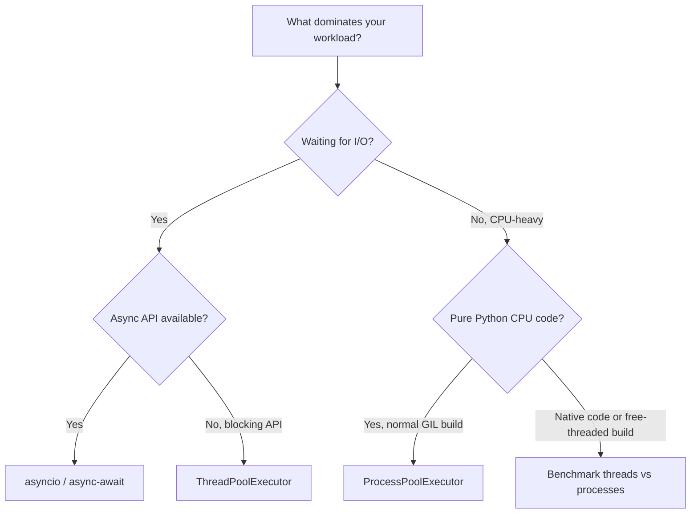
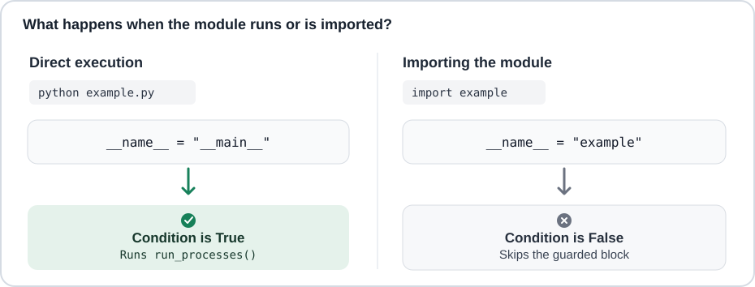
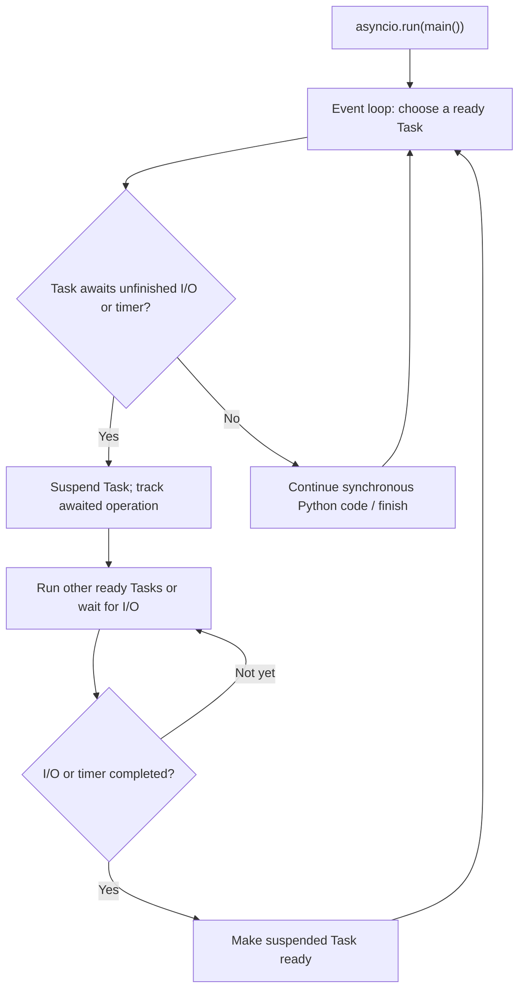
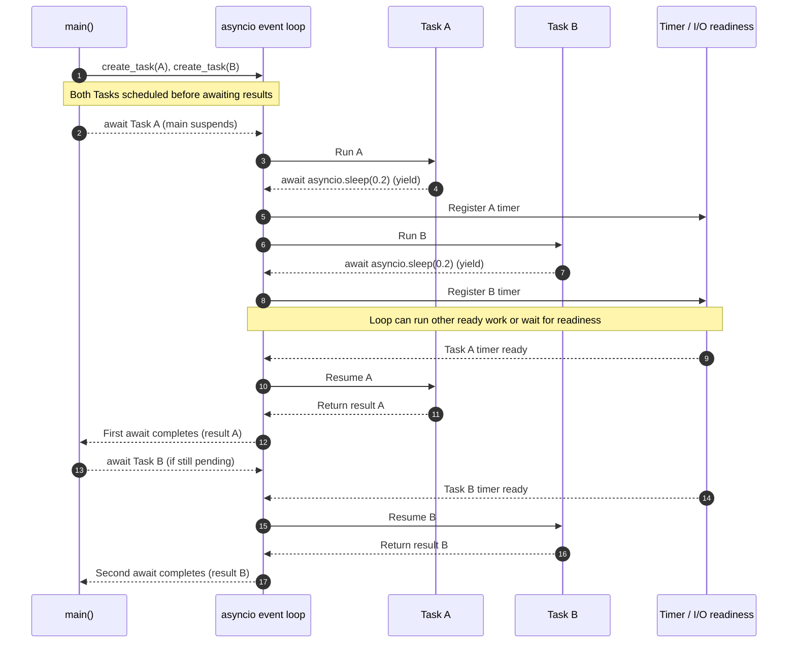
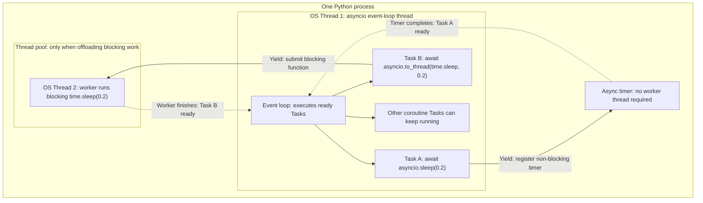

# Threads, Processes, and Async I/O

A practical guide to Python concurrency for experienced engineers. Prior experience with threads, processes, C# `Task` and async programming is useful, but **no previous Python concurrency knowledge is assumed**.

This lesson builds on [CPython Memory Model and the GIL](../01.%20CPython%20Memory%20Model%20and%20the%20GIL/README.md). All examples use the Python standard library. No external service, network access or packages are required.

## 1. Concurrency and parallelism are different

- **Concurrency:** multiple tasks can make progress over an overlapping period (for example, one waits for a database reply while another handles a request).
- **Parallelism:** two or more computations actually execute at the same instant, potentially on different CPU cores.
- **CPU-bound:** time is dominated by executing calculations. More OS threads do not normally speed up pure-Python bytecode with the **standard GIL-enabled CPython** runtime.
- **I/O-bound:** time is dominated by waiting for a network, disk, database or similar operation. Overlapping waits can improve throughput without increasing CPU parallelism.

Python offers several models, and they are **not interchangeable**:

| Model | Concurrency/parallelism | Memory | Typical choice |
|---|---|---|---|
| `threading.Thread` | OS threads; overlapping I/O waits; pure-Python CPU execution normally constrained by GIL | Shared within one process | A few blocking operations or long-lived worker threads |
| `ThreadPoolExecutor` | Pool of OS threads | Shared | Many independent calls to blocking synchronous APIs |
| `multiprocessing` / `ProcessPoolExecutor` | Separate OS processes can execute CPU work on different cores | Separate address spaces | Expensive independent Python computations |
| `asyncio` | Cooperative tasks typically executed by one event-loop thread | Shared within one process | High-volume I/O using non-blocking async APIs |

**Runtime exception:** optional **free-threaded CPython** (available since Python 3.13) permits Python threads to execute in parallel when the GIL is disabled; libraries and synchronization still matter. Native code can also release the GIL. Do not claim that all Python threads are always CPU-serial.

### Decision guide



The guide identifies a **starting point**, not a universal performance guarantee. Workloads that mix network I/O with CPU-heavy computation may require more than one model.

## 2. Requirements and how to run

Use **Python 3.11 or newer** (the `asyncio.TaskGroup` example requires 3.11+). The examples work with ordinary CPython and use no third-party libraries.

From the `02. Threads, Processes and Async IO/` directory:

```bash
python --version

python examples/threading_io.py --requests 3 --delay 0.2
python examples/thread_pool_io.py --requests 4 --workers 3 --delay 0.2
python examples/cpu_pool_comparison.py --iterations 1500000 --jobs 2
python examples/asyncio_io.py --requests 3 --delay 0.2
python examples/asyncio_blocking.py --requests 3 --delay 0.2

python -m unittest discover -s tests -v
```

Expected results: all strategies in a comparison compute **identical outputs**. Functional and README self-containment tests run without assertions about elapsed times. Runtime measurements vary with processor load, container CPU limits, OS scheduling, GIL mode, process startup and Python version.

**Important:** the I/O demos use `time.sleep` / `asyncio.sleep` to model waiting. They do **not** perform real network, disk or database operations. The CPU demo intentionally uses a plain Python loop; it does not represent NumPy or native code that releases the GIL.

## 3. OS threads with `threading`

Start with [`examples/threading_io.py`](examples/threading_io.py). The sequential version waits for each simulated response before starting the next. The threaded version starts multiple OS threads and lets waiting periods overlap.

```python
import threading

# '-> None' is a return type hint, similar to C# 'void'.
# A Python function without an explicit return returns None.
def worker(index: int) -> None:
    print(f"Worker {index}")

# Thread(...) creates a Thread object but does not start it.
# target= and args= are named (keyword) arguments to its constructor.
# target=worker passes the function object; worker() would CALL it now.
# args=(2,) is a one-element tuple: the comma makes it a tuple, not (2).
# When started, the new thread will call worker(2).
thread = threading.Thread(target=worker, args=(2,))
thread.start()  # Actually start executing worker(2) on an OS thread.
thread.join()   # Block the caller until this thread exits (not 'await').
```

**Note — `-> None` versus C# `void`:** The `-> None` annotation declares that `worker` is **not expected to return a meaningful value**, similarly to a `void` method in C#. There is an important runtime difference: **every normal Python function call produces a value**. If execution reaches the end without an explicit `return`, Python automatically returns `None`. `None` is Python's special value for the absence of a value, broadly similar to `null` in C#. For example, calling `result = worker(2)` directly would print `Worker 2` and assign `None` to `result`. The annotation is a *type hint*; Python does not automatically enforce it at runtime.

**C# comparison — void method and OS thread:**

```csharp
using System;
using System.Threading;

void Worker(int index)
{
    Console.WriteLine($"Worker {index}");
}

var thread = new Thread(() => Worker(2)); // Delegate to execute later.
thread.Start(); // Starts the thread.
thread.Join();  // Blocks until the thread finishes.
```

In C#, `new Thread(() => Worker(2))` captures the argument in a delegate. In Python, `target=worker, args=(2,)` supplies the callable and its argument separately. Neither constructor starts the thread automatically.

Python-specific details:

- `threading.Thread` creates an OS thread; `start()` schedules it. Invoking `worker(2)` directly would execute in the **current** thread, not another thread.
- `join()` is synchronous waiting; it is **not** Python's `await` and it does **not** automatically propagate worker exceptions.
- `target=` and `args=` are **keyword arguments** in the `Thread(...)` constructor. `target=worker` passes the **function object** without calling it; `target=worker()` would call it immediately. `args=(2,)` is a one-item tuple whose comma is required; `(2)` alone is just an integer. The thread calls `worker(2)` only when started.
- The full example uses `queue.Queue` for **thread-safe communication** and sends worker exceptions back through the queue. Unlike an unsynchronized shared list or counter, the queue manages access between threads.

For `--requests 3 --delay 0.2`, sequential waiting is *approximately* `0.6s` and overlapping waits *approximately* `0.2s`, plus scheduling overhead. **Do not assert those numbers**. Real I/O and worker scheduling will differ.

### 3.1 Read the actual OS-thread demo implementation

The short `worker` snippet above introduces `Thread`. The **real** [`threading_io.py`](examples/threading_io.py) adds a thread-safe `Queue` so every worker can deliver either a result or an exception. This is the actual `run_sequential()` and `run_threads()` implementation, with the helper functions imported from that same demo:

```python
import threading
from queue import Queue
from examples.threading_io import simulated_io, validate

def run_sequential(requests: int, delay: float) -> list[str]:
    validate(requests, delay)
    return [simulated_io(i, delay) for i in range(requests)]


def run_threads(requests: int, delay: float) -> list[str]:
    validate(requests, delay)
    # Queue is a thread-safe communication channel.
    messages: Queue[tuple[int, str | None, Exception | None]] = Queue()

    # '-> None' means no meaningful return value (similar to C# 'void').
    # Functions with no explicit 'return' still return None in Python.
    def worker(index: int) -> None:
        try:
            messages.put((index, simulated_io(index, delay), None))
        except Exception as exc:
            # Thread.join() does NOT automatically re-raise a worker exception.
            messages.put((index, None, exc))

    # Thread(...) constructs a Thread object but does not start it.
    # 'target=' and 'args=' are keyword arguments to the constructor.
    # target=worker passes the function itself; worker(i) would CALL it now.
    # args=(i,) is a one-element tuple: the comma distinguishes it from (i).
    # When started, each thread executes worker(i).
    threads = [
        threading.Thread(target=worker, args=(i,))
        for i in range(requests)
    ]
    for thread in threads:
        thread.start()  # Schedule the OS thread.
    for thread in threads:
        thread.join()  # Wait for it to finish; not the same as await.

    results: list[str | None] = [None] * requests
    for _ in range(requests):
        index, value, error = messages.get_nowait()
        if error is not None:
            raise RuntimeError(f"Worker {index} failed") from error
        results[index] = value

    if any(value is None for value in results):
        raise RuntimeError("A worker did not produce a result")
    return [value for value in results if value is not None]

print("sequential:", run_sequential(3, 0))
print("threads:   ", run_threads(3, 0))
```

**Expected output (the test uses zero delay for repeatability):**

```text
sequential: ['request-0:ok', 'request-1:ok', 'request-2:ok']
threads:    ['request-0:ok', 'request-1:ok', 'request-2:ok']
```

**How to read it:** `[simulated_io(i, delay) for i in range(requests)]` is a **list comprehension**, comparable to C# LINQ `Enumerable.Range(...).Select(...).ToList()`. In the threaded path, `def worker(index):` is a **nested function** used as the `target` of each `Thread`. Each worker writes `(index, value, None)` or `(index, None, exc)` into `Queue` — a thread-safe producer/consumer channel. `thread.start()` launches the worker; `thread.join()` waits for completion. The loop reading `get_nowait()` reconstructs **input order**, rather than assuming worker completion order. `raise RuntimeError(...) from error` is Python's **exception chaining**, analogous to including an inner exception in C#; a plain `join()` does not rethrow worker failures.

**Why import `simulated_io` and `validate`?** Both are implemented in [`examples/threading_io.py`](examples/threading_io.py); `simulated_io` waits using `time.sleep(delay)` and returns `f"request-{index}:ok"`. `validate` checks that `requests >= 1` and `delay` is finite and non-negative. These are ordinary helpers, not hidden Python concurrency primitives. You can inspect their implementations in that single linked file.


### Shared state still requires synchronization

Even with a GIL, multi-step business operations are not automatically atomic:

```python
import threading

balance_lock = threading.Lock()
balance = 10  # Example account balance; defined so the snippet is runnable.
amount = 3   # Example debit.

# 'with' uses the lock's context manager protocol:
# it acquires the lock on entry and always releases it on exit.
# The check and update must run together inside the critical section.
with balance_lock:
    if balance >= amount:
        balance -= amount

print(balance)  # 7
```

**Python syntax note — `with balance_lock:`:** `with` does not create a lock. It enters the context managed by the existing `threading.Lock` object: `__enter__()` acquires the lock before executing the indented block, and `__exit__()` releases it afterward, including when an exception occurs. For this specific lock, the behavior is equivalent to `balance_lock.acquire()` followed by a `try/finally` that calls `balance_lock.release()`. This is similar to C# `lock (balanceLock) { ... }`. Not every `with` statement acquires a lock: context managers can also manage files, transactions, pools, and other resources. See Lesson 03 for the `__enter__`/`__exit__` protocol in depth.

**C# comparison — critical section:**

```csharp
// balanceLock, balance, and amount are assumed to be defined.
lock (balanceLock)
{
    if (balance >= amount)
    {
        balance -= amount;
    }
}
```

The C# `lock` statement automatically exits the critical section, including if an exception occurs. Python's `with balance_lock:` uses the lock's context-manager methods to achieve the analogous behavior; both only synchronize threads using that same lock object.

The Python sample initializes `balance = 10` and `amount = 3`, so you can run it as written; the **C# illustrative fragment** still assumes those variables and a `balanceLock` already exist. In a real financial system, a local thread lock does not coordinate **different processes or machines**; database transactions or distributed coordination may be required.

## 4. Managing threads with `ThreadPoolExecutor`

For many independent blocking calls, direct `Thread` management is often unnecessary. [`examples/thread_pool_io.py`](examples/thread_pool_io.py) uses `concurrent.futures.ThreadPoolExecutor`.

```python
from concurrent.futures import ThreadPoolExecutor

def calculate(value: int) -> int:
    return value * value

# 'with' manages the pool's lifetime (and shuts it down on exit).
# 'as executor' assigns the value returned by __enter__() to 'executor'.
# For ThreadPoolExecutor, __enter__() returns the executor object itself.
with ThreadPoolExecutor(max_workers=2) as executor:
    future = executor.submit(calculate, 5)
    print(future.result())  # 25
```

**Python syntax note — `as executor`:** The expression `ThreadPoolExecutor(max_workers=2)` first constructs a pool manager. On entering the `with` block, Python calls that context manager's `__enter__()` method and assigns its result to the variable after `as` (here, `executor`). For `ThreadPoolExecutor`, `__enter__()` returns the executor itself, letting you call `executor.submit(...)`. On leaving the block, Python calls `__exit__()`; this executor waits for submitted work and shuts down, even if an exception leaves the block. Other context managers can return a **different object** from `__enter__()`. Conceptually, this resembles C# `using (var resource = ...)`, but Python's `as` binds the `__enter__()` result.

**C# comparison — resource binding with `using`:**

```csharp
using System.IO;

using (var resource = new MemoryStream())
{
    // 'resource' is available within this scope.
    resource.WriteByte(42);
} // Dispose() is called at the end of the scope.
```

This illustrates the **resource-lifetime** analogy, not an equivalent C# thread pool. Unlike C# `using`, Python `as executor` binds the value returned by the context manager's `__enter__()`, which may differ from the original object. In this case both refer to the same executor.

- `max_workers=2` limits the number of concurrent worker threads.
- `submit(fn, arg)` schedules the callable and returns a **Future** (a placeholder for its eventual result). It does **not** run `fn` on the calling thread.
- `future.result()` **blocks** until completion and raises the worker's exception if the call failed.
- `with` invokes the executor's context-management protocol to cleanly shut down and wait for work. See the context-managers lesson for more depth.
- Retrieving futures in submission order preserves a deterministic output order, although work may complete in a different order.

**C# comparison:** `Future` and `.result()` resemble the notion of a result that arrives later, but `.result()` here is **blocking**. It is not an equivalent replacement for `await someTask` in C#. Thread-pool CPU work is still subject to GIL behavior in standard CPython.

### 4.1 The real thread-pool implementation

In the runnable [`thread_pool_io.py`](examples/thread_pool_io.py), `run_pool()` does **not** use the square-calculation function above. It actually submits the **same simulated I/O operation** from Section 3 for every request:

```python
from concurrent.futures import ThreadPoolExecutor
from examples.threading_io import simulated_io, validate

def run_pool(requests: int, delay: float, workers: int) -> list[str]:
    validate(requests, delay)
    if workers < 1:
        raise ValueError("workers must be >= 1")

    # 'with' manages the pool lifetime and waits for work on exit.
    # 'as executor' binds the result of __enter__() to this variable.
    # For ThreadPoolExecutor, __enter__() returns the executor object itself.
    with ThreadPoolExecutor(max_workers=workers) as executor:
        # submit(function, *arguments) schedules a callable and returns a Future.
        futures = [
            executor.submit(simulated_io, index, delay)
            for index in range(requests)
        ]
        # future.result() waits for completion and re-raises worker exceptions.
        # Retrieving futures in input order also restores deterministic results.
        return [future.result() for future in futures]

print(run_pool(4, 0, workers=2))
```

```text
['request-0:ok', 'request-1:ok', 'request-2:ok', 'request-3:ok']
```

**Execution:** the comprehension creates one `Future` per submitted request; `executor.submit(simulated_io, index, delay)` passes the function itself, plus its arguments. A future is similar in purpose to a C# `Task<T>`, but **`future.result()` blocks** the caller. The second comprehension waits for the results **in submission order**; a worker failure is re-raised here. `with ThreadPoolExecutor(...)` ensures the pool is shut down after its tasks complete.

**Dependency note:** `thread_pool_io.py` imports `simulated_io` from `threading_io.py`. Its direct script command in Section 2 works because Python adds the `examples/` directory to the import path when running that file. The copyable snippet above uses `from examples.threading_io import ...` from the **lesson root** instead, so it works without modifying `sys.path` manually.


## 5. CPU parallelism with processes

[`examples/cpu_pool_comparison.py`](examples/cpu_pool_comparison.py) runs the **same** pure-Python workload (1) sequentially, (2) in a `ThreadPoolExecutor`, and (3) in a `ProcessPoolExecutor`.

```python
# Save as a real .py file before running: spawn-based workers import its module.
import multiprocessing
from concurrent.futures import ProcessPoolExecutor, ThreadPoolExecutor

def cpu_work(iterations: int) -> int:
    """Deliberately CPU-bound Python loop with a deterministic result."""
    if iterations < 0:
        raise ValueError("iterations must be >= 0")
    total = 0
    for i in range(iterations):
        total += (i % 97) * (i % 89)
    return total

def validate(iterations: int, jobs: int) -> None:
    if iterations < 0 or jobs < 1:
        raise ValueError("iterations must be >= 0 and jobs must be >= 1")

def run_sequential(iterations: int, jobs: int) -> list[int]:
    validate(iterations, jobs)
    return [cpu_work(iterations) for _ in range(jobs)]

def run_threads(iterations: int, jobs: int) -> list[int]:
    validate(iterations, jobs)
    with ThreadPoolExecutor(max_workers=jobs) as executor:
        return list(executor.map(cpu_work, [iterations] * jobs))

def run_processes(iterations: int, jobs: int) -> list[int]:
    validate(iterations, jobs)
    # Each worker is a separate process with its own interpreter and memory.
    # get_context("spawn") returns a context for the fresh-interpreter start method.
    # It does NOT start any worker yet and avoids relying on Unix 'fork'.
    context = multiprocessing.get_context("spawn")
    # Create a pool with up to 'jobs' separate worker processes.
    # mp_context=context makes it use the selected "spawn" start method.
    # 'as executor' receives the pool object returned by __enter__().
    # Leaving 'with' waits for submitted work and shuts down the pool.
    with ProcessPoolExecutor(max_workers=jobs, mp_context=context) as executor:
        # [iterations] * jobs repeats this input 'jobs' times (for example, [5] * 2 -> [5, 5]).
        # map(cpu_work, inputs) schedules cpu_work(value) for each input.
        # The result iterator preserves input order, even if workers finish out of order.
        # list(...) consumes results (possibly waiting or raising a worker exception).
        # return passes the final list[int] back to the caller.
        return list(executor.map(cpu_work, [iterations] * jobs))

if __name__ == "__main__":
    serial = run_sequential(100, 2)
    threaded = run_threads(100, 2)
    processes = run_processes(100, 2)
    print("All three results match:", serial == threaded == processes)
```

**Why this is a different example from the previous version:** The **actual** [`cpu_pool_comparison.py`](examples/cpu_pool_comparison.py) uses `(i % 97) * (i % 89)` for its deterministic pure-Python CPU workload, rather than `i * i`. The three modes all run **the same `cpu_work` function**, so results can be compared meaningfully. The complete source for the worker, validation, sequential, threaded and process variants appears above. No source demo algorithm was changed.

**Run rule:** Unlike the other short snippets, the process example **must be saved as a real Python script** and executed using `python your_script.py`; it cannot reliably run directly inside an interactive REPL or `exec(...)` because spawned workers must import the main module and pickle the module-level `cpu_work` function. The `if __name__ == "__main__":` guard is essential. Alternatively use the **existing standalone demo** `python examples/cpu_pool_comparison.py --iterations 100 --jobs 2` (which also measures elapsed time and prints runtime details). Its successful comparison prints `Same results: True` and the copyable sample above prints `All three results match: True`. 


**Python syntax note — `with ProcessPoolExecutor(...) as executor:`:** `ProcessPoolExecutor` constructs a **process-pool manager**, not an ordinary OS thread. `max_workers=jobs` sets a limit of **`jobs` worker processes**; it does not mean only two tasks can ever be submitted. `mp_context=context` tells the pool to use the `spawn` configuration selected above. The `with` statement calls the pool's `__enter__()`, and `as executor` binds its result (for this class, **the pool object itself**) to the name `executor`. Tasks are submitted when `executor.map(...)` is used; constructing the executor does **not necessarily** start all workers immediately. The process pool serializes submitted inputs/results across separate process memory spaces. When control exits the `with` block, including during an exception, `__exit__()` calls `shutdown(wait=True)` to wait for submitted work and release pool resources. This is **not** a guarantee that all submitted work is forcibly canceled on an exception.

**Python syntax note — `return list(executor.map(cpu_work, [iterations] * jobs))`:** This is three operations combined into one expression in the **real demo**:

1. `[iterations] * jobs` creates a list with `jobs` copies of the input count. For example `[100] * 2` becomes `[100, 100]`. `executor.map(cpu_work, ...)` submits one call for each input. The name `cpu_work` is a **function object**, not the result of calling it. Python numeric literals such as `500_000` may still use underscores as optional digit separators.
2. `executor.map(...)` provides an **iterator of results**, ordered like the input values even if workers finish in a different order. `list(...)` consumes that iterator and builds a `list[int]`; consuming the results may **block** while workers are still running or raise an exception from a failed worker.
3. `return` sends that finished list back from `run_processes(iterations, jobs)`. With `iterations=100` and `jobs=2`, it contains **two integers** from the same calculation, not process objects.

**C# syntax comparison — only the mapping and collection operations:**

```csharp
using System.Linq;

var results = new[] { 2, 3, 4 }
    .Select(n => n * n)
    .ToList(); // List<int> containing 4, 9, 16
```

This LINQ code runs sequentially by default. It is **not** equivalent to `ProcessPoolExecutor`'s multi-process execution. The existing C# `Process.Start` snippet below illustrates only the OS-process boundary, not the pool, argument serialization or result collection.

**Python syntax note — `multiprocessing.get_context("spawn")`:** `get_context(...)` returns a *multiprocessing context* configured with the named process start method. The string `"spawn"` selects a model where new worker processes start fresh Python interpreters instead of inheriting the parent process's running interpreter state. **This call does not itself launch any process.** The context is passed via `mp_context=context` so that `ProcessPoolExecutor` can use it when it starts workers. Submitted functions and their arguments must be suitable for process-to-process serialization (typically `pickle`); each worker has its own memory. Explicit `spawn` gives the example a consistent start method rather than relying on OS- and Python-version-dependent defaults.

**Python syntax note — `if __name__ == "__main__":`:** Python automatically defines `__name__` in each module. When you run a file directly, such as `python example.py`, its `__name__` is `"__main__"`, so `if __name__ == "__main__":` is true and the indented block runs. If another module uses `import example`, the imported file's `__name__` is `"example"`, so that block is skipped. `==` compares values, and `print(run_processes())` calls the function, then prints its returned list. This conditional is commonly called the **main-entry guard**.

It is essential for `spawn`-based multiprocessing: spawned workers import the module containing the worker function, and importing it must **not** start a new process pool recursively. Functions used by the workers should be defined at module level, outside the guard; only the **program entry point that starts the pool** belongs inside it. Importing a module still executes its other top-level statements, so the guard protects only the code inside its block.



### Why this guard is required in our process-pool example

The script calls `run_processes()`, which creates a `ProcessPoolExecutor` configured with `spawn`. When tasks are submitted, `spawn` starts **fresh Python interpreters** that must load the module containing the worker function `cpu_work`.

If we put `print(run_processes())` at module top level **without the `if __name__ == "__main__":` guard**, those worker interpreters could execute it while importing the module. Each would try to start another process pool during its own initialization, leading to recursive process creation attempts and typically a multiprocessing bootstrapping `RuntimeError`. The guard prevents this: **only the parent entry-point execution starts the demo**; child processes can import and call `cpu_work` without rerunning the demo. In the spawn implementation, the worker's main module is initialized under a different internal module name, so the `"__main__"` condition is not met.

This is why the **function definitions stay outside** the guard (so they are importable), but the **call that starts the application** stays inside it. The diagram illustrates ordinary direct execution versus `import example`; spawned workers use related import/initialization machinery.

**C# comparison — entry point:** Conceptually, this separates Python's executable entry point from importable functions, similar to a C# `Main` method:

```csharp
using System;

class Program
{
    static void Main(string[] args)
    {
        Console.WriteLine("Application started");
    }
}
```

C# has an explicit entry-point mechanism; Python conventionally uses the `__name__` check to decide which statements run only when a module is the main program.

**C# comparison — separate process, not `Task.Run`:**

```csharp
using System.Diagnostics;

// Illustrative only: worker.exe must exist for this to run.
using var process = Process.Start(new ProcessStartInfo
{
    FileName = "worker.exe",
    UseShellExecute = false
});

process?.WaitForExit(); // Wait for the separate OS process.
```

C# `Process.Start` illustrates the **process boundary**. It does not implement a process pool, task serialization, or result collection. Python's `ProcessPoolExecutor` manages those additional responsibilities.

**Python syntax note — `list[int]`:** The built-in `list` is an ordered, mutable collection. In a type annotation, `list[int]` means a list of integers, comparable to `List<int>` in C#. In `-> list[int]`, the arrow specifies the **expected return type**. This does not convert values or enforce their types when the function runs; static type checkers can report mismatches. `list[int]` has been supported since Python 3.9.

**C# syntax comparison (return type only, not an equivalent process-pool implementation):**

```csharp
List<int> GetNumbers()
{
    return new List<int> { 10, 20, 30 };
}
```

The Python equivalent of that simple collection-returning method would be `def get_numbers() -> list[int]: return [10, 20, 30]`. The process-pool behavior itself is explained separately below.

### Important implementation rules

- A process has a **separate address space**. Regular Python objects are **not shared by reference** with the parent. Data passed to/from a pool must be serialized (commonly with `pickle`); avoid passing open connections, locks or unpicklable closures.
- The function submitted to a spawn-based process pool should be defined at **module level** so workers can import it. A nested function or lambda is often not picklable.
- `if __name__ == "__main__":` is a **module-entry guard**. `__name__` is a special module variable. The guarded block executes when the file is run as the program's entry point, but not when a worker imports it. Without this guard, spawn-based workers can recursively start new processes.
- `multiprocessing.get_context("spawn")` explicitly chooses the same fresh-interpreter start model on Windows, macOS and Linux. This avoids depending on platform defaults, which have changed across Python releases.
- The pool's `max_workers` and the number of CPU cores are not guarantees of speedup. Process creation, serialization, result transfer, memory pressure and CPU quotas all add cost. **Small workloads may run slower in processes**.

In the standard GIL-enabled CPython, separate processes can run pure-Python CPU workloads in parallel. Unlike `asyncio`, this addresses **CPU parallelism**, not merely overlapping I/O waits.

**C# comparison:** `ProcessPoolExecutor` uses separate processes rather than managed tasks sharing the same heap. Model a process boundary as a serialization/IPC boundary, not as another `Task.Run` invocation.

## 6. Async I/O with `asyncio`

[`examples/asyncio_io.py`](examples/asyncio_io.py) contrasts **sequential awaits**, `asyncio.gather()`, and structured concurrency using `asyncio.TaskGroup`.


### 6.1 Three distinct things: coroutine object, Task, and returned value

**Calling an \`async def\` function does not automatically create an \`asyncio.Task\`.** It creates a **coroutine object**: an awaitable representing execution that has not started yet. This is different from C#: calling an ordinary \`async Task<string>\` method starts executing its body immediately (normally until its first incomplete \`await\`) and returns a \`Task<string>\`.

| Python expression | What you receive | Is it an \`asyncio.Task\`? |
|---|---|---|
| \`coroutine = get_data()\` | A **coroutine object**; its body has not run yet | **No** |
| \`result = await get_data()\` | The **returned value** (\`"Hello"\`, a \`str\`) after running the coroutine | **No** |
| \`task = asyncio.create_task(get_data())\` | A **Task object** that schedules and tracks the coroutine on the running event loop | **Yes** |
| \`result = await task\` | The **returned value** of the completed Task (\`"Hello"\`) | **No** |

Here is a complete, runnable demonstration using \`inspect.iscoroutine()\` (a standard-library check for coroutine objects) and \`isinstance(..., asyncio.Task)\` (the Python equivalent of checking an object's runtime type):

\`\`\`python
import asyncio
import inspect

async def get_data() -> str:
    await asyncio.sleep(0)
    return "Hello"

async def main() -> None:
    coroutine = get_data()  # Creates a coroutine; does NOT start its body.
    print("Coroutine object:", inspect.iscoroutine(coroutine))
    print("Already a Task:", isinstance(coroutine, asyncio.Task))
    print("Await existing coroutine:", await coroutine)

    result = await get_data()  # Runs it directly; receives the str.
    print("Direct await result:", result)
    print("Direct await type:", type(result).__name__)

    task = asyncio.create_task(get_data())  # Schedules a separate Task.
    print("Created Task:", isinstance(task, asyncio.Task))
    print("Await Task result:", await task)

asyncio.run(main())
\`\`\`

**Expected output:**

\`\`\`text
Coroutine object: True
Already a Task: False
Await existing coroutine: Hello
Direct await result: Hello
Direct await type: str
Created Task: True
Await Task result: Hello
\`\`\`

**Why \`await get_data()\` works without creating a separate Task:** \`await\` drives the coroutine as part of the **currently executing async task**; Python does **not** need to wrap *this call* in a new \`asyncio.Task\`. The value returned by \`await\` is what \`get_data()\` returns, not the coroutine or Task object. A coroutine object can normally be awaited **only once**; the example awaits \`coroutine\` so that it is consumed rather than abandoned.

**When to create a Task:** use \`asyncio.create_task(get_data())\` when you need the operation **scheduled independently** of the next line, for example so multiple I/O operations overlap, you can inspect \`task.done()\`, request \`task.cancel()\`, or await its result later. Call \`create_task()\` from a running event loop (usually inside \`async def\`). **Do not wrap every coroutine in a Task by default**; \`await get_data()\` is correct when you need its result before continuing.

**Other ways Tasks are created:** \`asyncio.TaskGroup.create_task()\` explicitly creates Tasks; \`asyncio.gather(coroutine1, coroutine2)\` automatically schedules coroutine arguments as Tasks. \`asyncio.run(main())\` is a top-level event-loop runner, not a reason to manually create a Task for each nested \`await\`.

**C# mental model:** Python \`asyncio.Task\` resembles C# \`Task<T>\` as a handle for tracking and awaiting an operation. But Python's \`async def\` call returns a **coroutine first**, whereas a C# \`async Task<T>\` call normally returns an already-started Task. Importantly, \`asyncio.create_task()\` schedules work on the event loop; it is **not C# \`Task.Run()\`** and does not automatically use a thread-pool thread.


```python
import asyncio

# 'async def' declares a coroutine function (similar to an async C# method).
# '-> str' describes its awaited result, like the string in C# Task<string>.
async def simulated_request() -> str:
    # 'await' suspends this coroutine while the event loop can run other tasks.
    # asyncio.sleep(0.2) is like C# Task.Delay(200): a non-blocking wait.
    await asyncio.sleep(0.2)
    return "ok"

async def main() -> None:
    # simulated_request() creates a coroutine object (not yet executed).
    # create_task(...) schedules it on the running event loop and returns a Task.
    # 'first' holds that Task so we can await its result later.
    first = asyncio.create_task(simulated_request())
    second = asyncio.create_task(simulated_request())

    # Both tasks are scheduled before either result is awaited.
    # print() evaluates its arguments left-to-right: await first, then second.
    # Awaiting is sequential here, but both tasks can progress concurrently.
    print(await first, await second)

# asyncio.run() starts/manages the event loop at the application boundary.
if __name__ == "__main__":
    asyncio.run(main())
```

**Python syntax note — `print(await first, await second)` is not sequential task execution:** Python evaluates the arguments of `print()` from left to right, so the code first awaits `first`, then awaits `second`. However, because **both Tasks were already scheduled** with `asyncio.create_task()`, the event loop can run them concurrently. Their simulated waits overlap; two 0.2-second delays normally take about **0.2 seconds plus scheduling overhead**, not 0.4 seconds.

**Official Python documentation confirms this behavior.** Its [*Coroutines and Tasks* example](https://docs.python.org/3/library/asyncio-task.html#coroutines) creates `task1 = asyncio.create_task(say_after(1, "hello"))` and `task2 = asyncio.create_task(say_after(2, "world"))`, then uses `await task1` followed by `await task2`. Python describes these tasks as running **concurrently**: the example takes about **2 seconds**, not the 3 seconds needed for two sequential calls. The two `await` expressions are evaluated in order, but both tasks were **scheduled before the first await**. `print(await first, await second)` follows the same rule; the fact that the awaits are arguments to `print()` does not change it.

Compare two different execution patterns:

```python
import asyncio

async def simulated_request() -> str:
    await asyncio.sleep(0.2)
    return "ok"

async def compare() -> None:
    # Sequential: second request starts only after the first completes.
    first_result = await simulated_request()
    second_result = await simulated_request()
    print(first_result, second_result)  # ok ok; approximately 0.4s

    # Concurrent: schedule both tasks before awaiting either result.
    first = asyncio.create_task(simulated_request())
    second = asyncio.create_task(simulated_request())
    print(await first, await second)    # ok ok; approximately 0.2s

asyncio.run(compare())
```

If the intention is to **wait for multiple results together** more explicitly, `asyncio.gather` is another option:

```python
import asyncio

async def simulated_request() -> str:
    await asyncio.sleep(0.2)
    return "ok"

async def main() -> None:
    results = await asyncio.gather(simulated_request(), simulated_request())
    print(*results)  # ok ok; '*' unpacks results as print arguments.

asyncio.run(main())
```

Unlike C# `Task.WhenAll`, Python `gather` has its own exception/cancellation behavior. For structured failure handling, see the `TaskGroup` section below. These timings are **illustrative only**, not correctness requirements.

**C# comparison — asynchronous delay returning a string:**

```csharp
using System.Threading.Tasks;

static async Task<string> SimulatedRequestAsync()
{
    // Await a non-blocking delay (200 milliseconds).
    await Task.Delay(200);
    return "ok";
}
```

The corresponding calls are `await simulated_request()` in a Python coroutine and `await SimulatedRequestAsync()` in a C# async method. `-> str` annotates the **value obtained by awaiting** the Python coroutine; the call itself produces a coroutine object, rather than an immediate `str`. In C#, the method is declared to return `Task<string>`.

**Crucial execution difference:** calling `simulated_request()` only **creates a coroutine object**; its body begins when it is awaited or scheduled (for example, with `asyncio.create_task(...)`). Calling a normal C# `async Task<string>` method, however, **begins executing its body immediately**, synchronously until it encounters an incomplete await or finishes. `Task.Delay` and `asyncio.sleep` both model non-blocking waits, but Python's `asyncio` typically runs these coroutines on one event-loop thread. Neither construct automatically starts a new thread or gives CPU-bound calculations parallel execution.

**Python syntax note — `first = asyncio.create_task(simulated_request())`:** The inner call `simulated_request()` produces a **coroutine object**, without executing its body. `asyncio.create_task(...)` wraps and **schedules** that coroutine on the **running event loop**, returning an `asyncio.Task`. The assignment `first =` stores the Task reference; `await first` later waits for its completion and obtains the returned `"ok"` string (or propagates its exception).

Because both `first` and `second` are scheduled before we await either one, the waits can overlap; two simulated 0.2-second operations may complete in approximately 0.2 seconds **plus overhead**, not necessarily 0.4 seconds. Scheduling normally allows the coroutine to start when the event loop next gets a chance to run it; it is **not** an immediate call of its body and **does not launch a new OS thread**. Keep a reference to tasks you want to track and await them, or manage their lifetime with `asyncio.TaskGroup` (discussed below).

**C# comparison — sequential awaits versus `Task.WhenAll`:**

```csharp
// Sequential OPERATIONS: the second method is not called until
// the first async operation finishes (~400 ms for two 200 ms delays).
string firstResult = await SimulatedRequestAsync();
string secondResult = await SimulatedRequestAsync();
```

```csharp
// Concurrent OPERATIONS: both async methods were called first.
// The two awaits happen sequentially, but the waits overlap (~200 ms).
Task<string> task1 = SimulatedRequestAsync();
Task<string> task2 = SimulatedRequestAsync();
string firstResult = await task1;
string secondResult = await task2;
```

```csharp
// Also concurrent: both async operations are already started.
// WhenAll waits for the entire group to finish (~200 ms).
Task<string> task1 = SimulatedRequestAsync();
Task<string> task2 = SimulatedRequestAsync();
string[] results = await Task.WhenAll(task1, task2);
```

The key distinction is **when the asynchronous operations are started**, not whether two `await` expressions appear on separate lines. `Task.WhenAll` does **not** start `task1` and `task2`; it creates an aggregate task that completes after both have completed. It is the clearer choice for **waiting for the full group**, especially if one fails: with `await task1; await task2;`, an exception from `task1` can stop the caller before it reaches `await task2`, even though `task2` keeps running. With `WhenAll`, the returned task represents both completions and can record both errors.

These C# `async Task<string>` methods normally begin executing when called, while Python's coroutine body begins when awaited or scheduled. **`asyncio.create_task()` is not the equivalent of C# `Task.Run()`**: it schedules on the event loop rather than automatically offloading work to a thread pool. The delays shown are illustrative; concurrent I/O is not automatically parallel CPU computation.

### Python-specific syntax and behavior

- `async def` declares a **coroutine function**. Calling it returns a **coroutine object**; the body does not automatically start executing in a background thread.
- `await` can be used inside `async def`. It allows the current coroutine to **suspend** while its awaited operation is pending, so the event loop can run other tasks.
- `asyncio.run(main())` creates, runs and closes an event loop. Typically invoke it **once** near the program entry point; do not nest it inside an already running event loop.
- `asyncio.create_task(coroutine)` schedules a coroutine on the event loop. Creating multiple tasks does **not** create multiple OS threads.
- `asyncio.gather(*tasks)` waits for several awaitables and returns their results in argument order. `*tasks` is Python's **positional argument unpacking**.
- `async with asyncio.TaskGroup() as group:` is an **asynchronous context manager** (Python 3.11+). The group waits for its children on exit. If one task fails with a regular exception, it cancels remaining siblings and raises an `ExceptionGroup` containing failures; this is different from simply calling `gather()`.
- Async tasks are **cooperatively** scheduled: a task that runs CPU-heavy Python code without reaching an `await` can block other tasks on the same event loop.

**C# comparison:** Python `async`/`await` looks familiar, but `asyncio` is an event-loop-driven concurrency API. A Python coroutine or `Task` is not automatically a thread-pool operation; `asyncio.sleep()` yields while `time.sleep()` blocks the current thread.

### 6.2 Complete `asyncio` strategies from the runnable demo

The simplified examples above teach syntax, but the real [`asyncio_io.py`](examples/asyncio_io.py) implements **three distinct functions**. All of the important source is reproduced here. The shared `validate()` function, imported from that demo, checks the request count and delay.

```python
import asyncio
from examples.asyncio_io import validate

async def simulated_io(index: int, delay: float) -> str:
    # 'await' suspends this coroutine while the event loop runs other tasks.
    # asyncio.sleep(delay) is non-blocking (similar to C# Task.Delay).
    await asyncio.sleep(delay)
    return f"request-{index}:ok"

async def run_sequential(requests: int, delay: float) -> list[str]:
    validate(requests, delay)
    results: list[str] = []
    for i in range(requests):
        results.append(await simulated_io(i, delay))
    return results


async def run_gather(requests: int, delay: float) -> list[str]:
    validate(requests, delay)
    # simulated_io(i, delay) produces a coroutine object (its body hasn't run).
    # create_task() wraps and schedules it on the current event loop, returning a Task.
    # This schedules all requests before we await their results; no OS threads are created.
    tasks = [asyncio.create_task(simulated_io(i, delay)) for i in range(requests)]
    # '*' unpacks a list into positional arguments for asyncio.gather().
    return list(await asyncio.gather(*tasks))


async def run_taskgroup(requests: int, delay: float) -> list[str]:
    validate(requests, delay)
    # TaskGroup (3.11+) waits for children and manages failure/cancellation.
    async with asyncio.TaskGroup() as group:
        tasks = [group.create_task(simulated_io(i, delay)) for i in range(requests)]
    # Once the 'async with' block exits successfully, every task has completed.
    return [task.result() for task in tasks]

async def main() -> None:
    sequential = await run_sequential(3, 0)
    gathered = await run_gather(3, 0)
    grouped = await run_taskgroup(3, 0)
    print("sequential:", sequential)
    print("gather equals sequential:", gathered == sequential)
    print("TaskGroup equals sequential:", grouped == sequential)

asyncio.run(main())
```

**Expected output:**

```text
sequential: ['request-0:ok', 'request-1:ok', 'request-2:ok']
gather equals sequential: True
TaskGroup equals sequential: True
```

- `run_sequential()` **awaits each coroutine inside a `for` loop** before starting the next operation; each result is appended to a mutable list.
- `run_gather()` uses a **list comprehension** to create all Tasks first. `*tasks` then **unpacks** the list as separate arguments into `asyncio.gather(...)`. Results are returned in argument order even when completion order differs.
- `run_taskgroup()` uses `async with asyncio.TaskGroup() as group:`. The group creates child Tasks, waits for them on exit, and then `task.result()` retrieves completed values. On a child failure, it cancels remaining siblings and raises an `ExceptionGroup` for non-cancellation errors.
- `await` is valid **only inside an `async def` function** (or supported interactive environments). The two short comparisons in this section now each include their own `async def` and `asyncio.run(...)` so they can be copied into saved `.py` files without `SyntaxError`.


## 7. The dangerous mistake: blocking the event loop

### What is an event loop?

An **event loop** is the scheduler at the heart of an `asyncio` application. It **runs ready coroutine tasks and callbacks**, watches for I/O readiness and timer completions, and **resumes suspended tasks** when the operation they were awaiting can make progress. Most ordinary `asyncio` applications have one event loop running in **one OS thread**; this model provides *concurrency*, not automatic multi-core CPU *parallelism*.

It is conceptually similar to the JavaScript **event loop** in a browser or Node.js: asynchronous operations do not require one blocked thread per request. The program registers work, yields during asynchronous waits, and continues it when the relevant event or timer becomes ready.

**The key word is cooperative:** an `asyncio.Task` executes Python code until it completes, raises, or **suspends at an await that is not ready**. The event loop does not interrupt arbitrary synchronous Python statements. If a task executes `time.sleep()`, a long synchronous loop, or blocking database/network I/O directly on the event-loop thread, **other tasks on that loop cannot run** while it is blocked.

### How Python's event loop works, step by step

1. `asyncio.run(main())` creates and runs an event loop for the entry-point coroutine, then performs cleanup when finished. Use it at the **application boundary**, not inside an already running event loop.
2. `asyncio.create_task(coroutine)` registers a coroutine to run as a Task on the loop. Calling an `async def` function **without** awaiting/scheduling it only creates a coroutine object.
3. The loop runs a ready Task. At `await asyncio.sleep(0.2)`, that Task **suspends**, and the loop can execute another ready Task instead.
4. While tasks wait, the loop arranges timers and monitors supported asynchronous I/O. When the wait completes, the Task becomes runnable again and later resumes.
5. If there is no runnable work, the loop can **wait for the next I/O event or timer** rather than continuously spinning the CPU. A Task that never suspends can starve other tasks.



*Conceptual scheduler diagram, not a precise implementation trace or a promise of fairness/order.*

### Example: two concurrent coroutines on one event-loop thread

The following **Mermaid sequence diagram** shows the important scheduling distinction: both Tasks are registered *before* `main()` awaits their results. Each Task yields at `await asyncio.sleep(0.2)`, allowing the event loop to run the other Task. The timer waits overlap without creating another OS thread.



*Illustrative order only: actual task resumption order is not guaranteed. Both `asyncio.sleep()` calls yield, so their waits can overlap; the event loop does not execute two pieces of Python bytecode simultaneously on the same thread.*

### Compare JavaScript and Python

In JavaScript, a common event-loop-based async wait looks like this:

```javascript
// Works in modern browsers and Node.js.
const delay = ms => new Promise(resolve => setTimeout(resolve, ms));

async function request(label) {
    await delay(200); // Yields: the JS event loop can run other work.
    return `request-${label}:ok`;
}

async function main() {
    const [first, second] = await Promise.all([
        request("A"),
        request("B")
    ]);
    console.log(first, second);
}

main().catch(console.error);
```

The comparable Python code is:

```python
import asyncio

async def request(label: str) -> str:
    await asyncio.sleep(0.2)  # Yield to the Python event loop.
    return f"request-{label}:ok"

async def main() -> None:
    # gather() schedules the coroutines and collects their results in input order.
    first, second = await asyncio.gather(request("A"), request("B"))
    print(first, second)

if __name__ == "__main__":
    asyncio.run(main())
```

Both examples print `request-A:ok request-B:ok` after about **0.2 seconds plus overhead** (rather than 0.4 seconds), because the waits overlap.

| Concept | JavaScript (browser/Node.js) | Python `asyncio` |
|---|---|---|
| Async function | `async function request()` | `async def request():` |
| Await a non-blocking delay | `await delay(200)` using `setTimeout` | `await asyncio.sleep(0.2)` |
| Wait for independent operations | `await Promise.all([...])` | `await asyncio.gather(...)` (different failure/cancellation behavior) |
| Schedule multiple operations | Calling a JS async function normally **starts** it immediately | Calling a Python coroutine function only **creates a coroutine**; use `await`, `gather`, or `create_task` to run it |
| Scheduling details | Browser task queue and **microtask queue** (Promise continuations) | `asyncio` Tasks, Futures, callbacks, ready work, I/O polling and timers |

**They are similar, not identical.** JavaScript browser event loops have distinct **task and microtask queues**, where Promise continuations run as microtasks. Python `asyncio` does **not** expose the same JavaScript microtask-queue rules; do not assume identical callback ordering. Likewise, .NET `async`/`await` is an asynchronous programming model, but does **not** imply one universal event loop: continuations depend on synchronization contexts, task schedulers, I/O completion, and the hosting environment.

### Why blocking the event loop is dangerous

[`examples/asyncio_blocking.py`](examples/asyncio_blocking.py) demonstrates the difference between blocking inside a coroutine and moving synchronous/blocking work to a thread.

```python
import asyncio
import time

async def wrong() -> None:
    time.sleep(0.2)  # BAD: blocks the event-loop thread for 0.2s.

async def good_async() -> None:
    await asyncio.sleep(0.2)  # GOOD: suspends the coroutine, not the loop.

async def bridge_blocking_library() -> None:
    # A worker thread is a separate OS thread used for background work.
    # to_thread() runs blocking time.sleep(0.2) there, not on the event-loop thread.
    # 'await' suspends this coroutine until that worker completes.
    await asyncio.to_thread(time.sleep, 0.2)
```

**Python syntax note — what is a worker thread?** It is an **OS thread used to execute work on behalf of the caller**. In our example, the main thread runs the `asyncio` event loop. The expression `asyncio.to_thread(time.sleep, 0.2)` arranges for the **synchronous** function `time.sleep(0.2)` to execute in a separate worker thread, managed by the event loop's default thread-pool executor. `time.sleep` is passed **without parentheses** because it is a function reference; `0.2` is the argument forwarded to that function. Awaiting the `to_thread` coroutine yields control to the event loop while the worker is busy, allowing other `asyncio` tasks to progress. It does **not** create a new OS process, and the worker is not the event-loop thread.

**Two paths through the same event loop (Mermaid):**



*The event loop runs on one OS thread, but its Tasks are **not threads**. `asyncio.sleep()` needs no worker; `asyncio.to_thread()` uses a separate thread from the reusable thread pool. More simultaneous offloads can use additional worker threads. The diagram is illustrative; it does not guarantee task scheduling order.*

**C# comparison:**

```csharp
using System.Threading;
using System.Threading.Tasks;

await Task.Run(() => Thread.Sleep(200)); // Blocks a ThreadPool worker.
await Task.Delay(200);                   // Asynchronous timer: no blocked worker needed.
```

The closer Python pair is `await asyncio.to_thread(time.sleep, 0.2)` versus `await asyncio.sleep(0.2)`. **Prefer the latter for an asynchronous timer.** `to_thread` is primarily a bridge to existing **blocking I/O libraries** without async interfaces. The default GIL-enabled CPython still limits CPU-parallel execution of ordinary Python bytecode, so thread offloading is not automatically a multi-core CPU optimization.

Even if `time.sleep()` **releases the CPython GIL**, it still blocks the **specific OS thread running the event loop**. Releasing the GIL permits *other OS threads* to execute; it does not make the blocked event-loop thread able to schedule its pending `asyncio` tasks.

Run the complete, executable demo from this lesson directory:

```bash
python examples/asyncio_blocking.py --requests 3 --delay 0.2
```

With three concurrent-looking tasks, the bad version using `time.sleep(0.2)` can take about **0.6s** because each task blocks the loop. The `asyncio.to_thread()` version can take about **0.2s plus overhead** because the blocking waits happen in worker threads. These are **illustrative timings**, never unit-test assertions; the demo verifies the results match.

For blocking **I/O**, `asyncio.to_thread()` can be a useful bridge when no native async API exists. On standard GIL-enabled CPython it does **not** make an ordinary pure-Python CPU loop multi-core parallel. Cancellation of the awaiting task also does **not** forcibly kill already-running code in the worker thread.

Use true asynchronous APIs (`await`-enabled drivers) when available; use the bridge for unavoidable blocking calls.

**Further reading:** [Python — Event Loop](https://docs.python.org/3/library/asyncio-eventloop.html), [Python — Coroutines and Tasks](https://docs.python.org/3/library/asyncio-task.html), [MDN — JavaScript execution model](https://developer.mozilla.org/en-US/docs/Web/JavaScript/Reference/Execution_model), [MDN — JavaScript microtasks](https://developer.mozilla.org/en-US/docs/Web/API/HTML_DOM_API/Microtask_guide).

### 7.1 The actual blocking-I/O demonstration

The `wrong()` / `good_async()` / `bridge_blocking_library()` names above are **short teaching examples**, not the functions executed by `asyncio_blocking.py`. The demo uses these real implementations:

```python
import asyncio
from time import sleep
from examples.asyncio_blocking import validate

async def bad_blocking(index: int, delay: float) -> str:
    # A coroutine runs on the event-loop thread until it yields at an await.
    # time.sleep() blocks THAT thread, even if CPython releases the GIL.
    # Therefore other scheduled asyncio Tasks cannot progress during this wait.
    sleep(delay)  # BAD: blocks the event-loop thread until sleep finishes.
    return f"request-{index}:ok"


async def bridge_blocking(index: int, delay: float) -> str:
    # A worker thread is a separate OS thread from the asyncio event-loop thread.
    # to_thread() uses the loop's thread pool to run blocking sleep(delay) there.
    # 'sleep' is a function reference, not an immediate call; 'delay' is its argument.
    # 'await' yields control to the event loop until the worker completes.
    await asyncio.to_thread(sleep, delay)
    return f"request-{index}:ok"

async def run_bad(requests: int, delay: float) -> list[str]:
    validate(requests, delay)
    return list(await asyncio.gather(
        *(bad_blocking(i, delay) for i in range(requests))
    ))


async def run_bridged(requests: int, delay: float) -> list[str]:
    validate(requests, delay)
    return list(await asyncio.gather(
        *(bridge_blocking(i, delay) for i in range(requests))
    ))

async def main() -> None:
    blocked = await run_bad(2, 0)
    bridged = await run_bridged(2, 0)
    print("Results match:", blocked == bridged)
    print("Values:", blocked)

asyncio.run(main())
```

```text
Results match: True
Values: ['request-0:ok', 'request-1:ok']
```

**Why this works:** `bad_blocking()` calls synchronous `sleep(delay)` **inside the event loop** without suspending, so other Tasks cannot run during that wait. `bridge_blocking()` instead awaits `asyncio.to_thread(sleep, delay)`, which runs the blocking function on a **worker thread**. `run_bad()` and `run_bridged()` use a generator expression `(bad_blocking(i, delay) for i in range(requests))` and `*...` argument unpacking to supply the coroutines to `asyncio.gather`. These operations return identical values, but their scheduling differs. The zero-delay test is deterministic; use the existing CLI command with `--delay 0.2` to **observe** the difference in measured time.


## 8. Production engineering considerations

- **Backpressure:** Bound the number of in-flight requests. Unbounded thread creation or `asyncio.create_task()` loops can overwhelm databases, upstream APIs and memory. For coroutines use `asyncio.Semaphore` or a bounded queue; for thread pools use carefully sized worker counts and control submission volume.
- **Timeouts and cancellation:** `asyncio.timeout()` (3.11+) supports cooperative cancellation; synchronous I/O timeouts must also be configured in the underlying client. `Future.result(timeout=...)` times out the **wait**, not necessarily the underlying operation.
- **Failures:** Raw `threading.Thread.join()` does not re-raise exceptions. Executors expose errors through Futures. `TaskGroup` provides structured failure handling with sibling cancellation; `gather()` has different semantics.
- **State sharing:** Threads share memory; processes require explicit IPC/shared-memory arrangements; `asyncio` tasks share event-loop-thread state but can still interleave at `await` points. Use appropriate locks/transactions, not assumptions about the GIL.
- **Observability:** Measure wall-clock latency, throughput, tail latency, CPU utilization, memory and queue depth. Do **not** use a single tiny microbenchmark to make a production architecture decision.
- **Deployment:** Docker/Kubernetes CPU quotas, worker count, and network limits can make a two-process local benchmark behave differently from production.

## 9. Hands-on exercises and verification

**Exercise A — Threads and blocking I/O.** Run `threading_io.py` with 1, 3 and 6 requests, keeping the simulated delay constant. Explain why total wait time changes when threads overlap I/O. Then deliberately make one worker raise an error; verify the queue-based error reporting, and contrast it with the `ThreadPoolExecutor` example.

**Exercise B — Worker pool capacity.** Run `thread_pool_io.py --requests 6 --workers 1 --delay 0.2`, then repeat with 2 and 6 workers. Explain the relationship between work queueing and completed wall-clock duration; identify why unrestricted worker counts are dangerous.

**Exercise C — CPU benchmark.** Run `cpu_pool_comparison.py` multiple times with a small workload (e.g. `--iterations 10000`) and a larger one (e.g. `--iterations 3000000`). Record the OS, interpreter implementation, GIL status, CPU availability, process/thread times, and **why faster/slower results differ**. Confirm exact output equality, not speedup ratios.

**Exercise D — Process boundaries.** Try passing a local nested function to a `ProcessPoolExecutor` with `spawn`. Examine the serialization/pickling failure and explain why a module-level function works. Return to the valid implementation afterward.

**Exercise E — Async scheduling.** Run `asyncio_io.py`. Predict the difference between three sequential `await` operations and three tasks scheduled via `gather()`. Compare with `TaskGroup` and describe its failure/cancellation behavior.

**Exercise F — Blocking pitfall.** Run `asyncio_blocking.py` and explain why `time.sleep()` blocks the event loop even though it releases the CPython GIL. Change the code to use `asyncio.to_thread()` and explain what is actually concurrent.

**Exercise G — Production design.** Choose a concurrency architecture for a service that fetches data from 100 HTTP endpoints and then runs a 2-second pure-Python calculation per response. Distinguish async I/O, process-pool CPU work, bounded concurrency, timeouts, resource ownership and failure propagation.

### Validation

```bash
python -m unittest discover -s tests -v
```

The test suite checks functional correctness: thread results, ordering, process results, async results and invalid-input behavior. **It deliberately does not assert performance timings**. If process spawning fails, run from a real saved `.py` file in a normal terminal, not an interactive notebook/REPL, and keep the main-entry guard.

## 10. Official reference documentation

- [`threading`: OS threads and GIL](https://docs.python.org/3/library/threading.html)
- [`concurrent.futures`: threads, processes, Futures](https://docs.python.org/3/library/concurrent.futures.html)
- [`multiprocessing`: process start methods and IPC](https://docs.python.org/3/library/multiprocessing.html)
- [`asyncio`: tasks and TaskGroup](https://docs.python.org/3/library/asyncio-task.html)
- [`asyncio.to_thread()`: running blocking code](https://docs.python.org/3/library/asyncio-task.html#asyncio.to_thread)
- [Free-threaded CPython](https://docs.python.org/3/howto/free-threading-python.html)
