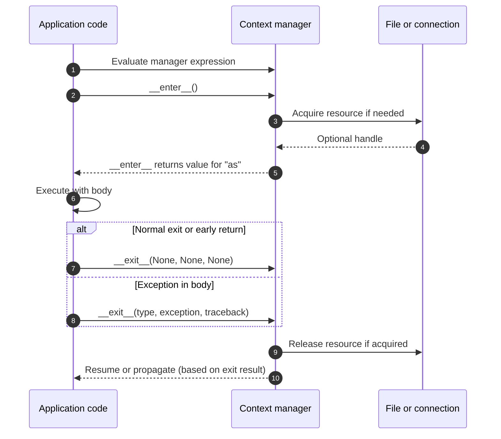
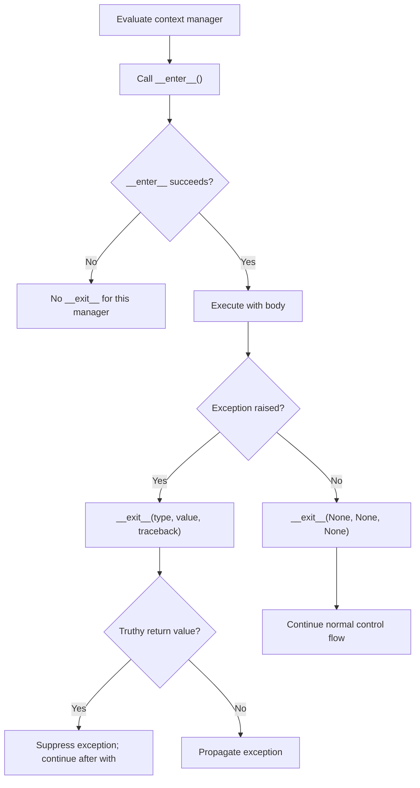
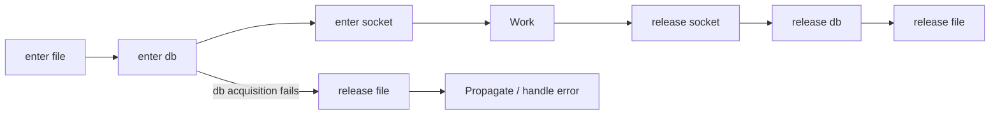

# Context Managers and Resource Safety

A self-contained, hands-on Python lesson for experienced C#/.NET engineers who are **new to Python's resource-management protocol**. Learn exactly what `with` guarantees, how `__enter__` and `__exit__` work, what happens when exceptions are raised, and how synchronous and asynchronous resources are safely released.

This lesson builds on [Threads, Processes, and Async I/O](../02.%20Threads,%20Processes%20and%20Async%20IO/README.md). It uses **only the standard library**, works without network access, and does not require a pre-existing input file.

## 1. Why context managers matter

Applications acquire files, locks, database connections, temporary directories, transactions, and network sessions. These resources need **predictable lifetimes**: relying on garbage collection for cleanup can exhaust handles or leave connections open under load.

A **context manager** defines what happens when a block begins and ends. Python's `with` statement calls the context manager's `__enter__()` method before running the block and its `__exit__()` method when leaving it, including on exceptions and early `return` or `break` — **provided `__enter__()` completed successfully**.

The closest C# analogy is `using` with `IDisposable`. Both help with deterministic cleanup, but Python's `__exit__()` also receives exception information and can **suppress** a pending exception by returning a truthy value. C# `Dispose()` has no equivalent return-value mechanism.

We start with the built-in file manager, then implement the protocol ourselves, and finally handle nested, dynamic, and asynchronous resources.

## 2. Requirements, files, and exact commands

- **Python 3.11+** (CI targets Python **3.11** and **3.14**).
- No `pip install`, packages, accounts, external services, or OS-specific paths.
- Run commands from the `03. Context Managers and Resource Safety/` directory.

```text
03. Context Managers and Resource Safety/
├── README.md
├── examples/
│   ├── file_resources.py
│   ├── simple_context_manager.py
│   ├── custom_manager.py
│   ├── contextlib_tools.py
│   ├── exit_stack.py
│   └── async_managers.py
└── tests/
    ├── test_context_managers.py
    └── test_readme_snippets.py
```

```bash
python --version

python examples/file_resources.py
python examples/simple_context_manager.py
python examples/custom_manager.py
python examples/contextlib_tools.py
python examples/exit_stack.py
python examples/async_managers.py

python -m compileall -q examples tests
python -m unittest discover -s tests -v
```

**Expected validation:** all **24 deterministic unit tests** pass. The samples need no network access or external packages. The tests also **execute all 12 standalone Python code blocks in this README**, using temporary input data when a snippet assumes `example.txt` exists. Sample data is written to temporary directories and removed at exit. Python may create local `__pycache__` files when compiling or running the examples.

On systems where the Python executable is called `python3` or `py -3`, substitute that launcher consistently. Snippets importing `examples.*` should be run **from this lesson directory**; Python 3 supports importing these modules through an implicit namespace package.

## 3. Reading a file with `with`

A file object is a built-in context manager. Reading a file requires no explicit call to `close()`:

```python
# This short example assumes example.txt exists in the working directory.
with open("example.txt", "r", encoding="utf-8") as file:
    data = file.read()

# The with block has ended: the file has been closed.
```

- `open("example.txt", "r", encoding="utf-8")` opens a text file. `"r"` selects **read mode**; `encoding=` is a **keyword argument** specifying UTF-8 decoding.
- `with ... as file:` calls the file object's `__enter__()`. The returned value is assigned to `file`; `as` is **not a type declaration or a new variable scope**.
- The indented suite is the managed block. `file.read()` returns the file's contents as a string.
- On leaving the block, Python calls `__exit__()` and closes the file even if `file.read()` raises. The name `file` remains bound after the block, but the underlying resource is **closed**.

**C# equivalent for the file lifetime:**

```csharp
using (var reader = new StreamReader("example.txt"))
{
    string data = reader.ReadToEnd();
} // Dispose() executes even if ReadToEnd() throws.
```

The short Python snippet needs an existing `example.txt`: otherwise it raises `FileNotFoundError`. The runnable [`examples/file_resources.py`](examples/file_resources.py) creates its own temporary input, demonstrates closing on success **and** on exceptions, and leaves no sample file behind:

```bash
python examples/file_resources.py
```

```text
Read: Python context managers
File closed: True
Closed after exception: True
Caught: simulated processing failure
```

### Creating test data without external files

The example uses `tempfile.TemporaryDirectory` to create and automatically remove a directory. Here is the central logic in a **standalone**, copyable form:

```python
from pathlib import Path
from tempfile import TemporaryDirectory

with TemporaryDirectory() as directory:
    path = Path(directory) / "example.txt"

    with open(path, "w", encoding="utf-8") as writer:
        writer.write("Hello from Python")

    with open(path, "r", encoding="utf-8") as reader:
        contents = reader.read()
        print("Open inside with:", not reader.closed)

    print("Closed after with:", reader.closed)

print(contents)
```

**Expected output:**

```text
Open inside with: True
Closed after with: True
Hello from Python
```

Here `"w"` means **write mode** (overwriting existing content), `Path(directory) / "example.txt"` joins path components using the `Path` `/` operator (not division), and `TemporaryDirectory.__enter__()` returns a **directory path string**, not the manager object. Unlike a custom manager that allocates inside `__enter__()`, the built-in `open()` function opens the file **before** the file object's `__enter__()` is invoked. When its outer `with` exits, that directory is removed.

### How `with` relates to `try/finally`

For **closing a file**, the relevant cleanup guarantee can also be written manually:

```python
file = open("example.txt", "r", encoding="utf-8")
try:
    data = file.read()
finally:
    file.close()  # Runs even if read() raises.
```

This is an accurate illustration of the **file cleanup behavior**, not a full implementation of Python's `with` protocol. A general context manager calls `__exit__(exc_type, exc_value, traceback)` with real exception information and can choose whether to suppress the exception. We explore that protocol next.

## 4. Implement `__enter__` and `__exit__`

The file object above follows the same enter/exit protocol. [`examples/simple_context_manager.py`](examples/simple_context_manager.py) makes the call order visible using a small custom class:

```python
class MyContextManager:
    def __enter__(self):
        print("Entering the context")
        return self

    def __exit__(self, exc_type, exc_value, traceback):
        print("Exiting the context")

with MyContextManager() as cm:
    print("Inside the context")
```

**Expected output:**

```text
Entering the context
Inside the context
Exiting the context
```

### The context-manager protocol

- `class MyContextManager:` creates a class. Python recognizes it as a context manager because it defines the required protocol methods; it does **not** have to inherit from an interface.
- `def __enter__(self):` defines the method called when entering `with`. `self` means the current instance, broadly like C# `this`. The two leading and trailing underscores mark a **special method**.
- `return self` sends the same instance back to the caller. Therefore, in `with MyContextManager() as cm:`, the variable `cm` references the object returned by `__enter__()`. **The `as` target receives the value returned by `__enter__()`, not necessarily the manager itself.**
- `def __exit__(self, exc_type, exc_value, traceback):` defines the method Python invokes when leaving the block. On normal exit, the three exception arguments are `None`. If the body raises, Python passes the exception class, exception instance, and traceback.
- The `__exit__` method has **no explicit `return`**, so it implicitly returns `None`. That means **it does not suppress exceptions**; the original exception still propagates after cleanup.
- `with MyContextManager() as cm:` constructs a manager and calls `__enter__`. The indented `print` is the managed body; after that body completes, Python calls `__exit__`.

This class demonstrates the call order; printing messages does **not** acquire or release a resource. A real manager must implement the appropriate acquisition and cleanup.

**C# analogy:** the lifecycle resembles entering a C# `using` scope, executing the body, and running `Dispose()` when leaving it. Unlike `using`, Python passes exception information to `__exit__`, and a *truthy* return value could suppress an exception.

### Exception arguments and type hints

The more complete [`examples/custom_manager.py`](examples/custom_manager.py) adds an event log, typed method signatures, nested managers, and exception-handling behavior. This file defines its **own** `MyContextManager` class with an extended constructor; it is **not** the minimal class shown above.

Its `__exit__()` signature uses `exc_type: type[BaseException] | None`, `exc_value: BaseException | None`, `exc_traceback: TracebackType | None`, and `-> bool`:

- `type[BaseException] | None` means **an exception class or `None`**; `TracebackType | None` means traceback data or `None`.
- `| None` is a **union type hint**, not a bitwise operation here. Return annotations such as `-> str` or `-> bool` are **not enforced automatically at runtime**.
- Normal exit provides three `None` values; exceptional exit provides information about the active exception. A falsy return allows an exception to propagate, while a truthy return suppresses it (Section 5).

### The exact lifecycle



**Guarantee and boundary:** once `__enter__` returns successfully, `__exit__` is invoked when leaving the managed block, including normal and exceptional exits. If `__enter__` itself raises, **that manager's `__exit__` is not called**. A manager that partially acquires resources inside `__enter__` must clean up its own partially acquired state before raising, or use a robust acquisition pattern.

## 5. Exceptions: propagate or suppress?

This is the biggest difference from ordinary C# `using`. In [`custom_manager.py`](examples/custom_manager.py), `MyContextManager` optionally suppresses **only** `ValueError` when configured:

```python
from examples.custom_manager import MyContextManager

events: list[str] = []

try:
    with MyContextManager("guard", events, suppress_type=ValueError):
        raise ValueError("recoverable")
except ValueError:
    events.append("caught")

print(events)
```

**Expected output:** the `except` branch is **not** executed:

```text
['enter:guard', 'exit:guard:ValueError']
```

The manager's `__exit__` returns `True` because the exception type matches. Python suppresses the pending exception and continues **after** the `with` statement. It does **not** resume the remaining statements *inside* the block.

Change `suppress_type=ValueError` to `suppress_type=None`, and the exception propagates to the surrounding `except`. An unrelated `RuntimeError` also propagates even when `ValueError` is allowed.

| Exit scenario | `__exit__` receives | Result of `__exit__` |
|---|---|---|
| Normal completion | `(None, None, None)` | Ignored; continue |
| `return` or `break` inside the body | `(None, None, None)` | Ignored; perform the exit |
| Body raises, returns `False` / `None` | Exception information | **Propagate** the exception |
| Body raises, returns `True` | Exception information | **Suppress** the exception |
| `__enter__` raises | `__exit__` **not called** for that manager | Exception propagates unless handled elsewhere |
| `__exit__` itself raises | Original exception may become its `__context__` | New cleanup exception propagates |



**Production warning:** accidentally returning `True` from a logging or metrics manager can hide defects and give callers a false success signal. Prefer `False` unless suppression is intentional, narrowly scoped, and documented.

## 6. Nesting and reverse-order release (LIFO)

```python
from examples.custom_manager import MyContextManager

events: list[str] = []

with MyContextManager("outer", events) as outer, MyContextManager(
    "inner", events
) as inner:
    events.append(f"body:{outer},{inner}")

print(events)
```

**Expected output:**

```text
['enter:outer', 'enter:inner', 'body:resource:outer,resource:inner', 'exit:inner:none', 'exit:outer:none']
```

- Managers are **entered left to right** and **exited right to left** (Last In, First Out).
- `with A() as a, B() as b:` is equivalent to nesting `with A() as a:` around `with B() as b:`.
- An exception in an inner body invokes the inner manager's exit before the outer manager's exit.
- If an inner manager suppresses an exception, the outer manager normally sees **no exception**; suppression changes what the outer `__exit__` receives.
- An early `return` still unwinds both managers; `custom_manager.run_early_return()` demonstrates this.

This is the same fundamental resource-unwinding principle you apply with nested C# `using` blocks or scoped disposables.

## 7. `contextlib.contextmanager`: setup and cleanup without a class

When a tiny resource scope is clearer as a function, `contextlib.contextmanager` converts a generator function into a context manager. See [`examples/contextlib_tools.py`](examples/contextlib_tools.py):

```python
from collections.abc import Iterator
from contextlib import contextmanager

@contextmanager
def traced_resource(name: str) -> Iterator[str]:
    print("acquire:", name)
    try:
        yield name
    finally:
        print("release:", name)

with traced_resource("cache") as resource:
    print("use:", resource)
```

**Expected output:**

```text
acquire: cache
use: cache
release: cache
```

### Python syntax notes

- `@contextmanager` is a **decorator**, applied to the following function definition. It wraps the generator to provide `__enter__` / `__exit__` behavior. Lesson 04 studies decorators in depth.
- `yield name` is not the same as `return name`. It **pauses the generator** and exposes that value as the target of `as resource`. After the block, the generator resumes and runs the cleanup.
- `Iterator[str]` documents the type yielded by the generator. It is a type hint, not runtime enforcement.
- The generator-based manager must **yield exactly once**. If it does not yield, or yields again during exit, `contextlib` raises a `RuntimeError`.
- When the body raises, `contextlib` re-injects that exception at the suspended `yield`. A `try/finally` ensures release, then lets the exception continue.
- **Do not accidentally swallow exceptions:** if you catch an exception inside the generator and simply finish without raising it again, the corresponding context manager can **suppress it**. Log and re-raise unless suppression is deliberate.

### `suppress` and `nullcontext`

`contextlib` also includes narrowly scoped tools:

```python
from contextlib import nullcontext, suppress

# A targeted exception is considered an acceptable missing optional resource.
with suppress(FileNotFoundError):
    raise FileNotFoundError("optional cache missing")

# No-op context manager: supports a uniform 'with' path.
with nullcontext("already available") as resource:
    print(resource)
```

**Expected output:** `already available`. The missing-file exception is suppressed.

**Do not** use `suppress(Exception)` as a blanket replacement for proper error handling. For optional resources, `nullcontext` is also useful when a caller **already owns** a handle you must not close.

## 8. `ExitStack`: acquire resources dynamically and safely

A fixed number of resources can use nested `with` statements. But an API might need to acquire **N** resources only known at runtime. [`examples/exit_stack.py`](examples/exit_stack.py) uses `contextlib.ExitStack`:

```python
from contextlib import ExitStack
from examples.exit_stack import acquire  # The manager defined in this lesson.

events: list[str] = []

with ExitStack() as stack:
    resources = []
    for name in ("file", "db", "socket"):
        resource = stack.enter_context(acquire(name, events))
        resources.append(resource)
    events.append("work")

print(events)
# ['acquire:file', 'acquire:db', 'acquire:socket', 'work',
#  'release:socket', 'release:db', 'release:file']
```

`acquire` is defined in `examples/exit_stack.py`; it is **not** a Python built-in. `events` records the acquisition and cleanup order. `stack.enter_context(manager)` calls its `__enter__()` and registers its `__exit__()` to run when the stack is closed.

If acquisition of `db` fails, `ExitStack` releases the previously acquired `file` even though the code never reaches the work step. The manager that **failed to enter** is responsible for cleaning up its own partial acquisition. The runnable demo prints:

```text
Partial acquisition: acquire:file | acquire:db | release:file | error:cannot acquire db
Acquired before cleanup: ['file']
```



`ExitStack.enter_context(manager)` enters a context manager and registers its exit method. `ExitStack.callback(...)` can register additional cleanup callbacks, but **callbacks registered by `callback` do not receive exception information and cannot suppress exceptions**. Do not confuse them with `push` / `enter_context`.

**C# analogy:** a stack of disposable resources unwound in reverse order, with safe cleanup when a later acquisition fails. Python provides the abstraction directly in the standard library.

## 9. `async with`: asynchronous acquisition and cleanup

A regular `with` uses synchronous `__enter__` and `__exit__` methods. When acquiring or releasing a resource itself involves `await` (for example, gracefully closing a network connection), implement the **asynchronous protocol** instead.

See [`examples/async_managers.py`](examples/async_managers.py):

```python
import asyncio
from types import TracebackType

class AsyncConnection:
    async def __aenter__(self) -> str:
        await asyncio.sleep(0)  # Stand-in for asynchronous connection setup.
        return "db"

    async def __aexit__(
        self,
        exc_type: type[BaseException] | None,
        exc_value: BaseException | None,
        exc_traceback: TracebackType | None,
    ) -> bool:
        await asyncio.sleep(0)  # Stand-in for async connection teardown.
        return False

async def main() -> None:
    async with AsyncConnection() as connection:
        print("use:", connection)

asyncio.run(main())
```

**Expected output:** `use: db`.

- `async def` defines a coroutine function; calling it creates a coroutine object. It runs when awaited or scheduled.
- `async with` awaits `__aenter__()` before the body and awaits `__aexit__()` as it leaves. It can appear only inside an asynchronous function.
- `async with` is **not** interchangeable with `with`: a plain synchronous manager does not automatically implement the async protocol, and vice versa.
- This is similar to C# `await using` and `IAsyncDisposable`, but Python's `__aexit__` also has the **exception-suppression return value**.

### `@asynccontextmanager` and `AsyncExitStack`

For a short async resource wrapper, use `@asynccontextmanager` and `async def` containing a single `yield`:

```python
import asyncio
from collections.abc import AsyncIterator
from contextlib import asynccontextmanager

@asynccontextmanager
async def session() -> AsyncIterator[str]:
    print("open")
    try:
        await asyncio.sleep(0)
        yield "session-handle"
    finally:
        await asyncio.sleep(0)
        print("close")

async def main() -> None:
    async with session() as resource:
        print("use:", resource)

asyncio.run(main())
```

**Expected output:**

```text
open
use: session-handle
close
```

`AsyncExitStack` plays the same role as `ExitStack` for a dynamic collection of async resources. Use `await stack.enter_async_context(manager)` to register asynchronous cleanup:

```python
import asyncio
from contextlib import AsyncExitStack
from examples.async_managers import async_resource

async def main() -> None:
    events: list[str] = []
    async with AsyncExitStack() as stack:
        for name in ("db", "cache"):
            await stack.enter_async_context(async_resource(name, events))
        events.append("work")
    print(events)

asyncio.run(main())
```

**Expected output:** `['open:db', 'open:cache', 'work', 'close:cache', 'close:db']`. The async resources are released in reverse order.

### Cancellation and failure paths

An `asyncio.Task` can be cancelled while holding a resource. Its exception unwinds the `async with` block, so Python attempts the awaited `__aexit__` cleanup. The runnable example tests this without timing assumptions. Its cancellation events are `open:stream → close:stream → caught:CancelledError`, showing that resource cleanup was awaited before the caller observed cancellation.

**Nuance:** `asyncio.CancelledError` inherits from `BaseException`, so an ordinary `except Exception:` does not catch it. A `finally` block *does* run while unwinding, but asynchronous cleanup can itself be interrupted by additional cancellation, timeouts, or process termination. Do not interpret `async with` as an absolute guarantee against process crashes.

## 10. C#/.NET comparison: capabilities and limits

| Question | C#/.NET | Python |
|---|---|---|
| How do I deterministically dispose a resource? | `using` / `IDisposable` | `with` / `__exit__` |
| How do I perform awaited disposal? | `await using` / `IAsyncDisposable` | `async with` / `__aexit__` |
| Can disposal suppress the body exception by return value? | **No** `Dispose()` return value | **Yes**, truthy `__exit__` / `__aexit__` |
| Is the value of `as` always the context-manager object? | Not applicable in the same form | **No**, it is the result of `__enter__` |
| Is a common interface inheritance mandatory? | `IDisposable` is an explicit interface contract | No inheritance required; protocol methods are sufficient |
| Can I manage dynamically acquired resources? | Custom `try/finally` / disposal collection | `ExitStack` / `AsyncExitStack` |
| Does the construct replace transactional rollback? | No; transaction behavior must be implemented | No; `with` alone is not a transaction |

**Engineering example:** a unit-of-work context manager may commit on successful exit and roll back on exceptions, but those semantics are application/library policy. Python does not automatically make every `with` block an atomic database transaction. Any real implementation must also consider a **failed commit, failed rollback, idempotent cleanup and connection ownership**.

A locking example from Lesson 02 uses `with threading.Lock():`, but be careful in asynchronous code: acquiring a contended `threading.Lock` synchronously on the event-loop thread can block the loop. Prefer `asyncio.Lock` with `async with` when synchronizing coroutines in the same event loop.

## 11. Hands-on exercises

### Exercise A — Build a resource-aware logger

Create a new `@contextmanager` named `log_operation(name, events)` that appends `start:name` at entry and `end:name` on exit. If the body raises `ValueError`, the exception must still reach the caller.

**Validation:** normal run records start, work, end; exceptional run records start, end, then the outer exception handler's event. Add a test that verifies the cleanup happens before the outer handler.

**Common failure:** catching `ValueError` *inside* the generator without re-raising silently suppresses it.

### Exercise B — Dynamic multi-resource startup

Extend `exit_stack.run_batch` so it can process a user-supplied list of resource names. Make acquisition of the third resource fail intentionally, and verify that exactly the **previously entered** resources are released, in reverse order.

**Validation:** no leaked resource and no `work` event after failure. Test both a middle failure and a failure on the first resource.

**Common failure:** appending resources to an ordinary list without protecting subsequent acquisitions with an `ExitStack`.

### Exercise C — Async session with cancellation

Extend `async_managers.py` with an operation that enters **two** async resources through `AsyncExitStack`, then waits on `asyncio.Event()`. Cancel its owning Task after both resources have entered.

**Validation:** both resources close in **reverse acquisition order** before the caller handles `asyncio.CancelledError`. Use `unittest.IsolatedAsyncioTestCase` and an `Event` to synchronize the cancellation, not sleeps or timing assertions.

**Common failure:** forgetting to await asynchronous cleanup, or cancelling before the resources have actually entered.

## 12. Troubleshooting and production pitfalls

| Symptom | Likely cause | What to inspect |
|---|---|---|
| `FileNotFoundError` with a copied `open("example.txt")` sample | File does not exist in current directory | Run `examples/file_resources.py`, which creates its own temporary input |
| `AttributeError: __enter__` or `TypeError` about a context manager | An object is not a synchronous context manager | Check `__enter__` and `__exit__` or use the correct `async with` |
| `TypeError` around `async with` | Used a synchronous manager with async syntax | Use an async manager implementing `__aenter__` / `__aexit__` |
| `RuntimeError: generator didn't yield` | `@contextmanager` generator returned before `yield` | Ensure every successful entry path yields exactly once |
| `RuntimeError: generator didn't stop` | Generator tried to yield more than once | Yield once and perform cleanup after that yield |
| Unexpectedly missing error | `__exit__` returned truthy, or a generator swallowed the exception | Return `False`, or re-raise inside the generator unless suppression is intentional |
| Cleanup was skipped after acquisition error | The failing manager's `__enter__` raised before completing | Clean up partial state inside acquisition; outer/`ExitStack` contexts only release successfully entered resources |
| Unreleased borrowed resource | Ownership rules unclear | Determine who acquired/owns the resource; consider `nullcontext` for borrowed handles |
| Async application becomes unresponsive | Synchronous blocking work inside event loop or cleanup | Prefer async libraries; use `asyncio.to_thread` for unavoidable blocking I/O |
| Tests fail on import | Ran from the wrong directory or altered `sys.path` | Use the exact commands above from the lesson directory |

**Security and correctness:** resource cleanup is not the same as successfully committing a transaction or safely handling untrusted data. In production, ensure closure errors are logged, transactional failure semantics are explicit, and exception suppression does not conceal security-critical failures.

## 13. Official Python references

- [Python Language Reference — The `with` statement](https://docs.python.org/3.14/reference/compound_stmts.html#the-with-statement)
- [Python Language Reference — The `async with` statement](https://docs.python.org/3.14/reference/compound_stmts.html#the-async-with-statement)
- [Python standard library — `contextlib`](https://docs.python.org/3.14/library/contextlib.html)
- [Python standard library — `tempfile`](https://docs.python.org/3.14/library/tempfile.html)
- [Python standard library — `asyncio` tasks and cancellation](https://docs.python.org/3.14/library/asyncio-task.html)

Each runnable example and its relevant edge cases are covered by standard-library tests. Run the examples and tests using the commands in Section 2.
