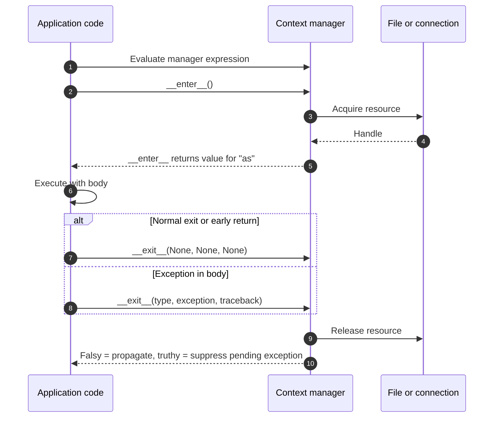
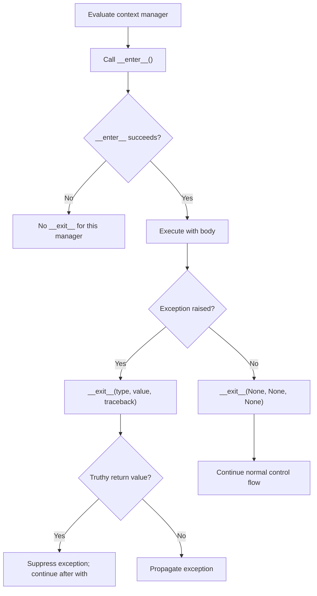
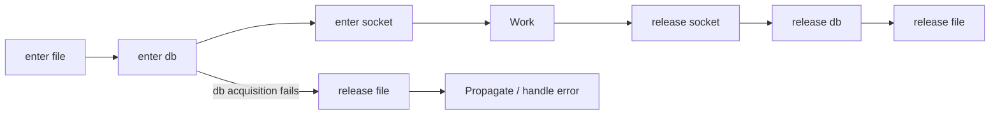

# Context Managers and Resource Safety

A self-contained, hands-on Python lesson for experienced C#/.NET engineers who are **new to Python's resource-management protocol**. Learn exactly what `with` guarantees, how `__enter__` and `__exit__` work, what happens when exceptions are raised, and how synchronous and asynchronous resources are safely released.

This lesson builds on [Threads, Processes, and Async I/O](../02.%20Threads,%20Processes%20and%20Async%20IO/README.md). It uses **only the standard library**, works without network access, and does not require a pre-existing input file.

## 1. Why context managers matter

Servers, APIs, and background jobs acquire resources that must have predictable lifetimes: files, locks, database connections, temporary directories, transactions, and network sessions. Relying on garbage collection to clean them up creates unpredictable behavior and resource exhaustion under load.

A **context manager** is an object implementing the Python protocol that surrounds a block with **enter** and **exit** behavior. The `with` statement arranges for the exit behavior to run on normal completion, exceptions, and early exits such as `return` or `break`, **provided the enter operation completed successfully**.

```python
with open("example.txt", "r", encoding="utf-8") as file:
    contents = file.read()
# The file is closed here, whether read() succeeded or raised an exception.
```

This is conceptually similar to C# `using` with `IDisposable`:

```csharp
using var reader = new StreamReader("example.txt");
string contents = reader.ReadToEnd();
// Disposal happens when the containing scope exits.
```

**Important difference:** Python context managers also receive exception information and can **deliberately suppress an exception** by returning a truthy value from `__exit__`. C# `using` / `Dispose()` has no equivalent return-value-based suppression mechanism.

### One-minute decision table

| Resource situation | Python API | C# analogy |
|---|---|---|
| Use an ordinary file or lock for a fixed block | `with resource as value:` | `using` / `lock` (depending on resource) |
| Implement a custom synchronous resource | `__enter__` / `__exit__` | `IDisposable` + acquisition method |
| Wrap setup/cleanup without a class | `@contextmanager` | `try/finally` around a helper |
| Number of resources known only at runtime | `contextlib.ExitStack` | A LIFO collection of disposables |
| Resource setup/cleanup requires `await` | `async with` / `__aenter__` / `__aexit__` | `await using` with `IAsyncDisposable` |
| Acquire dynamic async resources | `contextlib.AsyncExitStack` | Dynamically managed async disposables |
| Ignore only an expected exception | `contextlib.suppress(ExpectedError)` | Targeted `try/catch` |

## 2. Requirements, files, and exact commands

- **Python 3.11+** (CI targets Python **3.11** and **3.14**).
- No `pip install`, packages, accounts, external services, or OS-specific paths.
- Run commands from the `03. Context Managers and Resource Safety/` directory.

```text
03. Context Managers and Resource Safety/
├── README.md
├── examples/
│   ├── file_resources.py
│   ├── simple_context_manager.py
│   ├── custom_manager.py
│   ├── contextlib_tools.py
│   ├── exit_stack.py
│   └── async_managers.py
└── tests/
    └── test_context_managers.py
```

```bash
python --version

python examples/file_resources.py
python examples/simple_context_manager.py
python examples/custom_manager.py
python examples/contextlib_tools.py
python examples/exit_stack.py
python examples/async_managers.py

python -m compileall -q examples tests
python -m unittest discover -s tests -v
```

**Expected validation:** all **23 deterministic unit tests** pass. No elapsed-time assertions, network calls, additional dependencies, or files left in the repository. The file example uses `tempfile.TemporaryDirectory`, which deletes its own temporary data.

On systems where the Python executable is called `python3` or `py -3`, substitute that launcher consistently.

## 3. `with` and `as`: what actually happens?

Start with [`examples/file_resources.py`](examples/file_resources.py):

```python
from pathlib import Path
from tempfile import TemporaryDirectory

with TemporaryDirectory() as directory:
    path = Path(directory) / "example.txt"

    with path.open("w", encoding="utf-8") as writer:
        writer.write("Hello from Python")

    with path.open("r", encoding="utf-8") as reader:
        contents = reader.read()
        print("Open inside with:", not reader.closed)

    print("Closed after with:", reader.closed)

print(contents)
```

**Expected output:**

```text
Open inside with: True
Closed after with: True
Hello from Python
```

### Python syntax notes

- `with EXPRESSION as TARGET:` evaluates `EXPRESSION` to obtain a **context manager**. Python calls its `__enter__()`, then assigns the **returned value** to `TARGET`. The value need not be the manager object itself.
- The indented statements form the managed **suite** (block). When it exits, Python invokes `__exit__()`.
- `as writer` is **not** a type declaration (compare C# `var writer = ...`), and it does not create a separate lexical scope. The name `reader` is accessible after `with`, although the **file is closed**.
- `Path(directory) / "example.txt"` uses the `pathlib.Path` `/` operator to join filesystem path segments. It is **not arithmetic division**.
- `encoding="utf-8"` is a **keyword argument**. Explicit encoding avoids machine-default differences.
- The two file modes are `"w"` (write, replacing prior contents) and `"r"` (read).
- `with TemporaryDirectory() as directory` manages the directory's lifecycle. The value `directory` is a **path string**, not the context-manager object.

### How `with` relates to `try/finally`

For a simple, successful acquisition, the *conceptual* lifecycle is:

```python
manager = open("example.txt", "r", encoding="utf-8")
file = manager.__enter__()

try:
    contents = file.read()
finally:
    manager.__exit__(None, None, None)
```

This **simplified sketch is not a fully equivalent implementation of `with`**: it omits exception details, suppression, and the interpreter's special-method lookup rules. In particular, on an exception, Python passes the exception information to `__exit__` (not three `None` values). Prefer `with` rather than reimplementing the protocol manually.

## 4. Implement `__enter__` and `__exit__`

Start with the deliberately minimal, runnable [`examples/simple_context_manager.py`](examples/simple_context_manager.py). There are no type annotations, event logs, or exception-suppression decisions yet. First learn the three steps: **enter the context, execute the body, exit the context**.

```python
class MyContextManager:
    def __enter__(self):
        print("Entering the context")
        return self

    def __exit__(self, exc_type, exc_value, traceback):
        print("Exiting the context")

with MyContextManager() as cm:
    print("Inside the context")
```

**Expected output:**

```text
Entering the context
Inside the context
Exiting the context
```

### Syntax note — what does each line do?

- `class MyContextManager:` creates a class. Python recognizes it as a context manager because it defines the required protocol methods; it does **not** have to inherit from an interface.
- `def __enter__(self):` defines the method called when entering `with`. `self` means the current instance, broadly like C# `this`. The two leading and trailing underscores mark a **special method**.
- `return self` sends the same instance back to the caller. Therefore, in `with MyContextManager() as cm:`, the variable `cm` references the object returned by `__enter__()`. **`as cm` is not a new thread, a special resource allocation, or a new variable scope.**
- `def __exit__(self, exc_type, exc_value, traceback):` defines the method Python invokes when leaving the block. On normal exit, the three exception arguments are `None`. If the body raises, Python passes the exception class, exception instance, and traceback.
- The `__exit__` method has **no explicit `return`**, so it implicitly returns `None`. That means **it does not suppress exceptions**; the original exception still propagates after cleanup.
- `with MyContextManager() as cm:` constructs a manager and calls `__enter__`. The indented `print` is the managed body; after that body completes, Python calls `__exit__`.

**Important:** this is intentionally a **lifecycle demonstration**. It prints messages but does not actually open or close a resource. For real resource cleanup, implement meaningful acquisition in `__enter__` and release in `__exit__`.

**C# analogy:** the lifecycle resembles entering a C# `using` scope, executing the body, and running `Dispose()` when leaving it. Unlike `using`, Python passes exception information to `__exit__`, and a *truthy* return value could suppress an exception.

### Moving from the minimal example to production code

[`examples/custom_manager.py`](examples/custom_manager.py) expands the same `MyContextManager` idea with an event log, return type hints, nested contexts, failure paths, and **selective exception suppression**. The signature is annotated as `__exit__(self, exc_type: type[BaseException] | None, exc_value: BaseException | None, exc_traceback: TracebackType | None) -> bool`.

- `-> str` / `-> bool` are **return type hints**, not runtime enforcement; the simple example omits hints so the protocol is easier to see.
- `type[BaseException] | None` means an exception class or `None`, and `TracebackType | None` means traceback data or `None`.
- On normal exit, the exception arguments are all `None`, and Python ignores the return value of `__exit__`.
- Returning `False` or `None` allows pending exceptions to propagate; returning `True` deliberately suppresses one.

### The exact lifecycle



**Guarantee and boundary:** once `__enter__` returns successfully, `__exit__` is invoked when leaving the managed block, including normal and exceptional exits. If `__enter__` itself raises, **that manager's `__exit__` is not called**. A manager that partially acquires resources inside `__enter__` must clean up its own partially acquired state before raising, or use a robust acquisition pattern.

## 5. Exceptions: propagate or suppress?

This is the biggest difference from ordinary C# `using`. In [`custom_manager.py`](examples/custom_manager.py), `MyContextManager` optionally suppresses **only** `ValueError` when configured:

```python
events: list[str] = []

try:
    with MyContextManager("guard", events, suppress_type=ValueError):
        raise ValueError("recoverable")
except ValueError:
    events.append("caught")

print(events)
```

**Expected output:** the `except` branch is **not** executed:

```text
['enter:guard', 'exit:guard:ValueError']
```

The manager's `__exit__` returns `True` because the exception type matches. Python suppresses the pending exception and continues **after** the `with` statement. It does **not** resume the remaining statements *inside* the block.

Change `suppress_type=ValueError` to `suppress_type=None`, and the exception propagates to the surrounding `except`. An unrelated `RuntimeError` also propagates even when `ValueError` is allowed.

| Exit scenario | `__exit__` receives | Result of `__exit__` |
|---|---|---|
| Normal completion | `(None, None, None)` | Ignored; continue |
| `return` or `break` inside the body | `(None, None, None)` | Ignored; perform the exit |
| Body raises, returns `False` / `None` | Exception information | **Propagate** the exception |
| Body raises, returns `True` | Exception information | **Suppress** the exception |
| `__enter__` raises | `__exit__` **not called** for that manager | Exception propagates unless handled elsewhere |
| `__exit__` itself raises | Original exception may become its `__context__` | New cleanup exception propagates |



**Production warning:** accidentally returning `True` from a logging or metrics manager can hide defects and give callers a false success signal. Prefer `False` unless suppression is intentional, narrowly scoped, and documented.

## 6. Nesting and reverse-order release (LIFO)

```python
events: list[str] = []

with MyContextManager("outer", events) as outer, MyContextManager(
    "inner", events
) as inner:
    events.append(f"body:{outer},{inner}")

print(events)
```

**Expected output:**

```text
['enter:outer', 'enter:inner', 'body:resource:outer,resource:inner', 'exit:inner:none', 'exit:outer:none']
```

- Managers are **entered left to right** and **exited right to left** (Last In, First Out).
- `with A() as a, B() as b:` is equivalent to nesting `with A() as a:` around `with B() as b:`.
- An exception in an inner body invokes the inner manager's exit before the outer manager's exit.
- If an inner manager suppresses an exception, the outer manager normally sees **no exception**; suppression changes what the outer `__exit__` receives.
- An early `return` still unwinds both managers; `custom_manager.run_early_return()` demonstrates this.

This is the same fundamental resource-unwinding principle you apply with nested C# `using` blocks or scoped disposables.

## 7. `contextlib.contextmanager`: setup and cleanup without a class

When a tiny resource scope is clearer as a function, `contextlib.contextmanager` converts a generator function into a context manager. See [`examples/contextlib_tools.py`](examples/contextlib_tools.py):

```python
from collections.abc import Iterator
from contextlib import contextmanager

@contextmanager
def traced_resource(name: str) -> Iterator[str]:
    print("acquire:", name)
    try:
        yield name
    finally:
        print("release:", name)

with traced_resource("cache") as resource:
    print("use:", resource)
```

**Expected output:**

```text
acquire: cache
use: cache
release: cache
```

### Python syntax notes

- `@contextmanager` is a **decorator**, applied to the following function definition. It wraps the generator to provide `__enter__` / `__exit__` behavior. Lesson 04 studies decorators in depth.
- `yield name` is not the same as `return name`. It **pauses the generator** and exposes that value as the target of `as resource`. After the block, the generator resumes and runs the cleanup.
- `Iterator[str]` documents the type yielded by the generator. It is a type hint, not runtime enforcement.
- The generator-based manager must **yield exactly once**. If it does not yield, or yields again during exit, `contextlib` raises a `RuntimeError`.
- When the body raises, `contextlib` re-injects that exception at the suspended `yield`. A `try/finally` ensures release, then lets the exception continue.
- **Do not accidentally swallow exceptions:** if you catch an exception inside the generator and simply finish without raising it again, the corresponding context manager can **suppress it**. Log and re-raise unless suppression is deliberate.

### `suppress` and `nullcontext`

`contextlib` also includes narrowly scoped tools:

```python
from contextlib import nullcontext, suppress

# A targeted exception is considered an acceptable missing optional resource.
with suppress(FileNotFoundError):
    raise FileNotFoundError("optional cache missing")

# No-op context manager: supports a uniform 'with' path.
with nullcontext("already available") as resource:
    print(resource)
```

**Expected output:** `already available`. The missing-file exception is suppressed.

**Do not** use `suppress(Exception)` as a blanket replacement for proper error handling. For optional resources, `nullcontext` is also useful when a caller **already owns** a handle you must not close.

## 8. `ExitStack`: acquire resources dynamically and safely

A fixed number of resources can use nested `with` statements. But an API might need to acquire **N** resources only known at runtime. [`examples/exit_stack.py`](examples/exit_stack.py) uses `contextlib.ExitStack`:

```python
from contextlib import ExitStack

with ExitStack() as stack:
    resources = []
    for name in ("file", "db", "socket"):
        resource = stack.enter_context(acquire(name, events))
        resources.append(resource)
    # Work with the successfully acquired resources.
# All entered resources exit in reverse order.
```

Here `acquire` is the generator-based context manager defined in the runnable example (it is **not** a built-in Python function). It logs each acquisition and release.

If acquisition of `db` fails, `ExitStack` releases the previously acquired `file` even though the code never reaches the work step. The resource that **failed to enter** is responsible for cleaning up any of its own partial acquisition.



`ExitStack.enter_context(manager)` enters a context manager and registers its exit method. `ExitStack.callback(...)` can register additional cleanup callbacks, but **callbacks registered by `callback` do not receive exception information and cannot suppress exceptions**. Do not confuse them with `push` / `enter_context`.

**C# analogy:** a stack of disposable resources unwound in reverse order, with safe cleanup when a later acquisition fails. Python provides the abstraction directly in the standard library.

## 9. `async with`: asynchronous acquisition and cleanup

A regular `with` uses synchronous `__enter__` and `__exit__` methods. When acquiring or releasing a resource itself involves `await` (for example, gracefully closing a network connection), implement the **asynchronous protocol** instead.

See [`examples/async_managers.py`](examples/async_managers.py):

```python
import asyncio
from types import TracebackType

class AsyncConnection:
    async def __aenter__(self) -> str:
        await asyncio.sleep(0)  # Stand-in for asynchronous connection setup.
        return "db"

    async def __aexit__(
        self,
        exc_type: type[BaseException] | None,
        exc_value: BaseException | None,
        exc_traceback: TracebackType | None,
    ) -> bool:
        await asyncio.sleep(0)  # Stand-in for async connection teardown.
        return False

async def main() -> None:
    async with AsyncConnection() as connection:
        print("use:", connection)

asyncio.run(main())
```

**Expected output:** `use: db`.

- `async def` defines a coroutine function; calling it creates a coroutine object. It runs when awaited or scheduled.
- `async with` awaits `__aenter__()` before the body and awaits `__aexit__()` as it leaves. It can appear only inside an asynchronous function.
- `async with` is **not** interchangeable with `with`: a plain synchronous manager does not automatically implement the async protocol, and vice versa.
- This is similar to C# `await using` and `IAsyncDisposable`, but Python's `__aexit__` also has the **exception-suppression return value**.

### `@asynccontextmanager` and `AsyncExitStack`

For a short async resource wrapper, use `@asynccontextmanager` and `async def` containing a single `yield`:

```python
import asyncio
from collections.abc import AsyncIterator
from contextlib import asynccontextmanager

@asynccontextmanager
async def session() -> AsyncIterator[str]:
    print("open")
    try:
        await asyncio.sleep(0)
        yield "session-handle"
    finally:
        await asyncio.sleep(0)
        print("close")

async def main() -> None:
    async with session() as resource:
        print("use:", resource)

asyncio.run(main())
```

**Expected output:**

```text
open
use: session-handle
close
```

`AsyncExitStack` plays the same role as `ExitStack` for a dynamic collection of async resources. Use `await stack.enter_async_context(manager)` to register asynchronous cleanup.

### Cancellation and failure paths

An `asyncio.Task` can be cancelled while holding a resource. Its exception unwinds the `async with` block, so Python attempts the awaited `__aexit__` cleanup. The runnable example tests this by cancelling a task and checking that its resource close event occurs before the caller catches `asyncio.CancelledError`.

**Nuance:** `asyncio.CancelledError` inherits from `BaseException`, so an ordinary `except Exception:` does not catch it. A `finally` block *does* run while unwinding, but asynchronous cleanup can itself be interrupted by additional cancellation, timeouts, or process termination. Do not interpret `async with` as an absolute guarantee against process crashes.

## 10. C#/.NET comparison: capabilities and limits

| Question | C#/.NET | Python |
|---|---|---|
| How do I deterministically dispose a resource? | `using` / `IDisposable` | `with` / `__exit__` |
| How do I perform awaited disposal? | `await using` / `IAsyncDisposable` | `async with` / `__aexit__` |
| Can disposal suppress the body exception by return value? | **No** `Dispose()` return value | **Yes**, truthy `__exit__` / `__aexit__` |
| Is the value of `as` always the context-manager object? | Not applicable in the same form | **No**, it is the result of `__enter__` |
| Is a common interface inheritance mandatory? | `IDisposable` is an explicit interface contract | No inheritance required; protocol methods are sufficient |
| Can I manage dynamically acquired resources? | Custom `try/finally` / disposal collection | `ExitStack` / `AsyncExitStack` |
| Does the construct replace transactional rollback? | No; transaction behavior must be implemented | No; `with` alone is not a transaction |

**Engineering example:** a unit-of-work context manager may commit on successful exit and roll back on exceptions, but those semantics are application/library policy. Python does not automatically make every `with` block an atomic database transaction. Any real implementation must also consider a **failed commit, failed rollback, idempotent cleanup and connection ownership**.

A locking example from Lesson 02 uses `with threading.Lock():`, but be careful in asynchronous code: acquiring a contended `threading.Lock` synchronously on the event-loop thread can block the loop. Prefer `asyncio.Lock` with `async with` when synchronizing coroutines in the same event loop.

## 11. Expected demonstration outputs

Run each example from the lesson directory as shown in Section 2.

**`python examples/file_resources.py`**

```text
Read: Python context managers
File closed: True
Closed after exception: True
Caught: simulated processing failure
```

**`python examples/simple_context_manager.py`**

```text
Entering the context
Inside the context
Exiting the context
```

**`python examples/custom_manager.py`**

```text
Nested managers: enter:outer | enter:inner | body:resource:outer,resource:inner | exit:inner:none | exit:outer:none
Exception propagated: enter:guard | body:raise | exit:guard:ValueError | caught:ValueError | after:with
Exception suppressed: enter:guard | body:raise | exit:guard:ValueError | after:with
Failed __enter__: enter:failed | caught:RuntimeError
Early return: enter:early | body:return | exit:early:none | returned
```

**`python examples/contextlib_tools.py`**

```text
Normal generator manager: acquire:cache | use:resource:cache | release:cache
Exception in generator manager: acquire:cache | use:resource:cache | release:cache | caught:ValueError
Selective suppression: attempt:optional-cache | continue:without-cache
Optional manager on: acquire:optional | use:resource:optional | release:optional
Optional manager off: use:direct
```

**`python examples/exit_stack.py`**

```text
Success: acquire:file | acquire:db | acquire:socket | work:file,db,socket | release:socket | release:db | release:file
Acquired before cleanup: ['file', 'db', 'socket']
Partial acquisition: acquire:file | acquire:db | release:file | error:cannot acquire db
Acquired before cleanup: ['file']
```

**`python examples/async_managers.py`**

```text
Async class: open:db | use:db | close:db
AsyncExitStack: open:db | registered:db | open:cache | registered:cache | work | close:cache | close:db
Async exception: open:db | body:raise | close:db | caught:ValueError
Cancellation: open:stream | close:stream | caught:CancelledError
```

Each sample's behavior is tested without depending on wall-clock time.

## 12. Hands-on exercises

### Exercise A — Build a resource-aware logger

Create a new `@contextmanager` named `log_operation(name, events)` that appends `start:name` at entry and `end:name` on exit. If the body raises `ValueError`, the exception must still reach the caller.

**Validation:** normal run records start, work, end; exceptional run records start, end, then the outer exception handler's event. Add a test that verifies the cleanup happens before the outer handler.

**Common failure:** catching `ValueError` *inside* the generator without re-raising silently suppresses it.

### Exercise B — Dynamic multi-resource startup

Extend `exit_stack.run_batch` so it can process a user-supplied list of resource names. Make acquisition of the third resource fail intentionally, and verify that exactly the **previously entered** resources are released, in reverse order.

**Validation:** no leaked resource and no `work` event after failure. Test both a middle failure and a failure on the first resource.

**Common failure:** appending resources to an ordinary list without protecting subsequent acquisitions with an `ExitStack`.

### Exercise C — Async session with cancellation

Add an async resource to `async_managers.py` with two observable events: `open` and `close`. Start an operation that waits indefinitely on `asyncio.Event()`, then cancel the owning Task.

**Validation:** `close` is observed before the waiting caller handles the cancellation. Use `unittest.IsolatedAsyncioTestCase`, without sleeps or timing-sensitive assertions.

**Common failure:** starting cleanup in an unawaited coroutine, which does not guarantee resource release before control returns.

## 13. Troubleshooting and production pitfalls

| Symptom | Likely cause | What to inspect |
|---|---|---|
| `FileNotFoundError` with a copied `open("example.txt")` sample | File does not exist in current directory | Run `examples/file_resources.py`, which creates its own temporary input |
| `AttributeError: __enter__` or `TypeError` about a context manager | An object is not a synchronous context manager | Check `__enter__` and `__exit__` or use the correct `async with` |
| `TypeError` around `async with` | Used a synchronous manager with async syntax | Use an async manager implementing `__aenter__` / `__aexit__` |
| `RuntimeError: generator didn't yield` | `@contextmanager` generator returned before `yield` | Ensure every successful entry path yields exactly once |
| `RuntimeError: generator didn't stop` | Generator tried to yield more than once | Yield once and perform cleanup after that yield |
| Unexpectedly missing error | `__exit__` returned truthy, or a generator swallowed the exception | Return `False`, or re-raise inside the generator unless suppression is intentional |
| Cleanup was skipped after acquisition error | The failing manager's `__enter__` raised before completing | Clean up partial state inside acquisition; outer/`ExitStack` contexts only release successfully entered resources |
| Unreleased borrowed resource | Ownership rules unclear | Determine who acquired/owns the resource; consider `nullcontext` for borrowed handles |
| Async application becomes unresponsive | Synchronous blocking work inside event loop or cleanup | Prefer async libraries; use `asyncio.to_thread` for unavoidable blocking I/O |
| Tests fail on import | Ran from the wrong directory or altered `sys.path` | Use the exact commands above from the lesson directory |

**Security and correctness:** resource cleanup is not the same as successfully committing a transaction or safely handling untrusted data. In production, ensure closure errors are logged, transactional failure semantics are explicit, and exception suppression does not conceal security-critical failures.

## 14. Official Python references

- [Python Language Reference — The `with` statement](https://docs.python.org/3.14/reference/compound_stmts.html#the-with-statement)
- [Python Language Reference — The `async with` statement](https://docs.python.org/3.14/reference/compound_stmts.html#the-async-with-statement)
- [Python standard library — `contextlib`](https://docs.python.org/3.14/library/contextlib.html)
- [Python standard library — `tempfile`](https://docs.python.org/3.14/library/tempfile.html)
- [Python standard library — `asyncio` tasks and cancellation](https://docs.python.org/3.14/library/asyncio-task.html)

All sample code above is supported by executable examples in this folder and the accompanying tests; no third-party code or external service is needed.
