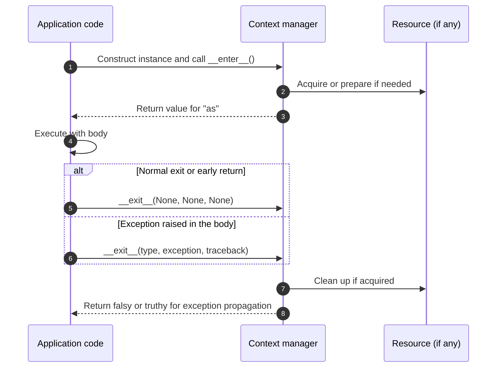
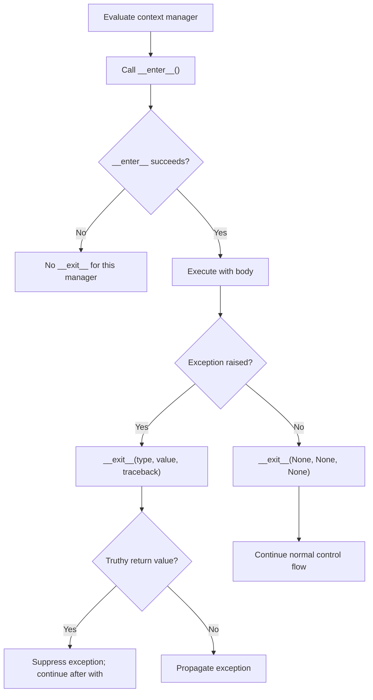
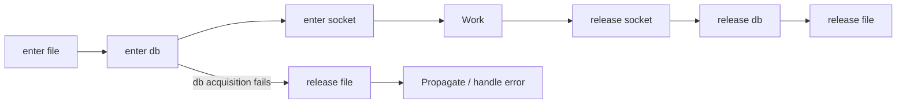

# Context Managers and Resource Safety

A self-contained, hands-on Python lesson for experienced C#/.NET engineers who are **new to Python's resource-management protocol**. Learn exactly what `with` guarantees, how `__enter__` and `__exit__` work, what happens when exceptions are raised, and how synchronous and asynchronous resources are safely released.

This lesson builds on [Threads, Processes, and Async I/O](../02.%20Threads,%20Processes%20and%20Async%20IO/README.md). It uses **only the standard library**, works without network access, and does not require a pre-existing input file.

## 1. Why context managers matter

Applications acquire files, locks, database connections, temporary directories, transactions, and network sessions. These resources need **predictable lifetimes**: relying on garbage collection for cleanup can exhaust handles or leave connections open under load.

A **context manager** defines what happens when a block begins and ends. Python's `with` statement calls the context manager's `__enter__()` method before running the block and its `__exit__()` method when leaving it, including on exceptions and early `return` or `break` — **provided `__enter__()` completed successfully**.

The closest C# analogy is `using` with `IDisposable`. Both help with deterministic cleanup, but Python's `__exit__()` also receives exception information and can **suppress** a pending exception by returning a truthy value. C# `Dispose()` has no equivalent return-value mechanism.

We start with the built-in file manager, then implement the protocol ourselves, and finally handle nested, dynamic, and asynchronous resources.

## 2. Requirements, files, and exact commands

- **Python 3.11+** (CI targets Python **3.11** and **3.14**).
- No `pip install`, packages, accounts, external services, or OS-specific paths.
- Run commands from the `03. Context Managers and Resource Safety/` directory.

```text
03. Context Managers and Resource Safety/
├── README.md
├── examples/
│   ├── file_resources.py
│   ├── simple_context_manager.py
│   ├── custom_manager.py
│   ├── contextlib_tools.py
│   ├── exit_stack.py
│   └── async_managers.py
└── tests/
    ├── test_context_managers.py
    └── test_readme_snippets.py
```

```bash
python --version

python examples/file_resources.py
python examples/simple_context_manager.py
python examples/custom_manager.py
python examples/contextlib_tools.py
python examples/exit_stack.py
python examples/async_managers.py

python -m compileall -q examples tests
python -m unittest discover -s tests -v
```

**Expected validation:** all **25 deterministic unit tests** pass. The samples need no network access or external packages. The tests **validate internal Markdown links and execute every runnable Python code block in this README independently**, using temporary input data when a snippet assumes `example.txt` exists. Sample data is written to temporary directories and removed at exit. Python may create local `__pycache__` files when compiling or running the examples.

On systems where the Python executable is called `python3` or `py -3`, substitute that launcher consistently. Snippets importing `examples.*` should be run **from this lesson directory**; Python 3 supports importing these modules through an implicit namespace package.

**Reading the demo files:** each example ends in `if __name__ == "__main__": main()`. Here the **module-level** variable `__name__` equals `"__main__"` when Python executes the file directly, so its demo runs. When the file is **imported** by another script or a test, that condition is false, preventing unwanted execution. This is similar in purpose to choosing an application entry point in C#. This module variable is a different use of `__name__` from the **exception class attribute** `exc_type.__name__` discussed in Section 5.

## 3. Reading a file with `with`

A file object is a built-in context manager. Reading a file requires no explicit call to `close()`:

```python
# This short example assumes example.txt exists in the working directory.
with open("example.txt", "r", encoding="utf-8") as file:
    data = file.read()

# The with block has ended: the file has been closed.
```

- `open("example.txt", "r", encoding="utf-8")` opens a text file. `"r"` selects **read mode**; `encoding=` is a **keyword argument** specifying UTF-8 decoding.
- `with ... as file:` calls the file object's `__enter__()`. The returned value is assigned to `file`; `as` is **not a type declaration or a new variable scope**.
- The indented suite is the managed block. `file.read()` returns the file's contents as a string.
- On leaving the block, Python calls `__exit__()` and closes the file even if `file.read()` raises. The name `file` remains bound after the block, but the underlying resource is **closed**.

**C# equivalent for the file lifetime:**

```csharp
using System.IO;

using (var reader = new StreamReader("example.txt"))
{
    string data = reader.ReadToEnd();
} // Dispose() executes even if ReadToEnd() throws.
```

The short Python snippet needs an existing `example.txt`: otherwise it raises `FileNotFoundError`. The runnable [`examples/file_resources.py`](examples/file_resources.py) creates its own temporary input, demonstrates closing on success **and** on exceptions, and leaves no sample file behind:

```bash
python examples/file_resources.py
```

```text
Read: Python context managers
File closed: True
Closed after exception: True
Caught: simulated processing failure
```

### Creating test data without external files

The example uses `tempfile.TemporaryDirectory` to create and automatically remove a directory. Here is the central logic in a **standalone**, copyable form:

```python
from pathlib import Path
from tempfile import TemporaryDirectory

with TemporaryDirectory() as directory:
    path = Path(directory) / "example.txt"

    with open(path, "w", encoding="utf-8") as writer:
        writer.write("Hello from Python")

    with open(path, "r", encoding="utf-8") as reader:
        contents = reader.read()
        print("Open inside with:", not reader.closed)

    print("Closed after with:", reader.closed)

print(contents)
```

**Expected output:**

```text
Open inside with: True
Closed after with: True
Hello from Python
```

Here `"w"` means **write mode** (overwriting existing content), `Path(directory) / "example.txt"` joins path components using the `Path` `/` operator (not division), and `TemporaryDirectory.__enter__()` returns a **directory path string**, not the manager object. Unlike a custom manager that allocates inside `__enter__()`, the built-in `open()` function opens the file **before** the file object's `__enter__()` is invoked. When its outer `with` exits, that directory is removed.

### How `with` relates to `try/finally`

For **closing a file**, the relevant cleanup guarantee can also be written manually:

```python
file = open("example.txt", "r", encoding="utf-8")
try:
    data = file.read()
finally:
    file.close()  # Runs even if read() raises.
```

This is an accurate illustration of the **file cleanup behavior**, not a full implementation of Python's `with` protocol. A general context manager calls `__exit__(exc_type, exc_value, traceback)` with real exception information and can choose whether to suppress the exception. We explore that protocol next.

## 4. The context-manager protocol: `__enter__()` and `__exit__()`

`__enter__()` and `__exit__()` are **special Python methods** that let an object define what happens when execution **enters and leaves a `with` block**. Together they form the **context-manager protocol**.

This is similar to C# `using` and `IDisposable`: both can provide predictable resource cleanup. The important Python difference is that `__exit__()` also receives information about any exception raised inside the block, and can choose to **suppress** it.

### A minimal example

The file object in Section 3 already implements this protocol. To see the methods directly, run [`examples/simple_context_manager.py`](examples/simple_context_manager.py):

```python
class MyContextManager:
    def __enter__(self):
        print("Entering the context")
        return self

    def __exit__(self, exc_type, exc_value, traceback):
        print("Exiting the context")

with MyContextManager() as cm:
    print("Inside the context")
```

**Expected output:**

```text
Entering the context
Inside the context
Exiting the context
```

### How Python executes this example

1. **Create the object:** `MyContextManager()` constructs an instance.
2. **Enter:** before running the body, Python calls its `__enter__()` method. `return self` returns the same instance, which `as cm` assigns to `cm`.
3. **Run the body:** Python executes the indented `print("Inside the context")` statement.
4. **Exit:** on leaving the block, Python calls `__exit__()` — on normal completion, an early `return`, or an exception in the body (provided `__enter__()` succeeded).

| Method | Purpose | C# analogy |
|---|---|---|
| `__enter__()` | Prepare or acquire a resource; return the value bound by `as` | Resource acquisition before a `using` scope |
| `__exit__()` | Perform cleanup and receive information about a pending exception | `Dispose()` plus exception-aware behavior |

**Note:** these methods do not automatically acquire or release resources. In this first example they **only print messages**; a real file or connection manager implements meaningful setup and cleanup. Also, the value assigned by `as` is **whatever `__enter__()` returns**, not necessarily `self`.

### Why the double underscores?

`__enter__` and `__exit__` are known as **dunder methods** (*double underscore methods*). Their names are predefined by Python's data model, not arbitrary naming conventions. The `with` statement invokes these special methods through the context-manager protocol.

You have already encountered another dunder method: `__init__()`, which Python invokes to initialize a newly created instance. Here, `__enter__()` and `__exit__()` are the hooks for a managed `with` block.

Python does **not** require inheritance from a special interface or base class to implement this protocol: an appropriate object with these methods can be used in `with`.

### What do the `__exit__()` parameters mean?

```python
def __exit__(self, exc_type, exc_value, traceback):
    print("Exiting the context")
```

- `self` — the current instance, broadly equivalent to `this` in C#.
- `exc_type` — the exception **class**, such as `ValueError`, if the body raised.
- `exc_value` — the actual **exception instance**, such as `ValueError("invalid input")`.
- `traceback` — the traceback object describing the exception's execution path.

On **normal exit**, `exc_type`, `exc_value`, and `traceback` are **all `None`**. The same is true for an early `return` or `break` that is not caused by an exception.

In the minimal example, `__exit__()` has no explicit `return` statement, so Python implicitly returns `None`. This means a pending exception is **not suppressed**; it propagates after the exit method completes. A **truthy** return value would suppress an exception from the body — an advanced behavior demonstrated in Section 5. A falsy return (such as `None` or `False`) lets it propagate.

**Important boundary:** if `__enter__()` itself raises, that manager's `__exit__()` is **not called**. An implementation that partially acquires resources during entry must account for that possibility.

The extended `MyContextManager` in Section 5 is defined in a **different module** with extra constructor arguments. It is the version used by `run_exception()` and `run_nested()`; the minimal class here has no `suppress_type` parameter. The next section introduces its code in full before using it.

### Context-manager lifecycle diagram



The diagram describes the general protocol, including real resource managers. The minimal printing-only example has no resource to acquire or release.

## 5. The extended `MyContextManager`: reading real Python code

The minimal manager above explains the protocol. Now examine the **actual class** from [`examples/custom_manager.py`](examples/custom_manager.py), which also records events and can suppress one configured exception type. The file remains the executable reference; the same class is included here so you can understand it **before** running the demo.

### 5.1 The complete class from the demo

```python
from __future__ import annotations

from types import TracebackType


class MyContextManager:
    """Log __enter__/__exit__ calls and optionally suppress one exception type."""

    def __init__(
        self,
        name: str,
        events: list[str],
        suppress_type: type[Exception] | None = None,
    ) -> None:
        self.name = name
        self.events = events

        # suppress_type is OUR optional constructor parameter, not a Python
        # keyword. Passing suppress_type=ValueError stores the ValueError
        # CLASS (not ValueError("message"), which would be an instance).
        # None means no exception type is allowed to be suppressed.
        self.suppress_type = suppress_type

    def __enter__(self) -> str:
        # 'as resource' receives THIS return value, not necessarily 'self'.
        self.events.append(f"enter:{self.name}")
        return f"resource:{self.name}"

    def __exit__(
        self,
        exc_type: type[BaseException] | None,
        exc_value: BaseException | None,
        exc_traceback: TracebackType | None,
    ) -> bool:
        # Important: there is no "catch" statement inside this method.
        # When code inside 'with' raises an exception, Python's 'with'
        # mechanism AUTOMATICALLY calls __exit__ BEFORE the outer
        # 'except ValueError:' handler gets a chance to run.
        #
        # For 'raise ValueError("demo failure")', Python supplies:
        #   exc_type      -> ValueError (the exception CLASS)
        #   exc_value     -> ValueError("demo failure") (the exception OBJECT)
        #   exc_traceback -> the traceback describing where it happened
        # On normal exit, all three are None.
        #
        # Python's inline conditional expression:
        #     value_if_true if condition else value_if_false
        # is similar to C#'s "condition ? value_if_true : value_if_false".
        #
        # The next line is equivalent to:
        #     if exc_type is not None:
        #         label = exc_type.__name__  # e.g. "ValueError"
        #     else:
        #         label = "none"
        #
        # '__name__' gives the NAME of the exception class (not its message).
        # "none" is a string for logging; None is Python's null-like value.
        label = exc_type.__name__ if exc_type is not None else "none"

        # f"..." is Python string interpolation, like C# $"...".
        # For self.name="guard" and label="ValueError", this produces
        # the string "exit:guard:ValueError".
        # list.append(value) adds an item, like List<T>.Add(value) in C#.
        # This is LOGGING ONLY: it neither catches nor suppresses the error.
        self.events.append(f"exit:{self.name}:{label}")

        # Python decides what happens NEXT based on this return value:
        #   True  -> the 'with' statement suppresses the pending exception;
        #            execution continues AFTER the 'with' block, so the
        #            outer 'except ValueError:' is NOT executed.
        #   False -> Python propagates the exception, allowing the outer
        #            'except ValueError:' to catch it.
        #
        # Example: if suppress_type=ValueError and the body raises ValueError,
        # all three checks below are True, so __exit__ returns True.
        # We restrict suppression to the configured class (and subclasses).
        return (
            # Did an exception occur in the body of 'with'?
            exc_type is not None
            # Did the caller configure a type to suppress?
            and self.suppress_type is not None
            # Is the raised exception of that class or one of its subclasses?
            and issubclass(exc_type, self.suppress_type)
        )
```

The code above **defines a class**; it does not run a demonstration until you create an instance and use it in `with`. Read the following explanations in order.

### 5.2 `__init__()`: constructor, keyword arguments and type hints

Start here:

```text
def __init__(self, name: str, events: list[str],
             suppress_type: type[Exception] | None = None) -> None:
    self.name = name
    self.events = events
    self.suppress_type = suppress_type
```

| Python syntax | Meaning | Familiar C# concept |
|---|---|---|
| `__init__(self, ...)` | Initializes a newly constructed instance; `self` is that instance | Constructor and `this` |
| `name: str` | `name` is expected to be a string | `string name` |
| `events: list[str]` | A mutable list of strings; `: list[str]` is a type hint | `List<string> events` |
| `suppress_type=...` | An **argument name** chosen by this class, not a Python keyword | Named argument |
| `type[Exception] | None` | An exception **class** or `None`; `|` denotes a union in a type annotation | `Type?` |
| `= None` | Parameter's default value when the caller does not provide it | Default parameter value `= null` |
| `-> None` | Return type hint for a function that has no useful return value | `void` |
| `self.suppress_type = suppress_type` | Store the argument as an **instance attribute** | Assigning to a field/property |

**Pay attention to the type being passed.** `suppress_type=ValueError` passes the *class object* `ValueError`, comparable to `suppressType: typeof(ArgumentException)` in C#. `ValueError("problem")` creates an *exception instance*: that is different. Python's classes are themselves objects, so no `typeof` operator is required here.

Unlike C#'s compiler-enforced types, these annotations are **not runtime validation**. You can omit `suppress_type` entirely and it defaults to `None`, meaning “suppress no exception types”.

The class also imports `TracebackType` from Python's `types` module to annotate the exception traceback; this is type information, not code that catches an exception. At the very top, `from __future__ import annotations` postpones type-annotation evaluation (in Python 3.11–3.13 it stores the annotations in string form). It **does not alter execution of `with` or `try/except`**; it lets the same example use type hints consistently across supported Python versions.

### 5.3 `__enter__()`: what is returned by `as`?

The demo's `__enter__() -> str` records `enter:guard` and returns the string `"resource:guard"`, **not `self`**. Therefore, `with MyContextManager("guard", events) as resource:` assigns that **string** to `resource`. This intentionally differs from the first, printing-only manager in Section 4.

Two additional Python features appear here:

- `f"enter:{self.name}"` is an **f-string** (string interpolation), analogous to C# `$"enter:{name}"`. Text inside `{...}` is evaluated and inserted.
- `self.events.append(value)` adds an element to the list, analogous to C# `events.Add(value)`. It is only **event logging**; it does not catch exceptions or release resources.

### 5.4 `__exit__()`: conditional expression, class names and suppression

On normal exit, Python passes three `None` values. When the `with` body executes `raise ValueError("demo failure")`, Python automatically calls:

```text
__exit__(
    exc_type=ValueError,
    exc_value=ValueError("demo failure"),
    exc_traceback=<traceback object>
)
```

These are **illustrative values**; this is not a Python call you write manually. Importantly, `__exit__()` does **not contain an `except` block**. The Python interpreter forwards the exception to the context-manager protocol before any outer `except` gets to handle it.

The first executable statement inside the demo's `__exit__()` is:

```python
# Illustrate the expression with a real exception class.
exc_type = ValueError
label = exc_type.__name__ if exc_type is not None else "none"
print(label)
```

**Expected output:** `ValueError`.

- `A if condition else B` is Python's **conditional expression**, equivalent to C# `condition ? A : B`. Here it is equivalent to `if exc_type is not None: label = exc_type.__name__`, otherwise `label = "none"`.
- `is not None` checks identity against Python's null-like singleton `None`; it is similar in intent to C# `!= null`.
- `exc_type.__name__` returns the **class name** (such as `"ValueError"`), not the exception message. For a normal exit we use the log string `"none"`.
- `self.events.append(f"exit:{self.name}:{label}")` builds a formatted string and appends it to the event list. For the `guard` manager and `ValueError`, it records `"exit:guard:ValueError"`. **Recording this event does not suppress anything.**

The **only part that decides suppression** is the final boolean `return`:

```text
return (
    exc_type is not None
    and self.suppress_type is not None
    and issubclass(exc_type, self.suppress_type)
)
```

Read this **top to bottom**: (1) an exception occurred; (2) the caller configured an allowed exception class; (3) `issubclass(actual_type, allowed_type)` checks whether the actual exception class equals or inherits from the configured class. `and` short-circuits: if an earlier condition is false, later conditions are skipped. The expression itself evaluates to `True` or `False`.

| Case | Configured `suppress_type` | Actual `exc_type` | `__exit__()` returns | Next step |
|---|---|---|---|---|
| Matching exception | `ValueError` | `ValueError` | `True` | Python **suppresses** the error |
| No suppression configured | `None` | `ValueError` | `False` | Python propagates to outer `except` |
| Different exception | `ValueError` | `RuntimeError` | `False` | Python propagates the error |
| Normal exit | `ValueError` | `None` | `False` | Exit completes normally; return value is ignored |

C# comparison: `issubclass(actual, allowed)` is conceptually like `allowed.IsAssignableFrom(actual)` using `System.Type` values. Python's `return True` does **not mean “we wrote a catch here”**: it tells the interpreter that the **pending** exception from the `with` body was handled by the context manager.

### 5.5 `run_exception()`: full execution trace

The executable demonstration is [`run_exception(suppress)`](examples/custom_manager.py). Run **both paths**:

```python
from examples.custom_manager import run_exception

print("suppress=False:", run_exception(False))
print("suppress=True: ", run_exception(True))
```

**Expected output:**

```text
suppress=False: ['enter:guard', 'body:raise', 'exit:guard:ValueError', 'caught:ValueError', 'after:with']
suppress=True:  ['enter:guard', 'body:raise', 'exit:guard:ValueError', 'after:with']
```

Inside `run_exception()`, Python performs the following steps:

1. `try:` begins the protected region (**C# `try`**). The argument expression `ValueError if suppress else None` is another conditional expression: the Boolean `suppress` selects which **class**, if any, is stored by the constructor.
2. `with MyContextManager(...)` invokes `__enter__()` and appends `enter:guard`.
3. `events.append("body:raise")` records progress; `raise ValueError("demo failure")` then **throws** the exception (**C# `throw new ArgumentException(...)`**).
4. **Before reaching `except`**, Python automatically invokes `__exit__(ValueError, exception, traceback)` and records `exit:guard:ValueError`.
5. If `__exit__()` returns **`True`**, Python suppresses the pending exception, so `except ValueError:` **does not run**. If it returns **`False`**, the exception propagates and the outer `except` appends `caught:ValueError` (**C# `catch (ArgumentException)`**).
6. Both paths continue after the protected region, appending `after:with`. The interpreter **does not resume** the rest of the interrupted `with` body.

The `try/except` statement corresponds to C# `try/catch`. Python also has `finally:` (similar to C# `finally`) and `raise` for throwing. **Only the return value from `__exit__()` determines the context-manager suppression here**, not `suppress_type` by itself.

### 5.6 Exit behaviors and failure boundary

| Exit scenario | Arguments received by `__exit__` | Outcome |
|---|---|---|
| Normal completion / early `return` or `break` | `(None, None, None)` | Cleanup runs; return value ignored |
| Body raises; `__exit__` returns `False` / `None` | Exception information | Exception propagates |
| Body raises; `__exit__` returns `True` | Exception information | Exception is suppressed |
| `__enter__` raises | This manager's `__exit__` is **not called** | Failed entry must clean up its own partial work |
| `__exit__` itself raises | Cleanup error | New exception propagates; prior one may be accessible via `__context__` |



**Production rule:** a metrics or logging manager should normally return `False`. Never hide unexpected failures by casually returning `True`; suppress only the intended exception classes. The demo also contains `FailingEnter`, which shows that when `__enter__()` fails, its own `__exit__()` never runs.

## 6. Nesting and reverse-order release (LIFO)

```python
from examples.custom_manager import MyContextManager

events: list[str] = []

with MyContextManager("outer", events) as outer, MyContextManager(
    "inner", events
) as inner:
    events.append(f"body:{outer},{inner}")

print(events)
```

**Expected output:**

```text
['enter:outer', 'enter:inner', 'body:resource:outer,resource:inner', 'exit:inner:none', 'exit:outer:none']
```

- Managers are **entered left to right** and **exited right to left** (Last In, First Out).
- `with A() as a, B() as b:` is equivalent to nesting `with A() as a:` around `with B() as b:`.
- An exception in an inner body invokes the inner manager's exit before the outer manager's exit.
- If an inner manager suppresses an exception, the outer manager normally sees **no exception**; suppression changes what the outer `__exit__` receives.
- The comma in `with ManagerA() as a, ManagerB() as b:` separates two context managers. It behaves like **nested `with` statements**, not parallel execution. The long demonstration splits the expression across lines inside parentheses; Python permits a continued expression inside parentheses without a continuation character.
- The variables `outer` and `inner` receive the strings returned by the advanced manager's `__enter__()`: `"resource:outer"` and `"resource:inner"`. This explains the `body:resource:outer,resource:inner` event.
- An early `return` still calls `__exit__()` **before the function actually returns**.

Two other paths in `examples/custom_manager.py` demonstrate that last rule and a **failed entry**:

```python
from examples.custom_manager import run_early_return, run_failed_enter

print("early return:", run_early_return())
print("failed entry:", run_failed_enter())
```

```text
early return: ['enter:early', 'body:return', 'exit:early:none', 'returned']
failed entry: ['enter:failed', 'caught:RuntimeError']
```

`FailingEnter.__enter__()` raises `RuntimeError` before returning, so its own `__exit__()` **never executes**, and the `with` body is skipped. Here `except RuntimeError:` is Python's equivalent of a typed C# `catch`.

This is the same LIFO resource-unwinding principle used by nested C# `using` blocks or scoped disposables.

## 7. `@contextmanager`, generators and optional resources

The file [`examples/contextlib_tools.py`](examples/contextlib_tools.py) creates a context manager without defining `__enter__()` and `__exit__()` by hand. Instead, it uses the standard-library `contextlib.contextmanager` decorator.

### 7.1 Read the generator-based manager

This is the **actual `traced_resource()` implementation** from the demo:

```python
from collections.abc import Iterator
from contextlib import contextmanager

@contextmanager
def traced_resource(name: str, events: list[str]) -> Iterator[str]:
    """A generator-based context manager must yield exactly one resource."""
    events.append(f"acquire:{name}")
    try:
        yield f"resource:{name}"  # __enter__ returns the yielded value.
    finally:
        # On exceptions, control resumes at 'yield' with the exception.
        # This finally executes before the exception propagates.
        events.append(f"release:{name}")


events: list[str] = []
with traced_resource("cache", events) as resource:
    events.append(f"use:{resource}")

print(events)
```

**Expected output:**

```text
['acquire:cache', 'use:resource:cache', 'release:cache']
```

Read the new syntax in the order Python executes it:

1. `@contextmanager` is a **decorator** (the `@` syntax). It wraps the generator function so that it supports the same `with` protocol. You will implement decorators yourself in Lesson 04.
2. `def traced_resource(name: str, events: list[str]) -> Iterator[str]:` declares the generator function. `Iterator[str]` is a **type hint** for the values it yields. As in the previous class, annotations are not automatically enforced at runtime.
3. `events.append(f"acquire:{name}")` runs when entering the `with` block. The body before `yield` is **setup**.
4. `yield f"resource:{name}"` is **not a normal `return`**. It pauses the generator and sends the string to the `as resource` variable in the outer `with` block. The caller now executes its body.
5. On exit, the generator resumes at the suspended `yield`. The `finally:` block appends the release event, including when the caller's body raises.

**C# comparison:** imagine a helper that performs setup, invokes the user action, and runs `Dispose()` in `finally`. The Python `yield` marks the handoff to the caller's `with` body. Unlike a normal `return`, the generator continues after the body completes.

A generator-based manager must **yield exactly once** per entry. Missing `yield` raises `RuntimeError: generator didn't yield`, and a second yield while exiting raises `RuntimeError: generator didn't stop`.

**Exception detail:** when the body throws, `contextlib` re-injects the exception at the suspended `yield`. `finally` still executes. If you catch the exception *inside* the generator and finish without re-raising, you can unintentionally suppress it. Ordinary cleanup should re-raise or simply use `try/finally` as the example does.

### 7.2 `suppress`, `nullcontext` and another conditional expression

The same file demonstrates two built-in managers:

```python
from contextlib import suppress, nullcontext

with suppress(FileNotFoundError):
    raise FileNotFoundError("optional cache missing")

with nullcontext("already available") as resource:
    print(resource)
```

**Output:** `already available`. The first exception is intentionally suppressed and execution reaches the second block.

- `suppress(FileNotFoundError)` is similar to a targeted C# `try/catch (FileNotFoundException)` whose handler intentionally does nothing. Suppress only **expected** errors, never every `Exception` indiscriminately.
- `nullcontext(value)` performs no acquisition or cleanup but returns `value` from its enter method. It is useful when the caller already owns the resource or when management is optional.
- In `run_optional(enabled)`, the demo uses `manager = traced_resource("optional", events) if enabled else nullcontext("direct")`. This is the **same conditional expression** introduced in Section 5: choose the manager depending on the Boolean, then use a **single shared `with` body**.

Run both optional-resource paths from the original demo:

```python
from examples.contextlib_tools import run_optional

print("enabled:", run_optional(True))
print("disabled:", run_optional(False))
```

```text
enabled: ['acquire:optional', 'use:resource:optional', 'release:optional']
disabled: ['use:direct']
```

## 8. `ExitStack`: dynamically managed resources

When the number of resources is fixed, nested `with` statements are sufficient. In a server or batch process, you may need to acquire an unknown number of connections or handles. [`examples/exit_stack.py`](examples/exit_stack.py) demonstrates how `contextlib.ExitStack` keeps track of everything **successfully entered** and later runs the corresponding exit methods in **reverse order**.

### 8.1 Start from the actual `run_batch()` demo

```python
from examples.exit_stack import run_batch

events, acquired = run_batch(("file", "db", "socket"))
print("success acquired:", acquired)
print("success events:", " | ".join(events))

events, acquired = run_batch(("file", "db", "socket"), fail_on="db")
print("failure acquired:", acquired)
print("failure events:", " | ".join(events))
```

**Expected output:**

```text
success acquired: ['file', 'db', 'socket']
success events: acquire:file | acquire:db | acquire:socket | work:file,db,socket | release:socket | release:db | release:file
failure acquired: ['file']
failure events: acquire:file | acquire:db | release:file | error:cannot acquire db
```

The central portion of the **real `run_batch()` function** is:

```text
with ExitStack() as stack:
    for name in names:
        resource = stack.enter_context(
            acquire(name, events, fail=(name == fail_on))
        )
        acquired.append(resource)
    events.append(f"work:{','.join(acquired)}")
```

Here `acquire()` is a generator-based context manager **defined in `examples/exit_stack.py`**, not a built-in Python function. It raises `RuntimeError` when `fail=True`. The surrounding function catches that failure with `except RuntimeError as exc:` *after* the entered resources are unwound.

### 8.2 New Python syntax in the demo

| Syntax | Explanation | C# comparison |
|---|---|---|
| `names: tuple[str, ...]` | A tuple containing any number of strings; `...` inside this type annotation means variable tuple length | An immutable-style sequence input, such as an array or read-only list |
| `("file", "db", "socket")` | A **tuple literal**, commonly used for fixed sequences | Like a small fixed collection |
| `events, acquired = run_batch(...)` | **Unpacking:** assign the two elements returned by the function to two names | Deconstructing a tuple: `(events, acquired) = RunBatch(...)` |
| `for name in names:` | Iterate over the sequence, with indentation defining the loop body | `foreach (var name in names)` |
| `name == fail_on` | Compare values for equality; do **not** confuse with `is`, which checks object identity | `name == failOn` |
| `fail=(name == fail_on)` | Pass the Boolean comparison result as a **named argument** to `acquire()` | `fail: name == failOn` |
| `','.join(acquired)` | Join string elements into one string separated by commas | `string.Join(",", acquired)` |
| `except RuntimeError as exc:` | Catch an exception **and bind its instance** to `exc` | `catch (Exception exc)` (with an appropriate concrete type) |

The annotation `-> tuple[list[str], list[str]]` on `run_batch()` means “returns a **two-element tuple** containing two lists of strings.” It is descriptive, not enforced at runtime.

**How cleanup works:** `stack.enter_context(manager)` calls the manager's `__enter__()` and registers `__exit__()` only if entry succeeds. If `db` fails, the previously entered `file` is released even though the loop never reaches `socket`. The **failing manager itself** must clean up any partial acquisition made before its own `__enter__()` failed.



**C# analogy:** dynamically collecting `IDisposable` instances and disposing them in reverse order during `finally`, including partial startup failure. `ExitStack` provides that behavior directly.

Also note: `ExitStack.callback(callback)` registers a cleanup function that receives **no exception details** and cannot suppress an exception. `push()` and `enter_context()` register different kinds of exit behavior. For normal managers, use `enter_context()`.

## 9. `async with`: async setup, cleanup and cancellation

A normal `with` calls synchronous `__enter__()` / `__exit__()`. When setup or cleanup itself needs to `await`, Python uses a **different protocol**: `__aenter__()` and `__aexit__()`. It is conceptually similar to C# `await using` and `IAsyncDisposable`.

All examples below refer to the real [`examples/async_managers.py`](examples/async_managers.py) file.

### 9.1 `AsyncConnection`: the class-based async manager

```python
import asyncio
from examples.async_managers import AsyncConnection

async def main() -> None:
    events: list[str] = []
    async with AsyncConnection("db", events) as resource:
        events.append(f"use:{resource}")
    print(events)

asyncio.run(main())
```

**Expected output:**

```text
['open:db', 'use:db', 'close:db']
```

The original `AsyncConnection` class implements `async def __aenter__(self) -> str:` and `async def __aexit__(self, exc_type, exc_value, exc_traceback) -> bool:`. Each performs `await asyncio.sleep(0)` to **simulate a cooperative asynchronous operation**, not to contact a real database.

| Python syntax | What happens | C# analogy |
|---|---|---|
| `async def main() -> None:` | Declares an **async coroutine function**; calling it creates a coroutine object | `async Task Main()` in intent |
| `asyncio.run(main())` | Creates/runs the event loop for this standalone script, runs the coroutine and closes the loop | Application entry point that awaits a task |
| `await asyncio.sleep(0)` | Suspends the coroutine and gives the event loop a chance to run other work | Cooperative yielding such as `await Task.Yield()` |
| `async with AsyncConnection(...) as resource:` | Awaits `__aenter__()`, runs the body, then awaits `__aexit__()` | `await using` with `IAsyncDisposable` |
| `async def __aexit__(...) -> bool` | Async cleanup that also decides exception suppression | Async disposal **plus** Python's exception-aware exit contract |

A regular `with` cannot automatically use an async-only context manager; an `async with` requires the asynchronous protocol. As in Section 5, a falsy `__aexit__()` return lets a body exception propagate, while a truthy return suppresses it.

### 9.2 `@asynccontextmanager`: the async generator version

The same demo also defines a generator-based async manager. This is the **actual implementation** (with its imports and a call):

```python
import asyncio
from collections.abc import AsyncIterator
from contextlib import asynccontextmanager

@asynccontextmanager
async def async_resource(name: str, events: list[str]) -> AsyncIterator[str]:
    """An async generator-based manager; yield exactly one value."""
    events.append(f"open:{name}")
    try:
        await asyncio.sleep(0)
        yield name
    finally:
        # The async finally is awaited even if the body is cancelled.
        await asyncio.sleep(0)
        events.append(f"close:{name}")


async def main() -> None:
    events: list[str] = []
    async with async_resource("cache", events) as resource:
        events.append(f"use:{resource}")
    print(events)

asyncio.run(main())
```

**Expected output:**

```text
['open:cache', 'use:cache', 'close:cache']
```

This combines the concepts from `@contextmanager` (Section 7) with `async def` and `await`:

- `@asynccontextmanager` turns an **async generator function** into an object usable by `async with`.
- `AsyncIterator[str]` is the return **type hint** for the async generator's yielded values. `yield name` exposes the handle to the caller.
- `await asyncio.sleep(0)` stands in for real asynchronous open/close operations; it is deliberately **not** a network call.
- `try/finally` ensures that the `close:cache` event is recorded on normal exit and when the body throws. The `await` in cleanup is part of leaving the `async with` block.

### 9.3 `AsyncExitStack`: dynamic async resources

`AsyncExitStack` is the asynchronous counterpart of `ExitStack`. The original `run_async_stack()` function uses `await stack.enter_async_context(async_resource(name, events))` to enter and register each manager. Its exit order is still **LIFO**.

```python
import asyncio
from examples.async_managers import run_async_stack

print(asyncio.run(run_async_stack()))
```

**Expected output:**

```text
['open:db', 'registered:db', 'open:cache', 'registered:cache', 'work', 'close:cache', 'close:db']
```

The `registered:...` events confirm that each call to `enter_async_context` succeeded. Compare the order: enter `db`, enter `cache`, then close `cache`, then close `db`.

### 9.4 `asyncio.Task` cancellation and resource safety

In `run_cancellation()`, the demo creates a task that holds a `stream` resource and waits for an event that never becomes set. The caller then cancels the task after confirming entry. Run the example:

```python
import asyncio
from examples.async_managers import run_cancellation

print(asyncio.run(run_cancellation()))
```

```text
['open:stream', 'close:stream', 'caught:CancelledError']
```

Follow the relevant Python syntax:

1. `entered = asyncio.Event()` creates a coordination event (**similar in purpose** to a completion signal in .NET).
2. `task = asyncio.create_task(operation())` schedules the coroutine to run as a Task, comparable to running asynchronous work in .NET, though the scheduling models differ.
3. `await entered.wait()` ensures the resource has been **entered** before requesting cancellation. This avoids tests depending on arbitrary sleep durations.
4. `task.cancel()` requests cancellation, which causes an `asyncio.CancelledError` to be raised at a suspension point inside the task.
5. Python unwinds `async with` and **awaits cleanup**; only afterward does the waiting caller handle `except asyncio.CancelledError:`.

**Important difference from ordinary exceptions:** `asyncio.CancelledError` inherits from `BaseException`, not `Exception`, so a generic `except Exception:` does **not** catch task cancellation. The async cleanup shown here is not an absolute guarantee against hard process termination, repeated cancellation, or cleanup failures.

## 10. C#/.NET comparison: capabilities and limits

| Question | C#/.NET | Python |
|---|---|---|
| How do I deterministically dispose a resource? | `using` / `IDisposable` | `with` / `__exit__` |
| How do I perform awaited disposal? | `await using` / `IAsyncDisposable` | `async with` / `__aexit__` |
| Can disposal suppress the body exception by return value? | **No** `Dispose()` return value | **Yes**, truthy `__exit__` / `__aexit__` |
| Is the value of `as` always the context-manager object? | Not applicable in the same form | **No**, it is the result of `__enter__` |
| Is a common interface inheritance mandatory? | `IDisposable` is an explicit interface contract | No inheritance required; protocol methods are sufficient |
| Can I manage dynamically acquired resources? | Custom `try/finally` / disposal collection | `ExitStack` / `AsyncExitStack` |
| Does the construct replace transactional rollback? | No; transaction behavior must be implemented | No; `with` alone is not a transaction |

**Engineering example:** a unit-of-work context manager may commit on successful exit and roll back on exceptions, but those semantics are application/library policy. Python does not automatically make every `with` block an atomic database transaction. Any real implementation must also consider a **failed commit, failed rollback, idempotent cleanup and connection ownership**.

A locking example from Lesson 02 uses `with threading.Lock():`, but be careful in asynchronous code: acquiring a contended `threading.Lock` synchronously on the event-loop thread can block the loop. Prefer `asyncio.Lock` with `async with` when synchronizing coroutines in the same event loop.

## 11. Hands-on exercises

### Exercise A — Build a resource-aware logger

Create a new `@contextmanager` named `log_operation(name, events)` that appends `start:name` at entry and `end:name` on exit. If the body raises `ValueError`, the exception must still reach the caller.

**Validation:** normal run records start, work, end; exceptional run records start, end, then the outer exception handler's event. Add a test that verifies the cleanup happens before the outer handler.

**Common failure:** catching `ValueError` *inside* the generator without re-raising silently suppresses it.

### Exercise B — Dynamic multi-resource startup

Extend `exit_stack.run_batch` so it can process a user-supplied list of resource names. Make acquisition of the third resource fail intentionally, and verify that exactly the **previously entered** resources are released, in reverse order.

**Validation:** no leaked resource and no `work` event after failure. Test both a middle failure and a failure on the first resource.

**Common failure:** appending resources to an ordinary list without protecting subsequent acquisitions with an `ExitStack`.

### Exercise C — Async session with cancellation

Extend `async_managers.py` with an operation that enters **two** async resources through `AsyncExitStack`, then waits on `asyncio.Event()`. Cancel its owning Task after both resources have entered.

**Validation:** both resources close in **reverse acquisition order** before the caller handles `asyncio.CancelledError`. Use `unittest.IsolatedAsyncioTestCase` and an `Event` to synchronize the cancellation, not sleeps or timing assertions.

**Common failure:** forgetting to await asynchronous cleanup, or cancelling before the resources have actually entered.

## 12. Troubleshooting and production pitfalls

| Symptom | Likely cause | What to inspect |
|---|---|---|
| `FileNotFoundError` with a copied `open("example.txt")` sample | File does not exist in current directory | Run `examples/file_resources.py`, which creates its own temporary input |
| `AttributeError: __enter__` or `TypeError` about a context manager | An object is not a synchronous context manager | Check `__enter__` and `__exit__` or use the correct `async with` |
| `TypeError` around `async with` | Used a synchronous manager with async syntax | Use an async manager implementing `__aenter__` / `__aexit__` |
| `RuntimeError: generator didn't yield` | `@contextmanager` generator returned before `yield` | Ensure every successful entry path yields exactly once |
| `RuntimeError: generator didn't stop` | Generator tried to yield more than once | Yield once and perform cleanup after that yield |
| Unexpectedly missing error | `__exit__` returned truthy, or a generator swallowed the exception | Return `False`, or re-raise inside the generator unless suppression is intentional |
| Cleanup was skipped after acquisition error | The failing manager's `__enter__` raised before completing | Clean up partial state inside acquisition; outer/`ExitStack` contexts only release successfully entered resources |
| Unreleased borrowed resource | Ownership rules unclear | Determine who acquired/owns the resource; consider `nullcontext` for borrowed handles |
| Async application becomes unresponsive | Synchronous blocking work inside event loop or cleanup | Prefer async libraries; use `asyncio.to_thread` for unavoidable blocking I/O |
| Tests fail on import | Ran from the wrong directory or altered `sys.path` | Use the exact commands above from the lesson directory |

**Security and correctness:** resource cleanup is not the same as successfully committing a transaction or safely handling untrusted data. In production, ensure closure errors are logged, transactional failure semantics are explicit, and exception suppression does not conceal security-critical failures.

## 13. Official Python references

- [Python Language Reference — The `with` statement](https://docs.python.org/3.14/reference/compound_stmts.html#the-with-statement)
- [Python Language Reference — The `async with` statement](https://docs.python.org/3.14/reference/compound_stmts.html#the-async-with-statement)
- [Python standard library — `contextlib`](https://docs.python.org/3.14/library/contextlib.html)
- [Python standard library — `tempfile`](https://docs.python.org/3.14/library/tempfile.html)
- [Python standard library — `asyncio` tasks and cancellation](https://docs.python.org/3.14/library/asyncio-task.html)

Each runnable example and its relevant edge cases are covered by standard-library tests. Run the examples and tests using the commands in Section 2.
