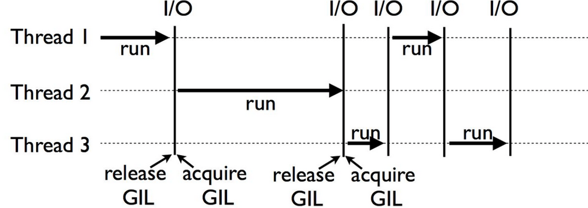

# 01 — CPython Memory Model and the GIL

> **Status:** Working lesson for joint review; learner Q&A is being incorporated.
> **Audience:** senior developers with experience in object-oriented and concurrent programming; no introduction to basic programming syntax.

## Learning outcomes

After this lesson you should understand CPython object identity, aliasing and reference counting; the role of the cyclic GC; the traditional CPython GIL and its impact on CPU-heavy threads; the difference between concurrency and parallelism; and the availability of optional **free-threaded CPython** from Python 3.13 onward. Compare these details with .NET/C# rather than assuming equivalent runtime semantics.

## Requirements and quick start

- Ordinary CPython **3.11+**; 3.13+ recommended for inspecting the current GIL status with `sys._is_gil_enabled()`.
- No third-party dependencies. Run from this directory:

```bash
python --version
python examples/reference_count.py
python examples/reference_cycles.py
python examples/io_wait_threads.py --seconds 0.4
python examples/factorial_threads.py --n 12000 --repeats 3
python -m unittest discover -s tests -v
```

The alias check should print `True`, an unreachable reference cycle should disappear after `gc.collect()`, the factorial results must match, and all **five unit tests** should pass. Reference-count values, thread durations and GC statistics can vary. Code has been checked on CPython 3.13.5.

## Start here — what is the GIL?

**GIL** stands for **Global Interpreter Lock**. It is a synchronization mechanism in **CPython**, the most widely used implementation of the Python language. You can be an experienced C# or Java developer and still be unfamiliar with it: the GIL is a **Python-runtime implementation detail**, not a general programming concept or a Python language keyword.

### 1. Python vs. CPython

**Python is a programming language; CPython is an implementation that executes programs written in it.** This is similar to distinguishing C# from the .NET runtime executing compiled C# programs, although their internal architectures are different.

| | Python | CPython |
|---|---|---|
| What it is | A programming language | The most widely used Python interpreter and runtime, implemented primarily in C |
| What it defines | Syntax, language semantics and standard-library interfaces | Concrete execution mechanics, object representation and memory management |
| GIL and reference counts | Not required by the language definition | Used by traditional CPython; optional free-threaded CPython is also available |
| Alternatives | Code can run on multiple implementations | PyPy, for example, is another implementation of Python |

When someone says **“Python 3”**, they mean **version 3 of the Python language**, not necessarily CPython. In practice, an installation from [python.org](https://www.python.org/) normally provides **CPython 3**, and many discussions of “Python behavior” implicitly assume CPython. **PyPy 3** and other compatible implementations can differ in runtime internals.

CPython normally compiles `.py` source into an internal bytecode representation before executing it. Bytecode format, reference counts and the GIL are **implementation details**, not part of the Python language syntax. The code below checks your installation:

```python
import platform

print(platform.python_implementation())  # Usually: CPython
print(platform.python_version())         # e.g. 3.13.5
```

**An OS thread** is a real thread scheduled by the operating system. Python's `threading.Thread` can create multiple such threads in one process. In a standard **GIL-enabled CPython** interpreter, the Global Interpreter Lock controls which thread may execute Python bytecode or interact with Python objects through the normal interpreter C API.

**The important distinction:** you can create ten Python threads, but in a standard GIL-enabled CPython interpreter **only one of them can execute Python bytecode at any given instant**. The threads still exist, can be scheduled independently by the OS, and can overlap while waiting for I/O.

### 2. Why does CPython have a GIL?

CPython traditionally manages most object lifetimes using **reference counts**. When a new reference to an object appears, its count is increased; when a reference disappears, its count is decreased. In a multithreaded runtime, two threads could otherwise attempt to update the same object's internal state at the same time.

Traditional CPython's GIL provides a coarse-grained way to protect the interpreter's shared object model, including these reference-count operations. This simplifies the runtime implementation, but it also serializes execution of Python bytecode across threads in the same GIL-enabled interpreter.

Do **not** conclude that every memory-management operation needs the GIL in every Python implementation. Free-threaded CPython replaces the coarse lock with other synchronization and reference-management techniques.

### 3. How does the GIL move between threads? (I/O example)

The following diagram shows **three real OS threads** sharing a single GIL-enabled CPython interpreter. It illustrates what happens when a thread **blocks on I/O** (for example, waiting for a network response). This is **not a CPU-only scheduling diagram**.



**How to read the diagram:**

1. **Time runs from left to right.** Each dotted horizontal line represents one OS thread. A thick arrow labeled **run** means that thread is currently executing Python code while holding the GIL.
2. **Thread 1** begins executing Python code. When it reaches a blocking **I/O** operation, CPython can **release the GIL**, letting another ready thread run.
3. **Thread 2** acquires the GIL and executes Python code. When Thread 2 reaches its own blocking I/O, it can release the lock in turn.
4. **Thread 3** then executes until it needs I/O. Meanwhile, a previously waiting thread (such as Thread 1) may be ready to continue and can **reacquire the GIL**. Later, another thread can acquire it again.
5. The labels **release GIL** and **acquire GIL** identify hand-offs. A thread waiting for I/O does not need to occupy the GIL while it is blocked.

**What the diagram demonstrates:** several Python threads can make progress concurrently because waiting time can overlap with useful execution in another thread. **In traditional GIL-enabled CPython, that does not mean two threads execute Python bytecode in parallel at the same instant.**

**What it does not demonstrate:** a guaranteed execution order, equal CPU time, or the only way threads can switch. CPython can also switch between **CPU-bound** Python threads without waiting for I/O. The interpreter's switch interval (often 5 ms) is a scheduling hint, not a fixed time slice; OS scheduling and native extension behavior also matter. Some native code can release the GIL and perform parallel work.

To observe overlapping waits in practice, run [the I/O-wait example](examples/io_wait_threads.py). To observe the limitation for pure-Python CPU computation, run [the factorial comparison](examples/factorial_threads.py).

### 4. CPU-bound versus I/O-bound: why the difference matters

**CPU-bound** means the code is busy doing computations (e.g., a pure-Python factorial loop). The threads compete to execute Python bytecode, so adding threads usually does **not** make the CPU work scale across cores in standard CPython. Run [the factorial comparison](examples/factorial_threads.py):

```bash
python examples/factorial_threads.py --n 12000 --repeats 3
```

It runs **two CPU-heavy workloads** once sequentially and once in two threads. Both versions must compute the same results; execution times vary, and two threads may be slightly slower.

**I/O-bound** means the program spends substantial time **waiting** for work outside the CPU—for example, a network reply, disk read, or database result. During blocking I/O, CPython can **release the GIL**, so another thread can execute Python code. For a small controlled example, [`io_wait_threads.py`](examples/io_wait_threads.py) uses `time.sleep` to *simulate waiting*, not to perform real networking:

```bash
python examples/io_wait_threads.py --seconds 0.4
```

Two sequential waits take approximately `0.8s` of wall-clock time; overlapping waits in two threads take approximately `0.4s` **plus scheduling overhead**, if the machine is otherwise idle. These are illustrative expectations, **not fixed timings or pass/fail thresholds**. The speedup comes from **overlapping waits**, not from executing two Python computations simultaneously.

**Native exception:** some libraries written in C/C++ release the GIL around expensive native computations. This can permit actual CPU parallelism inside such native code; do not generalize the pure-Python rule to every package.

### 5. Three things the GIL does *not* guarantee

- **It does not make your business logic thread-safe.** An operation such as “check balance, then debit” spans multiple actions and needs appropriate coordination. Shared state still requires application-level synchronization such as `threading.Lock`.
- **It does not mean Python has only one OS thread.** Threads are real; the restriction concerns Python bytecode execution in an ordinary GIL-enabled interpreter.
- **It does not apply as one lock across all Python processes.** Separate processes have separate interpreters and can execute Python work on multiple cores. We compare `threading`, `multiprocessing` and `asyncio` in Lesson 02; `asyncio` helps with I/O concurrency, not automatic CPU parallelism.

### 6. What changed in modern Python?

From **Python 3.13**, CPython also offers an **optional free-threaded build** that can execute Python code on multiple threads in parallel without the GIL. The ordinary CPython build still uses the GIL; free threading is not something that automatically turns on when you call `threading.Thread`. Some incompatible native extensions can cause a free-threaded interpreter to re-enable the GIL.

Check the interpreter you are using:

```bash
python -VV
python -c "import sys; print(getattr(sys, '_is_gil_enabled', lambda: 'not available before CPython 3.13')())"
```

On CPython 3.13+, `True` means the GIL is **currently enabled** and `False` means it is **currently disabled**. The API is not available on all earlier Python versions or other implementations. Even with the GIL disabled, race conditions in **your own code** do not disappear: carefully synchronize shared mutable state.

### 7. Comparison with your C#/.NET experience

In .NET, two CPU-heavy tasks dispatched to separate thread-pool threads may run on different processor cores simultaneously. With ordinary CPython, two `threading.Thread` instances executing pure Python bytecode **do not automatically gain that CPU parallelism**. It is therefore important to choose the right Python execution model for the workload, rather than translating `Task.Run` or `Parallel.ForEach` mechanically.

**Takeaway:** GIL is a runtime lock that trades simpler interpreter object safety for reduced *pure-Python thread-based CPU parallelism*. It does **not** prevent useful thread-based I/O concurrency, and it does **not** replace your own locks.

---

## Object identity and reference counting

The original reference example is preserved as a transcript in [source_examples/refcount_original.txt](source_examples/refcount_original.txt). Here is its **copyable Python version**:

```python
import sys

a = []
b = a

print(sys.getrefcount(a))
```

Typical output on standard CPython in this simple context:

```text
3
```

The value is for illustration; it is not guaranteed to be identical across implementations, configurations or code contexts.

1. `a = []` creates a list object, bound to the name `a`.
2. `b = a` creates an **alias** for the same list, not a list copy: `a is b` is `True`.
3. `sys.getrefcount(a)` receives a **temporary argument reference**; on traditional CPython, the simple example therefore reports **3**, even though only `a` and `b` are visible.

The precise count is **not a portable invariant**. More hidden references, interpreter internals, immortal objects and free-threading implementations may affect it. Use `sys.getrefcount` for runtime investigation, not application logic. Compare this with C# reference variables, but remember that .NET does not use ordinary CPython's reference-count-based deallocation algorithm.

Run `python examples/reference_count.py`: it displays the count before and after `b = a` and `del b` and verifies object identity.

### Important addition: cyclic garbage collection

A basic explanation of reference counting says the object can be reclaimed when its reference count reaches zero. This describes the main idea of ordinary CPython reference counting but omits **reference cycles**. A self-referential object can have a nonzero count while no longer reachable from the program. CPython also uses a **cyclic garbage collector** to reclaim many such cycles. Object reclamation does not imply that the OS immediately sees lower process RSS; allocators may retain memory.

`python examples/reference_cycles.py` creates a cycle and observes a weak reference before and after explicit collection. This is an **additional example** demonstrating a case not covered by simple reference-count explanations.

### What the traditional GIL actually protects

The GIL was historically used to protect CPython's interpreter/object state, including safe reference-count operations. Traditional CPython generally requires a thread to hold the **Global Interpreter Lock** while executing Python code or accessing objects through the C API. **The GIL is not an application-level lock.** You can still have data races, multi-step update races and inconsistent external I/O. Use synchronization for shared mutable application state.

## Concurrency is not CPU parallelism

CPU-bound Python work is limited by the GIL specifically in **ordinary GIL-enabled CPython**. It has multiple OS threads, but only one at a time generally executes Python bytecode. Threads may *interleave*; they do not ordinarily provide multi-core speedup for pure-Python CPU work. Blocking I/O and some native extension operations can **release** the GIL, allowing useful overlap and, in the extension case, possible CPU parallelism.

| Case | GIL-enabled CPython | Consequence |
|---|---|---|
| Pure Python CPU work | Threads alternate bytecode execution | Two threads usually do not give a 2× CPU speedup |
| I/O waits | Thread may release the GIL | Other threads can run during blocking waits |
| Native code that releases GIL | Work can overlap | Avoid blanket claims about every native function |
| Optional free-threaded CPython | Threads can execute Python code simultaneously | Requires thread-safe algorithms and compatible libraries |

Calling this “single-threaded execution” without qualification is imprecise: a **multithreaded** program really has multiple OS threads, but the GIL restricts concurrent execution of Python bytecode in the standard build.

### Current version context (November 2026)

- **3.13:** optional free-threaded build introduced (initially experimental).
- **3.14:** free-threading officially supported, still **not the default**.
- **3.15:** standard CPython still normally has the GIL. Free-threaded binaries/builds exist; importing incompatible C extensions may re-enable the GIL.
- `sys._is_gil_enabled()`, when available on CPython 3.13+, tells you whether the GIL is currently enabled.
- `sys.getswitchinterval()` normally returns a small *ideal* switching interval (frequently 0.005 s). It is **not** a fixed and fairly distributed CPU time slice. The claim “every thread gets equal 5 ms CPU time and starvation cannot occur” is not guaranteed; scheduling depends on the OS and actual execution.

## Factorial example — CPU-bound threads

### A faithful transcription (contains a bug)

The original reference snippet is stored in [source_examples/factorial_original.txt](source_examples/factorial_original.txt), unchanged:

```python
def factorial(num):
    if num < 0:
        return 0
    elif num == 0:
        return 1
    else:
        for i in range(1,num + 1):
            factorial = factorial*i
        return factorial
```

For a positive input, it raises **`UnboundLocalError`** because the *local* variable `factorial` is read before assignment. The source also returns 0 for negative integers, whereas factorial is not defined for negative integers. These are defects of the reference code, **not GIL demonstrations**.

### Runnable, corrected code

[examples/factorial_threads.py](examples/factorial_threads.py) starts with:

```python
def factorial(num: int) -> int:
    if num < 0:
        raise ValueError("factorial is undefined for negative integers")
    result = 1
    for i in range(2, num + 1):
        result *= i
    return result
```

It additionally executes **two identical factorial workloads** sequentially and with **two Python threads**, measuring wall-clock time via `time.perf_counter()` and verifying equal results. The reference example **does not provide** the thread-launching code: this additional exercise is designed to test the GIL behavior.

```bash
python examples/factorial_threads.py --n 12000 --repeats 3
```

Expected structure (not predetermined measured values):

```text
Python: CPython <version>
Thread switch interval: <seconds>
GIL enabled right now: <True/False>     # or API unavailable
Two sequential workloads: <seconds>
Two threaded workloads:   <seconds>
Same results:              True
Result bit-length:         <integer>
Wall-clock timings vary: do not assert a fixed ratio or infer thread safety.
```

**Do not expect a fixed duration or speed ratio.** Scheduling, CPU load, processor, native operations and the interpreter build all matter. In a standard GIL-enabled CPython process, two CPU-heavy Python threads generally provide no substantial speedup and may be slower. That does **not** mean the threads execute as a single indivisible sequential block; bytecode execution can interleave.

### Comparison with C#/.NET

C# `Task.Run` can schedule managed CPU work on different thread-pool threads, which can run on separate cores. Ordinary CPython `threading.Thread` cannot simply be assumed to yield the same pure-Python bytecode parallelism. We will cover processes, `asyncio`, pools and separate interpreters in **Lesson 02**.

## Hands-on lab

1. **Aliases:** Predict and execute the `sys.getrefcount(a)` example. Explain why `b = a` does *not* create a copy and why the observed count includes a temporary reference.
2. **Cycles:** Execute the `reference_cycles.py` example. Explain why reference counting alone is insufficient.
3. **Debug the reference code:** Copy the original factorial function into a disposable REPL and call `factorial(5)`. Inspect the `UnboundLocalError`, then compare the corrected function's result (`120`) and its negative-input behavior.
4. **Benchmark:** Run the two-thread experiment at least three times. Record Python version, GIL state and timings; explain why relative duration can fluctuate.
5. **Validation:** Run the five stdlib unit tests with `python -m unittest discover -s tests -v`.
6. **Engineering scenario:** A service has 8 CPU cores, expensive Python calculations, and high-volume network requests. Why can you not assume 8 standard CPython threads will parallelize pure-Python calculation? What different concurrency models might you choose for computation and I/O? (A full comparison is Lesson 02.)

### Check your understanding

- Does `b = a` copy the object? Why does `a is b` matter?
- Does a GIL prevent *all* application race conditions?
- Can two Python OS threads exist in the same process even if only one executes bytecode at once?
- Why are I/O-bound and CPU-bound workloads different?
- What does the optional free-threaded runtime change, and what does it **not** guarantee?

### Common failures and pitfalls

- Counting only visible names and asserting `getrefcount(a) == 3` in all programs.
- Assuming the absence of visible references immediately reduces process RSS.
- Assuming the GIL eliminates shared-state races.
- Interpreting the switch interval as a guaranteed 5 ms round-robin schedule.
- Treating small benchmark fluctuations as proof of CPU scalability.
- Confusing a broken reference factorial function with a threading defect.

## Live walkthrough Q&A

**Question:** An experienced software developer may be completely new to Python. What is the GIL, and why should they know about it?

**Answer:** Start with the [GIL introduction](#start-here--what-is-the-gil) above. The GIL is a CPython interpreter lock that prevents simultaneous execution of Python bytecode by multiple threads in the ordinary build, but lets threads overlap while waiting on I/O. See [the CPU-heavy example](examples/factorial_threads.py) and [the waiting example](examples/io_wait_threads.py) for the practical difference. It is not a substitute for application-level thread-safety.

**Question:** When somebody says “Python 3”, which implementation do they mean?

**Answer:** “Python 3” refers to the language's major version, not a specific implementation. The default download from python.org is typically CPython 3; PyPy and other runtimes can also implement Python 3. That is why this course explicitly labels details such as reference counting and the GIL as **CPython-specific**. See [Python vs. CPython](#1-python-vs-cpython).

**Question:** Why do the reference-count examples use `python` blocks rather than an interactive `pycon` transcript?

**Answer:** `pycon` represents the interactive `>>>` prompt, but its Markdown rendering varies. The lesson presents **copyable Python code** with `print(...)` and shows its expected output separately, so learners can execute the example directly without removing prompts.

**Question:** Why is a text timeline with two threads not a useful explanation of GIL scheduling?

**Answer:** It hides important information about when threads release and reacquire the lock. The [three-thread I/O diagram](#3-how-does-the-gil-move-between-threads-io-example) shows each thread's execution and the I/O-triggered hand-offs. It is explicitly an I/O-bound example, not a complete picture of CPU-bound scheduling.

We will add further learner questions and answers as they arise.

## Documentation (verified against current CPython)

- [`sys`: getrefcount, getswitchinterval, _is_gil_enabled](https://docs.python.org/3.15/library/sys.html)
- [`threading`: GIL performance caveats](https://docs.python.org/3.15/library/threading.html)
- [CPython C API: thread states and GIL](https://docs.python.org/3.15/c-api/threads.html)
- [Python free-threading HOWTO](https://docs.python.org/3.15/howto/free-threading-python.html)
- [Python FAQ: free-threading support](https://docs.python.org/3.15/faq/library.html)
- [`gc`: cyclic garbage collector](https://docs.python.org/3.15/library/gc.html)

## Progress

- [x] Original reference examples preserved separately.
- [x] Broken reference factorial explained and corrected independently.
- [x] Reference counting, reference cycle, and CPU-thread code tested on CPython 3.13.5.
- [x] Five automated stdlib unit tests; hands-on exercises.
- [x] Beginner-to-Python explanation of the GIL added in response to learner feedback, with an I/O-wait demonstration.
- [x] Initial learner questions and answers documented (GIL, Python vs CPython, executable code formatting).
- [ ] Further questions and technical clarifications incorporated as the walkthrough continues.
- [ ] User-approved lesson completion.
